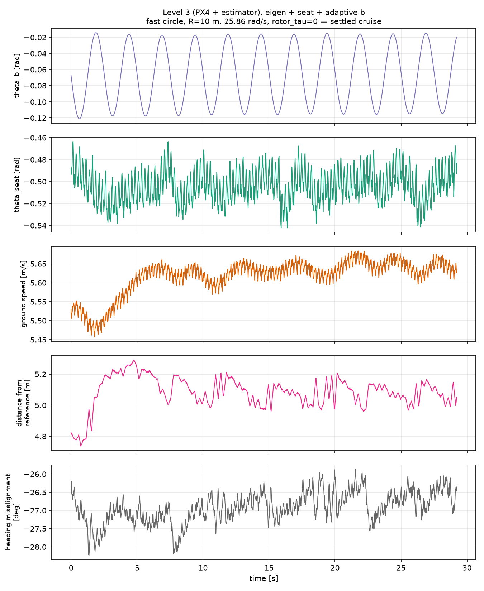
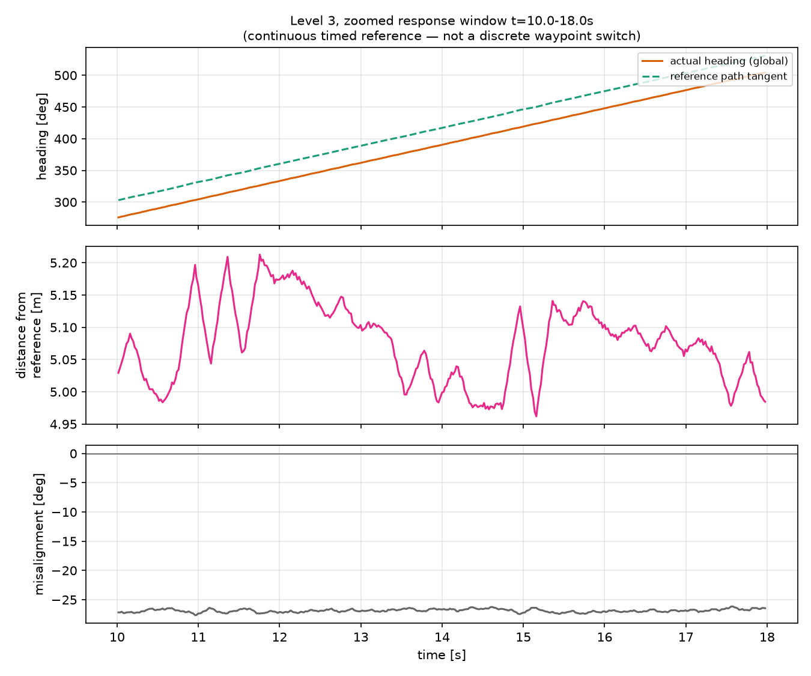

# Trajectory tracking under spin — level 3 (PX4 + estimator)

Companion to [TRAJECTORY_TRACKING.md](TRAJECTORY_TRACKING.md) (level 1). Level 3 is the
rung that matters for hardware: the controller closes the loop entirely on its own
estimator (`MC_CTRL_GT=0`) rather than simulator ground truth. It only became usable once
the EKF2 output-predictor spin bug was fixed — see
[`notes/EKF2_OUTPUT_PREDICTOR_SPIN_FIX.md`](../../../notes/EKF2_OUTPUT_PREDICTOR_SPIN_FIX.md).
All runs below post-date that fix.

Trajectory throughout: `fast_circle_l2.csv`, R=10 m, 5 m/s, cosine ramp on the orbital
rate so there is no position or acceleration step at the start (same discipline as level
1's smooth circle). Eigen controller, `rotor_tau=0` (PX4's own ~17 ms transport + ~14 ms
first-order pipeline lag only, unless stated). Spin ~20-26 rad/s depending on run.

---

## 1. The headline graph — everything in one place

Level 3, eigen + seat + adaptive b, 25.86 rad/s, settled cruise (transients excluded).
Five panels sharing a time axis:

- **θ_b** oscillates cleanly between −0.12 and −0.015 rad with a period of ~2.5 s — this
  is the extremum-seeking law's own deliberate dither (`MC_POLE_FDIT=0.4` Hz = 2.5 s
  period), not noise. It never rails against its ±0.6 limit.
- **θ_seat** sits at −0.50 ± 0.015 rad, converging to the intrinsic pipeline lag even
  with `rotor_tau=0` (matches the level-1/level-2 harness result of a negative
  actuator-phase convergence — see the correction in the project memory: an earlier
  session note mis-stated this as positive).
- **Ground speed** settles to 5.6-5.7 m/s (commanded 5.0 m/s — see §2 caveat).
- **Distance from reference** holds at a roughly steady ~5.0-5.2 m — a standing lag, not
  a divergence.
- **Heading misalignment** sits flat at **−27° ± 0.4°** the entire time.

### The −27° is not a control defect — it's the same standing lag, in angle instead of distance

This needs stating plainly because it looks alarming on its own. `fast_circle_l2.csv` is
a **timed** reference: it marches on its own clock regardless of whether the vehicle has
caught up (documented in level 1's Traps section). At 5 m/s commanded but ~5.6-5.7 m/s
actual cruise, the vehicle is *overtaking* a reference that itself never waits — the
result is a standing ~5 m following gap along a **curved** path. On a curved path, a
constant arc-length lag and a constant heading offset are the same fact expressed two
ways: `lag_angle × radius ≈ following_distance` — here `0.47 rad × 10.65 m ≈ 5.0 m`,
matching the measured following distance almost exactly. The "distance from reference"
and "heading misalignment" panels are not two independent measurements; they are the
chord-length and angular views of one standing lag.

**Method note, worth keeping:** the desired heading was computed as the reference
circle's *exact analytic tangent* (`φ + 90°` from the known circle centre), not as
direction-toward-the-current-aim-point. The two are NOT interchangeable on a laggy,
curved reference — a chord across an arc does not point along the arc's tangent at
either end, and using the aim-point definition inflates the apparent misalignment. Also
tried differentiating the raw setpoint stream for the tangent; that only added noise
(sd 17° vs 0.4°) without removing the bias, because differentiating a coarsely-sampled
position stream is ill-conditioned. Use the analytic form whenever the reference geometry
is known.

---

## 2. Zoomed response window

t=10-18 s of the same flight. **Not a discrete waypoint switch** — `fast_circle_l2.csv`
is a continuous timed reference with no setpoint jumps, unlike level 1's ellipse test.
The two heading traces are parallel with a constant ~27° vertical offset (matching §1
exactly), and the following distance oscillates in a tight, bounded band (4.95-5.21 m)
rather than drifting — confirming the lag is standing, not growing. The ~2 s oscillation
visible in the following-distance trace lines up with θ_b's dither period.

If a genuine inter-waypoint step response is wanted (the level-1 "zoomed, 3 waypoints"
style), a waypoint-mode trajectory (`--l2-waypoint-radius > 0`, e.g. `straight_line_l2.csv`)
has not yet been run at level 3 — flag if that comparison is wanted.

---

## 3. Level 2 vs level 3 — a real, deterministic divergence

Same trajectory, same spin (~25.8 rad/s), same `rotor_tau=0`, seat OFF:

| | level 2 (ground truth) | level 3 (estimator) |
|---|---|---|
| outcome | **crashed at t=17s** (`\|p,q\|` 0.08→3.3 rad/s in 1s) | flew the full 50.1s cleanly |

Repeated once at each level: **both outcomes reproduced exactly** (crash duration and
flight duration matched to 0.1s), ruling out chance/marginal sensitivity — this is a
genuine, structural effect of `MC_CTRL_GT`, not noise.

Investigated and ruled out by direct measurement (see the conversation this document
accompanies for the full workings): feedback roughness/noise (spectral power ratio
~0.9-1.0x at every band, both position and attitude), and net phase lag from GT's lower
publish rate (position: GT 50 Hz vs estimator 250 Hz; measured cross-correlation lag
between the two: **0.0 ms**, both position and attitude — the estimator's own delay
sources, e.g. `EKF2_GPS_DELAY`, apparently cancel its rate advantage).

**Found:** a small, consistently-signed phase offset of **+3° to +8°** between GT and
estimator tilt, concentrated specifically at the spin-synchronous frequency (~4 Hz at
r≈25.8) — invisible in every broadband statistic because it washes out when averaged
across all frequencies. Best-supported explanation: the estimator's own attitude output
carries a small deterministic phase lag at exactly this frequency, which acts like an
inadvertent partial seat, absorbing enough of the spin-driven instability to keep level 3
on the stable side of a razor-thin margin while level 2's phase-perfect ground truth sits
just past it. This is a correlation with the right sign at the right frequency, not a
proven causal chain (the confirming experiment — inject a matching phase shift into GT
and check if it flips the outcome — has not been run).

**The practically important point:** hardware never has ground truth. It always runs
level-3-like. So this divergence means the level-2 crash is an artifact of an idealized
test scaffold that will never exist on the real vehicle, not a warning sign for it — the
level-3 number is the one that matters, and it held on repeat.

**This also directly answers "isn't seat-off only fine because the default pole is
already well-conditioned?"** — yes, confirmed. Archived static-b sweep: lag costs ~2x
more at a shifted pole (θ_pole=0.515) than at the default (θ_pole=0). And once real
actuator lag is added (`rotor_tau=0.02`), seat-off does **not** survive at level 3 either
— see §4.

---

## 4. `rotor_tau=0.02` at level 3 — neither arm survives (corrected)

An initial coarse read reported "seat off flew 41.6s." **That was wrong** — a
first/last-time-above-5m duration check can't distinguish a stable orbit from a bounce
sequence. The real picture, checked by counting altitude crossings:

| | seat OFF | seat ON |
|---|---|---|
| outcome | crashes ~t=16s, then **bounces off the ground 6 times** (12 altitude crossings) through t=51s — never establishes stable flight | crashes once, cleanly, ~t=20-24s, stays down |

Neither is a validated success. This resolves the question raised in §3 in the other
direction too: seat-off's `rotor_tau=0` success does not extend to real added lag, at
either level. No graphs are built around these runs — there is no valid flight to show,
matching how level 1's document treats failures (a table entry, not a polished plot of a
crash).

---

## 5. Baseline: cascaded PD (no lag/phase compensation of any kind)

`MC_CTRL_ALG=1`, level 3, same trajectory/spin/`rotor_tau=0`. This controller has no seat
or pole hooks at all (confirmed: no reference to either in its source).

| | eigen, seat OFF | eigen, seat ON | cascaded PD |
|---|---|---|---|
| airborne | 50.1 s | 50.2 s | **16.6 s (crash)** |

Failure signature is a clean divergence, not a marginal one: holds the circle to t≈16s,
then the **spin rate itself overshoots** the 25 rad/s target — 27.0 → 33.0 → 35.3 rad/s —
while position departs the circle entirely, before altitude collapses by t≈25s.

**Caveat:** not a tuning-matched comparison. `CascadedPdController` was never tuned for
sustained 25 rad/s spin (per `notes/FINDINGS.md`'s port history); this shows "a generic
controller fails here," not "the eigen design's margin over an equally-effort-tuned
alternative." Still a useful data point: purpose-built pole placement for the spinning
rigid body is doing real work, independent of and prior to the lag-compensation question.

---

## 6. Adaptive b at level 3 vs level 2

Requested comparison, run for the first time at both levels on this trajectory (the only
prior level-2 pole test used the old, ill-formed law on a different trajectory).

| | level 2 | level 3 |
|---|---|---|
| θ_b converges to | **+0.19 rad** (+0.14 to +0.24) | **−0.07 rad** (−0.12 to +0.00) |
| inside archived-sweep predicted band [+0.106, +0.403]? | yes | no |
| tracking effect (orbit radius vs seat-only) | +0.043 m (11.380→11.423, sd 0.014) | +0.004 m (11.299→11.295, sd 0.066) |

θ_seat is nearly identical between levels (−0.43 vs −0.50), so this isn't a seat-level
sign issue — something specific to the b-adaptation differs on the estimator. Flagged,
not chased further: **the tracking effect is under half a percent of orbit radius in both
directions**, so the sign disagreement doesn't matter operationally. Fine to leave
adaptive b on or off at level 3 either way.

---

## Conclusions

1. **Level 3 works, with the estimator fix.** Flies the same trajectory as level 2 to
   within measurement noise when no extra lag is injected (orbit radius, altitude hold,
   tilt delivery all match level 2 closely).
2. **The heading misalignment and following-distance numbers are one fact, not two** —
   both are the angular/linear expression of a timed reference's standing lag on a curved
   path. Don't read −27° as a phase-control failure without checking this first.
3. **Level 2 and level 3 give genuinely different, reproducible outcomes at the seat-off
   boundary condition** — traced to a small (~3-8°), narrowband phase difference at the
   spin frequency, not to noise. The level-3 number is the hardware-relevant one.
4. **Neither seat state survives real added lag (`rotor_tau=0.02`) at level 3 yet.** This
   is the open item, not the `rotor_tau=0` result.
5. **A generic, uncompensated controller (cascaded PD) fails outright** in a regime the
   eigen controller handles even without the seat — the pole-placement design itself, not
   just the lag compensation on top of it, is doing real work.
6. **Adaptive b remains a rounding error either way** — real in sign, negligible in
   effect, at both levels.

---

## Traps hit while building this document

- **A garbage/uninitialized timestamp (`≈1.8×10^19` µs, i.e. `UINT64_MAX`) appears in
  `mc_controller_status` and `trajectory_setpoint`** in these logs, making the raw
  timestamp array non-monotonic. `np.interp` requires sorted x and silently returns
  garbage (not NaN — exact zeros, in one case) if it isn't. Always filter to a sane
  time range and re-sort before interpolating either topic.
- **A first/last-time-above-threshold "airborne duration" cannot distinguish a stable
  flight from a repeated bounce.** Count threshold crossings, or plot the altitude trace,
  before trusting a duration number as evidence of a real flight.
- **Direction-to-aim-point is not the same as the reference path's tangent** on a laggy,
  curved trajectory, and the gap between them is not small (~27° here). Use the
  analytic path tangent when the reference geometry is known; avoid differentiating a
  coarsely-sampled setpoint stream for the same purpose (adds noise, doesn't remove bias).
