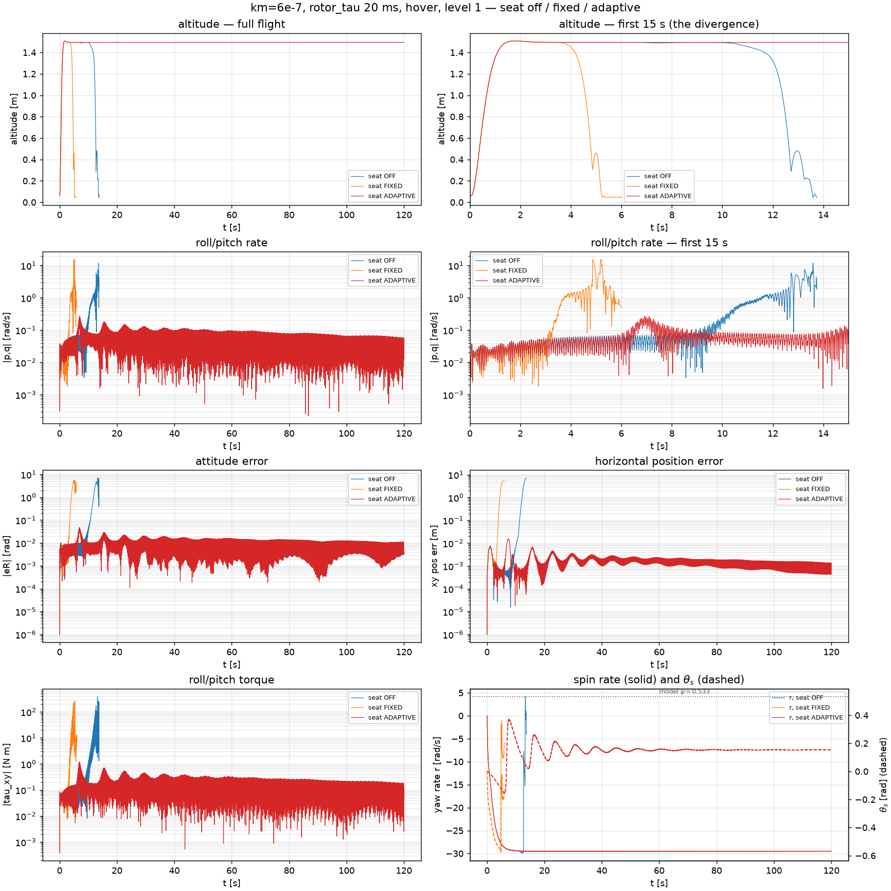
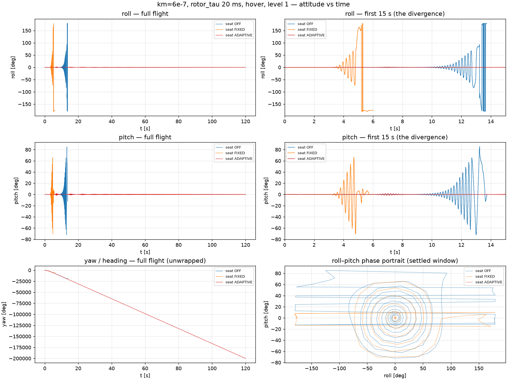
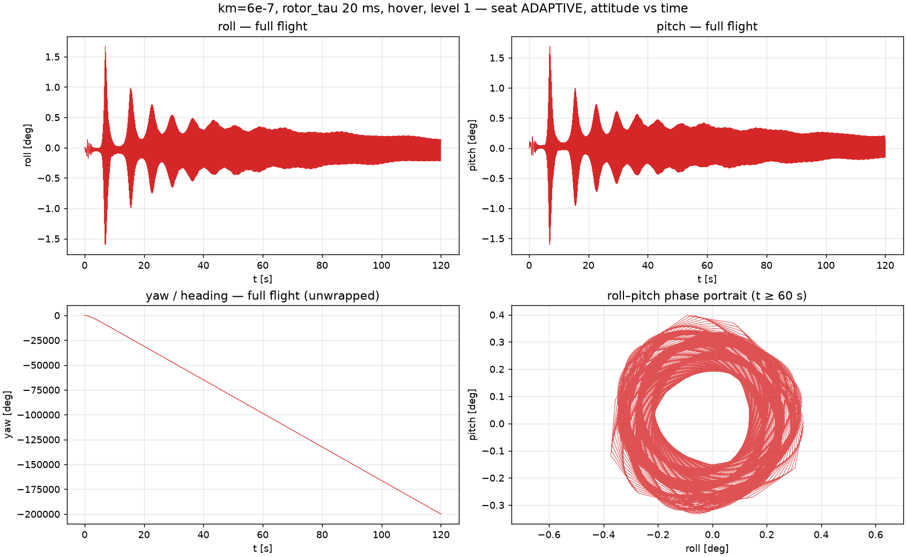
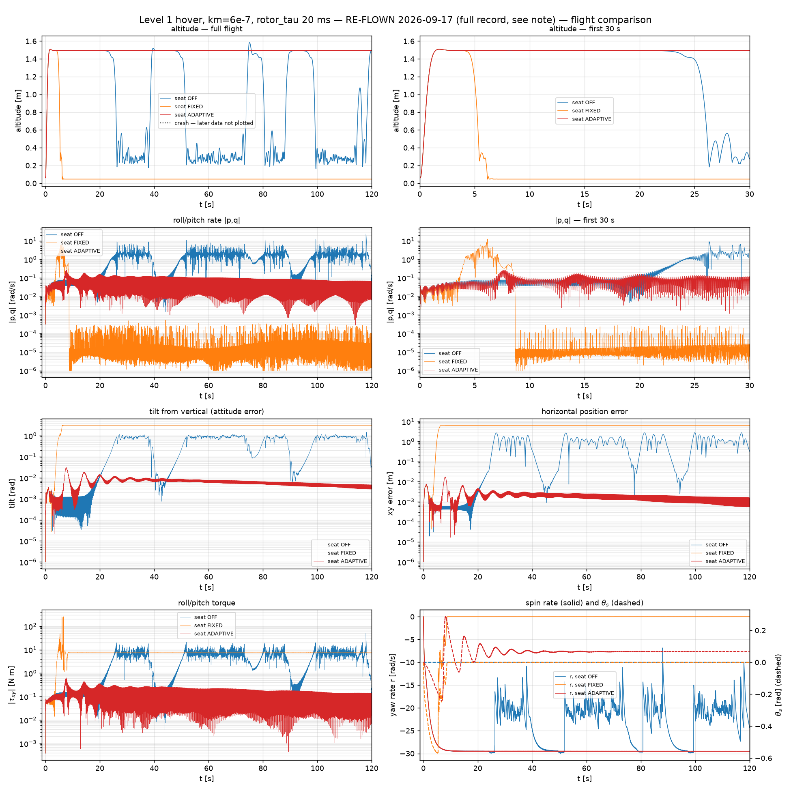
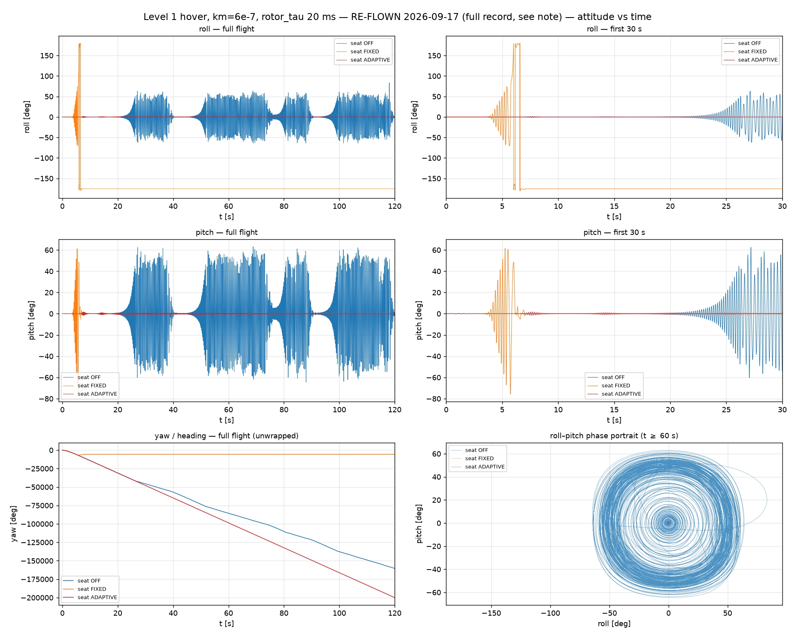
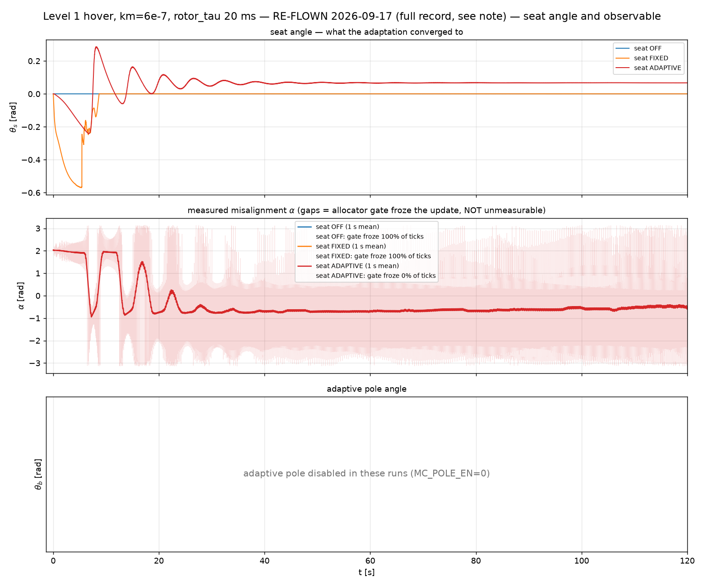
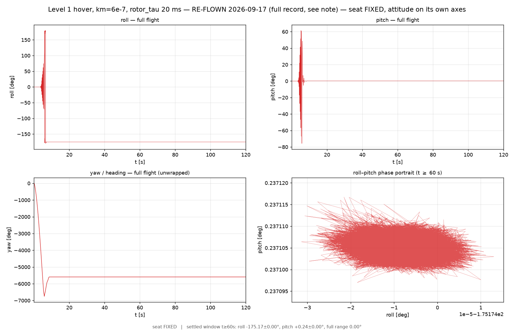

# km=6e-7 (r ≈ −29.5 rad/s), 20 ms rotor lag, level 1 — the seat rescue

Three plots, one experiment. Level 1 (Pegasus + the Python eigen law, no PX4, no
estimator), hover at 1.5 m over the spawn point, no lateral demand, 120 s, three arms:
**seat off / fixed / adaptive**.

The question: at a spin rate high enough that the 20 ms rotor lag alone destabilises the
vehicle, does the adaptive command-frame rotation (θ_s) recover it — and does it beat
simply computing the rotation from the spin rate (FIXED)?

Answer: **off crashes at 13.7 s, fixed crashes at 5.3 s, adaptive flies the full 120 s.**
This is the first unambiguous full rescue in the seat work, and it is what the commit
message "validated upto 30rad/s at 20ms lag" refers to.

---

## What the three arms actually are

| arm | what it does | `examples/utils/seat.py` |
|---|---|---|
| **off** | no seat object is built at all — the wrench is passed through | `_make_seat` returns `None` |
| **fixed** | θ_s = ψ_model(r) = `r*tau_a + atan(r*T)`, recomputed each tick from the *live* spin rate. **No measurement.** | `Seat.update_fixed` |
| **adaptive** | θ_s integrates the CROSS drive `−k·(xd × xa)·dt = −k·|xd||xa|sin α` | `Seat.adapt`, `law=cross` |

`T` defaults to whatever `--rotor-tau` is, so FIXED is handed the *exact true plant lag* —
it is the best a model-based rotation can possibly do here. That matters for reading §2.

---

## 1. `km6e7_compare.png` — the flight-level result



Eight panels, all three arms overlaid.

**Altitude (top row).** The only panel that needs no interpretation. Full flight on the
left, first 15 s on the right because that is where everything happens:

| arm | altitude held | on the ground at |
|---|---|---|
| seat OFF | to t ≈ 10.5 s | **13.7 s** |
| seat FIXED | to t ≈ 4.3 s | **5.3 s** |
| seat ADAPTIVE | 1.5 m flat for the whole run | **never — 120 s** |

**Roll/pitch rate |p,q| (second row, log scale).** The divergence mechanism. Both failing
arms show the same shape: a clean exponential envelope growth out of the ~0.03 rad/s
hover noise floor, up through 1 rad/s and into 10 rad/s where the vehicle tumbles. That
is a linear instability, not a disturbance or a saturation event — the loop's own pole has
crossed into the right half plane because the lag has rotated the feedback.

The adaptive arm sits at 0.05–0.1 rad/s for 120 s and is *slowly decaying* over the last
60 s. Nothing is fighting anything.

**Attitude error |eR| and horizontal position error (third row, log).** Same story one
integration up. Adaptive holds |eR| ~ 10⁻² rad and xy error settling toward **0.5–1 mm** —
it is not merely surviving, it is hovering precisely. The two failing arms shoot past 1 rad
and 10 m within a couple of seconds of the rate divergence.

**Roll/pitch torque (bottom left, log).** Adaptive spends 0.1–0.2 N·m. The failing arms
spike past 100 N·m of *demand* before they go — this is the commanded torque, and the
mixer/rotor limits mean the vehicle never delivers it. The spike is the controller
screaming, not the vehicle acting.

**Spin rate r (solid) and θ_s (dashed), bottom right.** Two things:

- **r is identical across all three arms until each one dies** — it settles to
  **−29.5 rad/s** in ~2 s and holds. The seat does not touch yaw, and confirming that
  visually is the point of plotting r at all. It also confirms km=6e-7 → r_ss ≈ 29.4,
  which is the `r_ss ≈ 4.9e7·km` rule in `fly.py`'s help.
- **θ_s (right axis) converges to ≈ +0.157 rad**, after overshooting to 0.38 at t ≈ 7.5 s
  and ringing down over ~8 cycles of a 7.4 s mode (dissected in §4a). The dotted line marks
  **ψ_model = 0.533 rad = atan(r·T)** with `tau_a = 0` — correct for level 1, which has no
  transport delay, only the first-order rotor pole.

  **The adaptive answer is about a third of the model, and it is the one that flies.**
  (θ_s read off the plot, not from the log — the log is gone, see "Reproducing" below.)

---

## 2. Why FIXED is *worse than off* — the most useful thing on the page

> **Corrected 2026-09-17.** This section explains FIXED's failure as an *over-rotation* of
> ~0.36 rad. Measured on the re-flight, it is worse than that: **FIXED and ADAPTIVE apply
> opposite signs.** `Seat.update_fixed` evaluates `psi_model` at the *signed* spin rate, and
> r is negative here, so FIXED holds **−0.567 rad** while the adaptation converges to
> **+0.067 rad**. Against a correct answer of +0.067, seat-off's error is 0.067 rad and
> FIXED's is 0.63 rad — an order of magnitude, and in the wrong direction rather than merely
> too far. The conclusion of this section is unchanged and strengthened; the mechanism below
> is not right. See the re-flight section at the end.

FIXED is handed the true `T` and computes the textbook lag phase. It dies in 5.3 s, less
than half the time the *uncompensated* vehicle survives. Rotating by the right amount is
worse than not rotating at all.

The measurement above says why: the angle that actually stabilises the loop is ~0.17, and
0.533 overshoots it by ~0.36 rad. An over-rotation is just as much a phase error as an
under-rotation, and here it is a *larger* one than the 0.17 the bare vehicle was already
carrying — hence a faster divergence. `atan(r·T)` is the phase of the continuous one-pole
lag in isolation; what the closed loop needs is the phase of the *whole* actuator path at
the frequency that matters, and at level 1 that includes the discrete-time sampling and
the allocator. The v3 harness found the same thing from the other direction: θ_s converges
to the **discrete** actuator phase, and ψ_model reads ~20% high there too.

**This is the argument for adaptation, and it is the cleanest form of it in the whole
project** — not "the model is unavailable", but "the model is available, exact, and still
wrong."

---

## 3. `km6e7_attitude.png` — the same flights in Euler angles



Six panels. Same three arms. This plot exists because |eR| in `km6e7_compare.png` is a
magnitude and hides the *shape* of the departure.

**roll and pitch (top two rows, full flight + first 15 s).** Now the failure is legible:
a growing oscillation, not a drift. FIXED rings up from ~t=3.3 s and hits ±180° by 5.3 s;
OFF is quiet until ~t=9.5 s then rings up through ±90° by 13.5 s. Both envelopes grow
smoothly by a roughly constant ratio per cycle — again the signature of an unstable
complex pole pair, and the oscillation frequency is the attitude loop's, not the spin's.

Red (adaptive) is a flat line at this scale. That is the whole point of the plot, and also
why it needed a second plot of its own (§4).

**yaw, unwrapped (bottom left).** A straight ramp to −200,000° over 120 s. That is
−1667 °/s = **−29.1 rad/s**, the sustained spin, and the panel is here purely as a
sanity check that the vehicle really did spin the whole time at the rate the bottom-right
panel of `km6e7_compare.png` claims. All three arms lie on top of each other for as long
as they exist.

**roll–pitch phase portrait (bottom right).** Roll vs pitch over the "settled" window.
For OFF and FIXED this window still contains their departure, so they draw the outward
spiral of the divergence — you can watch the orbit grow from the origin out past ±80°.
Adaptive is the dot at the origin.

**Caveat on this panel:** the shared axes are set by the two diverging arms, so adaptive is
crushed to a point and tells you nothing. Read §4 instead.

---

## 4. `km6e7_attitude_adaptive.png` — the adaptive arm on its own axes



Same run, adaptive only, rescaled. This plot exists *because* of the crushing problem
above — with the failing arms removed, the y-axis drops from ±180° to **±1.6°**.

**roll and pitch (top row).** Two superimposed signals:

- A **fast carrier** filling the band solid — the spin-synchronous content, a small
  residual tilt sweeping past the body axes at ~29.5 rad/s (4.7 Hz). At 120 s that is
  ~560 cycles, so it renders as a filled envelope, not as countable cycles.
- A **slow envelope** with a distinct lobed shape, described in full below.

Peak excursion of **1.6°**, on a vehicle that tumbles past 180° without the seat.

---

## 4a. The slow envelope — shape, and why it is the important part of the figure

The envelope is not a plain exponential decay. It is a **lobed, lightly-damped ringdown
that sits on a separate slowly-decaying floor**, and the two parts mean different things.

### The shape, measured

Lobe peaks read off the roll panel:

| lobe | 1 | 2 | 3 | 4 | 5 | 6 | 7 | 8 |
|---|---|---|---|---|---|---|---|---|
| t [s] | 7.0 | 15.5 | 22.5 | 29.5 | 36.5 | 43.5 | 50.5 | 57.5 |
| peak [deg] | 1.67 | 0.98 | 0.71 | 0.53 | 0.48 | 0.47 | 0.38 | 0.33 |

- **Spacing is 7.0 s, to the resolution of the plot, for every lobe after the first.**
  Period **7.2 s = 0.139 Hz = 0.87 rad/s**.
- Between lobes the envelope **pinches almost shut** — at t ≈ 11 and t ≈ 19 the band
  narrows to under ~0.1°, i.e. near-nodes, not merely troughs.
- The lobes **stop being distinguishable after t ≈ 60 s**, leaving a smooth band that
  decays monotonically from ±0.3° to ±0.15° over the remaining 60 s.
- Subtracting that ±0.33° floor, the lobe peaks give a log decrement δ ≈ 0.55, i.e.
  **ζ ≈ 0.09** — lightly damped, about eight visible cycles.

### It is the θ_s adaptation, and the two panels prove it

Overlay the θ_s trace from `km6e7_compare.png`'s bottom-right panel:

| | θ_s peaks | θ_s troughs | period |
|---|---|---|---|
| θ_s (compare, bottom right) | 7.5, 15.5, 23, 30.5, 37.5, 44.5 s | 11.5, 19.5, 27 s | **7.4 s** |
| roll envelope (this figure) | 7.0, 15.5, 22.5, 29.5, 36.5, 43.5 s | 11, 19, 26 s | **7.2 s** |

Same period, same phase, same decay, and they go quiet at the same time. θ_s runs
0 → **0.38** (t ≈ 7.5) → 0.067 (t ≈ 11.5) → ringing down to **≈ 0.157** — a **142 %
overshoot** on a first swing that reaches **71 % of the way to the 0.533 model value**.

**So the 1.6° attitude peak is the adaptation overshooting, not an external disturbance.**
Each lobe is a smaller overshoot. Nothing else in the run has a 7 s timescale: it is 34×
slower than the spin (4.7 Hz) and far slower than the attitude loop. This is a mode that
*only exists because the seat is there* — θ_s is an integrator (θ̇_s = −k·|xd||xa|sin α)
wrapped around the already-closed attitude loop, and closing that outer loop creates a new,
very slow second-order mode. **The envelope is that mode's step response.**

### Why the near-nodes matter

If the fast carrier were an independent standing disturbance and the envelope merely a
transient added on top, the band could never pinch below the carrier's own amplitude. It
does — to under 0.1° at t ≈ 11, well below the ±0.33° it settles at. So this is not
"carrier plus envelope". It is **one rotating tilt vector whose magnitude oscillates at
0.139 Hz and passes through (near) zero**, with the direction sweeping at the spin rate.
The nodes are beat nodes, and the tilt reverses phase through each one.

That reframing is what makes the phase portrait and the time series consistent: the
annulus at t ≥ 60 s (radius 0.25–0.35°) is the *same* vector once its magnitude has stopped
oscillating.

### What it costs, and why this condition is near the edge

Three consequences worth carrying forward:

1. **The seat needs ~60 s (≈ 8 cycles) to fully settle, and its first overshoot peaks at
   t ≈ 7 s.** Seat-off departed at **13.7 s**. The adaptation's worst moment therefore lands
   *inside the window in which the unaided vehicle was already losing control.* The rescue
   works, but the margin is one adaptation half-cycle wide — this is why the condition is
   at the edge of what the seat handles, not comfortably inside it.
2. **The first swing passes through the FIXED arm's territory and survives only because it
   does not stay.** θ_s reaches 0.38 against FIXED's constant 0.533. FIXED, held there
   permanently, was on the ground by 5.3 s. Same neighbourhood, opposite outcome — the
   distinguishing variable is dwell time, not the angle.
3. **ζ ≈ 0.09 says the gain `k` is near the top of its useful range.** A lightly damped
   adaptation mode is what you get just below the point where it rings up instead of down,
   and that is precisely the failure recorded elsewhere in this project: at level 2, k = 2.0
   moved θ_s across its whole ±1.4 range in one 4 ms tick; the extremum-seeking b law
   railed and crashed at k_es = 2.0 and flew at 0.3. **Do not raise `k` to make the
   transient shorter** — the ringing is the warning, and the next thing past it is the rail.

### The floor is still moving at t = 120 s

The post-t≈60 band is not flat. It decays 0.3° → 0.15° over 60 s with no lobes — a
*different*, much slower process with a time constant well over a minute. **The run ends
while this is still improving**, so ±0.15° is an upper bound on the settled attitude, not
the settled value. If a steady-state number is ever wanted from this condition, fly longer
than 120 s.

*(Every number in this section is read off the rendered PNG, not from the log — the npz
was overwritten. See "Reproducing". They are good to roughly the last digit shown and the
qualitative structure is unambiguous, but re-derive them from data before quoting them
anywhere load-bearing.)*

**yaw (bottom left).** Same ramp as before, plotted again so this figure stands alone.

**roll–pitch phase portrait, t ≥ 60 s (bottom right).** The settled attitude, gated to
t ≥ 60 s so only post-transient data is in it. An **annulus** — roll and pitch trace a
near-circle of radius ~0.25–0.35° with a hollow centre. That is exactly what a rotating
residual tilt of constant magnitude looks like in body axes, and it is the geometric
statement of the "fast carrier" above: the vehicle is not wobbling randomly, it is holding
a small fixed tilt in the *world* frame while the body spins underneath it.

The annulus is centred slightly off origin (roll ≈ −0.05°, pitch ≈ +0.05°) — a small
standing bias on top of the rotating component. Not investigated.

---

## Conclusions

1. **At r ≈ 29.5 rad/s with 20 ms rotor lag, the eigen law without a seat is unstable.**
   It survives 13.7 s of hover and then departs on a growing attitude oscillation. This is
   the condition, not an outlier.
2. **The adaptive seat is a complete rescue, not a mitigation.** 120 s, 1.6° peak attitude,
   sub-millimetre position hold, decaying rather than marginal. No other arm in this
   project's history does this.
3. **A model-computed rotation, given the exact true lag, makes it worse than doing
   nothing** (5.3 s vs 13.7 s). ψ_model = atan(r·T) = 0.533 rad; the angle that flies is
   ≈ 0.17 rad. Adaptation is earning its place against a *correct* model here, which is the
   strongest version of that claim.
4. **θ_s finds ≈ 0.157 rad unaided**, but slowly: a 142 % overshoot on the first swing and
   ~8 cycles of a lightly damped 7.4 s mode before it settles, ~60 s in total. The attitude
   envelope tracks that ringdown lobe for lobe (§4a) — which is both the proof the seat is
   what stabilises the vehicle, and the measurement of what the rescue costs.
5. **The margin is one adaptation half-cycle.** The seat's worst transient (t ≈ 7 s) lands
   inside the window where seat-off was already departing (13.7 s). Read §4a before
   assuming this condition has headroom, and before touching `k` — ζ ≈ 0.09 says the gain
   is already near the top of its range.

---

## Reproducing

**The raw log is gone.** Level 1 writes to a single fixed path,
`examples/results/controller_eval/eigen/statistics/eigen_statistics.npz`, which every
subsequent level-1 run overwrites. The file currently there is from the 2026-09-13
trajectory work, not from these flights. **Copy the npz out after each arm** or the next
run destroys it.

The seat-off arm, verbatim from shell history:

```bash
python3 examples/flight/fly.py --level 1 --controller eigen \
    --motor-moment 6e-7 --failure-mode off --rotor-tau 0.020 \
    --duration 120 --seat off
```

The other two arms are the same line with `--seat fixed` and `--seat adaptive`. Add
`--headless` for batch. **The exact `--seat-gains` for the adaptive arm is not recorded
anywhere** — not in shell history (those runs were launched from a subshell), not in the
commit, not in a config file. The `Seat` defaults are `k=2.0, theta_max=1.4, r_min=5.0,
law=cross, k_sign=+1`, with `T` inherited from `--rotor-tau`. If a re-run's θ_s does not
converge to ≈ 0.17 rad with a ~7–8 s oscillation envelope, the gain is the thing that
differed — sweep `k` first. (`k` is **dimensional** for the CROSS law; see the CAUTION in
`Seat.adapt`'s docstring.)

Fields in the npz, and what each plot panel is built from:

| panel | field |
|---|---|
| altitude | `p[:,2]` |
| \|p,q\| | `hypot(angular_velocity[:,0], angular_velocity[:,1])` |
| \|eR\| | `norm(eR, axis=1)` |
| xy pos err | `hypot(ep[:,0], ep[:,1])` |
| \|tau_xy\| | `hypot(torque[:,0], torque[:,1])` |
| r, θ_s | `yaw_rate`, `seat_theta` |
| **roll, pitch** | **`desired_angles[:,0:2] − eR[:,0:2]`** |
| **yaw** | **`desired_angles[:,2]`** (already the *measured* yaw), then `np.unwrap` |

The attitude reconstruction is the one non-obvious step: the npz has no raw attitude.
`eigen_controller.py` logs `roll_error = desired_roll − roll`, so **actual = desired −
error**, and it stores the measured yaw in the third slot of `desired_angles` rather than
a desired one.

---

## Reading traps in these specific figures

- **The phase portrait in `km6e7_attitude.png` is useless for the adaptive arm.** Shared
  axes, set by two arms that reach ±180°. `km6e7_attitude_adaptive.png` exists only to fix
  this. Any future three-arm plot where one arm survives and two diverge has the same
  problem in every linear panel — note that the log-scale panels in `km6e7_compare.png`
  do not, which is why they carry most of the information.
- **The torque spike is demand, not delivery.** `torque` is the commanded wrench; the
  100+ N·m peaks on the failing arms were never applied. Check `motor_thrusts` for what
  the vehicle did.
- **`km6e7_attitude.png`'s "settled window" phase portrait is not settled** for OFF and
  FIXED — the label describes the intent for the surviving arm only.
- **ψ_model on the plot uses tau_a = 0.** `Seat.psi_model` includes a `r*tau_a` term with a
  2 ms default; level 1 has no transport delay, so the dotted line is `atan(r*T)` alone.
  With the 2 ms default it would read 0.592, not 0.533 — check which convention a figure
  used before comparing θ_s against it.
- **The filled bands in every attitude panel are ~4.7 Hz spin content, not plot noise.**
  Anything measured against them needs averaging over several spin periods first.

---

# RE-FLIGHT, 2026-09-17 — read this before quoting any number above

The original logs were gone, so the trio was re-flown to replace the pixel-read numbers in
§4a with measured ones. **It did not reproduce.** The qualitative result stands; several
specific numbers do not, and the archived figures above describe a **different build of the
controller** from the one in the tree today.

`examples/utils/eigen_controller.py`, `seat.py` and `sim_pegasus.py` changed by 213 lines in
commit `8c48c10` — *after* the 2026-09-10 flights and *before* this re-flight. The
`--max-lateral-accel` clamp and a rework of the position loop's D term both landed there.

## What reproduced, and what did not

| | archived (2026-09-10, pixel-read) | re-flown (2026-09-17, measured) | |
|---|---|---|---|
| **adaptive flies the full 120 s** | yes | **yes** | ✅ |
| **fixed is the worst arm** | crashes 5.3 s | **crashes ~4.4 s** | ✅ |
| settled spin rate | −29.5 rad/s | **−29.48 rad/s** | ✅ |
| envelope damping ζ | ≈0.09 | **0.103** | ✅ |
| envelope floor | 0.33° | **0.308°** | ✅ |
| first lobe peak | 1.67° | **1.75°** | ✅ |
| still decaying at t=120 s | yes | **yes** (0.385° → 0.249°) | ✅ |
| envelope lobe period | 7.2 s | **5.94 ± 0.38 s** | ❌ |
| θ_s overshoot peak | 0.38 rad @ 7.5 s | **0.286 rad @ 8.1 s** | ❌ |
| **θ_s converged** | **0.157 rad** | **0.0672 ± 0.0004 rad** | ❌ **2.3× apart** |
| seat OFF outcome | crashes at 13.7 s, stays down | **departs at 24.0 s, then repeatedly recovers and departs again** for the rest of the run | ❌ |

**The structure of §4a is confirmed by data** — it really is a lobed, lightly-damped
ringdown (ζ ≈ 0.10) on a floor that is still decaying when the run ends. **The specific
values are not.**

## The two consequences that matter

1. **§2's argument survives and is slightly strengthened.** θ_s converges to 0.067 rad while
   `--seat fixed` holds ψ_model = 0.533 rad, and fixed still dies fastest of the three. The
   gap between the adapted angle and the model angle is now *larger*, not smaller. "The
   model is available, exact, and still wrong" holds.
2. **§4a's "θ_s ≈ 30 % of atan(r·T)" does not hold.** Measured on the current build the
   ratio is **0.126**, not 0.295. The apparent agreement with level 2's independently
   measured 0.301 was a coincidence between a *pixel-read number from a superseded build*
   and a real one. See the correction in
   [level 2 §4](../trajectory_level2_px4_groundtruth_fast_circle/LEVEL2_TRACKING.md).

## The re-flight figures



Same eight panels as `km6e7_compare.png`, current build.

**These three are plotted with `--no-crash-cut`, unlike every other figure in this tree,
and the reason is the finding.** The seat-off arm never reaches a terminal crash to cut at.
It holds 1.49 m to t ≈ 20 s, departs at **t = 24.0 s**, and then *oscillates between
departure and recovery* for the remaining 96 s:

| t [s] | 10–20 | 20–30 | 30–40 | **40–50** | 50–60 | 60–70 | **90–100** | 110–120 |
|---|---|---|---|---|---|---|---|---|
| mean altitude [m] | 1.49 | 1.00 | 0.48 | **1.49** | 0.44 | 0.28 | **1.35** | 0.60 |
| mean \|p,q\| [rad/s] | 0.06 | 1.35 | 2.17 | **0.22** | 2.33 | 2.38 | **0.65** | 2.32 |

At t = 40–50 s it is back at hover altitude with body rates of 0.22 rad/s — genuinely
recovered, not bouncing — and then loses it again. **Marginal stability with a limit cycle,
not a crash.** Cutting the trace at the first departure would hide exactly the thing that
distinguishes this build from the archived one.






The adaptive arm on its own axes — the re-flight's counterpart to the archived
`km6e7_attitude_adaptive.png`. Settled window t ≥ 60 s: **roll −0.030 ± 0.214°, pitch
+0.023 ± 0.214°**, full range 0.80°. The archived figure's annulus is still there and still
centred slightly off origin.

Note the scatter: **±0.21°, about 4× the ±0.04–0.06° that levels 2 and 3 hold at their
comparable hover conditions.** Level 1 has no transport delay at all, so this is not a lag
difference — it is the bare Python loop against PX4's, and it is the opposite of the
direction one might assume.

The seat figure is the one the archived set never had: θ_s on its own axes rather than
squeezed onto a twin axis. It shows the overshoot to 0.286 rad at t = 8.1 s and the ringdown
to 0.0672 ± **0.0004** rad — a far tighter convergence than the archived plot suggested.

## The sharpest thing the re-flight found: FIXED has the wrong *sign*

The archived figures could not show this, because θ_s was squeezed onto a twin axis and
FIXED's trace lasts five seconds. On its own axes it is unmistakable:

| arm | θ_s applied | |
|---|---|---|
| seat OFF | 0 | survives 24 s |
| **seat FIXED** | **−0.5674 rad** | dies at 4.1 s |
| **seat ADAPTIVE** | **+0.0672 rad** | flies 120 s |

`Seat.update_fixed` computes `k_sign * psi_model(r)` with `psi_model(r) = r*tau_a +
atan(r*T)` evaluated at the **signed** spin rate. Here r = −29.5, so it returns
−0.059 + (−0.533) = **−0.592 rad**. The adaptation, given the same vehicle, walks the other
way and settles at **+0.067**.

So the failure is not "the model over-rotates". It is that **the model-driven arm rotates
the wrong way**, and by ten times the magnitude the adaptation judges correct. That is why
FIXED is not merely worse than ADAPTIVE but worse than doing nothing at all: zero is a much
better approximation to +0.067 than −0.59 is.

Whether the sign convention in `update_fixed` is itself a bug, or whether `psi_model` is
meant to be evaluated at |r| with the direction supplied elsewhere, is **not settled here**
— but it is the first thing to check before FIXED is used or cited again.

## A note on α: it does not converge to zero, and should not

The α panel's 1 s rolling mean settles near **−0.5 rad**, not 0. That is the documented
behaviour of the CROSS law, not a failure: its fixed point is where the time-average of
`|xd||xa| sin(α)` vanishes, which is *not* where α vanishes. `Seat.adapt`'s docstring says
so explicitly ("CROSS actually carries MORE bias... the win is variance, not bias").
Reading a non-zero mean α as non-convergence would be a mistake — θ_s is flat to
±0.0004 rad over the same window.

## What to do with this

- **Cite the re-flown numbers, not the archived ones**, for anything about the current code.
- **Keep the archived figures**: they are the record of the build the `a592ed3` commit
  message refers to, and §2's FIXED-vs-OFF result was measured on that build.
- **The seat-off discrepancy is not explained.** Departure moved 13.7 s → 24.0 s and the
  failure mode changed from terminal to bouncing. `8c48c10` is the only candidate and it was
  not bisected. If the exact seat-off failure time matters to a conclusion, bisect it.
- The `--seat-gains` for the adaptive arm are *still* unrecorded for the archived flights,
  so part of the θ_s gap may simply be a different `k`. The re-flight used `Seat` defaults
  (`k=2.0, theta_max=1.4, r_min=5.0, law=cross, k_sign=+1`).
