# Hover under spin — level 2 (PX4 + ground truth)

Climb to 6 m and hold, no trajectory. `MC_CTRL_GT=1`, eigen controller. Flown 2026-09-17
alongside an identical level-3 batch
([`../hover_level3_px4_estimator/LEVEL3_HOVER.md`](../hover_level3_px4_estimator/LEVEL3_HOVER.md))
so that the only difference between the two is `MC_CTRL_GT`.

**No post-ground-truth-fix hover runs existed at either rung before this** — all 21 valid
level-2 runs from 2026-09-13 fly the fast circle.

---

## 1. At r ≈ 29.5 the seat does not rescue hover

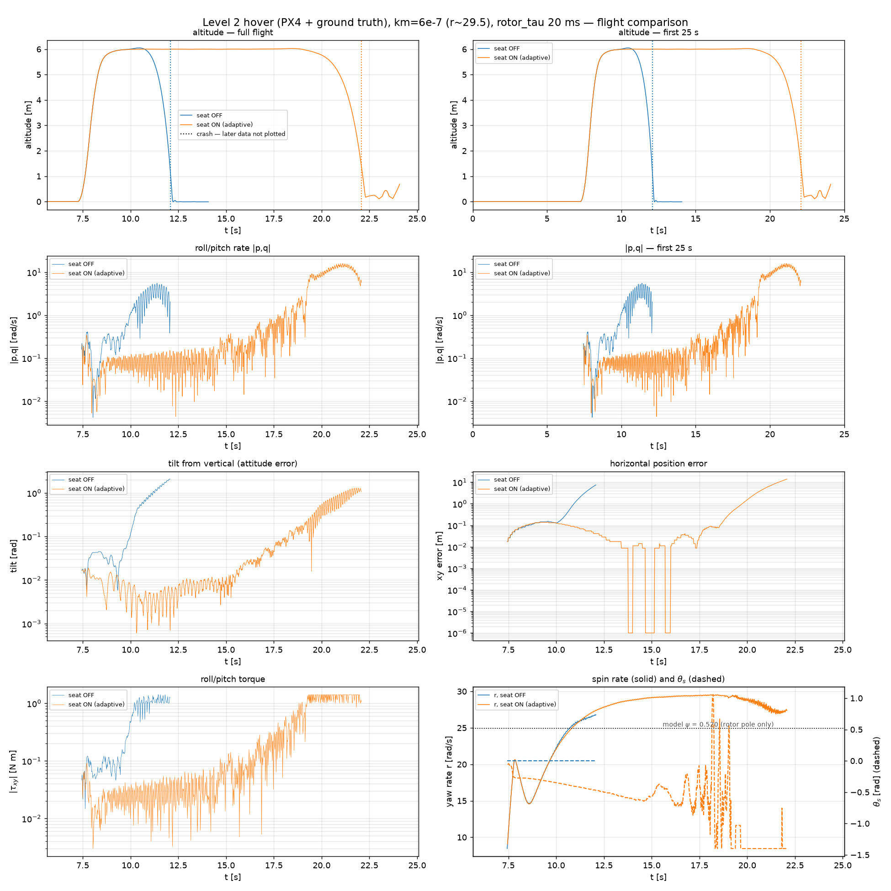

| `rotor_tau = 0.02`, r ≈ 29.5 | seat OFF | seat ON (adaptive) |
|---|---|---|
| outcome | **crash 12.1 s** | **crash 22.1 s** |

The seat roughly doubles time-to-departure and does not save it. Compare the fast circle at
r = 20.7, where the same seat turned 7.8 s into 48.7 s — a full rescue.

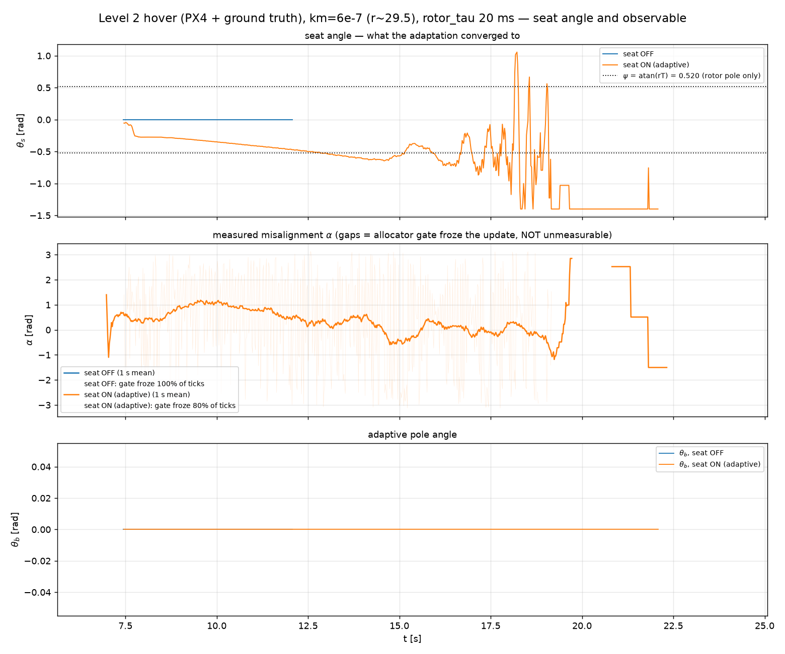
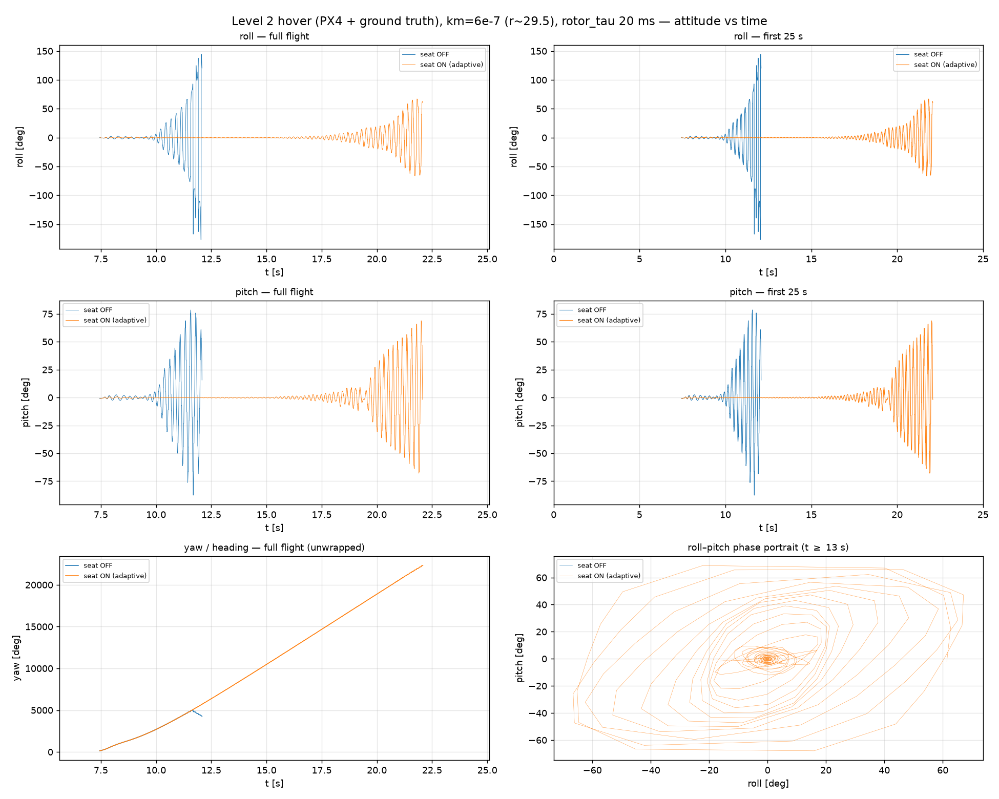
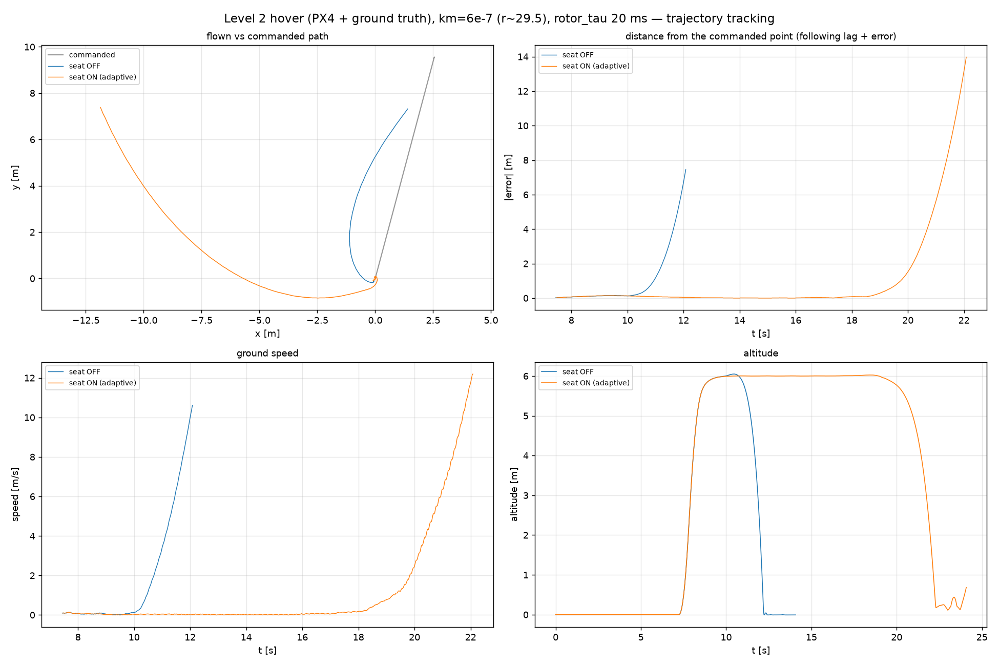

**The seat figure shows exactly where it breaks, and it is not a time — it is a spin rate.**
Spin ramps from ~19 to ~29.5 over the first 20 s, and θ_s tracks it:

| t [s] | 9 | 11 | 13 | 15 | 16 | 17 | 18 | 19 |
|---|---|---|---|---|---|---|---|---|
| spin [rad/s] | 19.5 | 26.4 | 28.6 | 29.2 | 29.4 | 29.4 | 29.4 | 29.1 |
| θ_s | −0.322 | −0.436 | **−0.571** | −0.458 | −0.562 | −0.544 | −0.507 | −1.117 |
| θ_s sd | 0.016 | 0.017 | **0.021** | 0.060 | 0.171 | 0.232 | 0.682 | 0.496 |
| \|p,q\| | 0.080 | 0.084 | 0.093 | 0.179 | 0.285 | 0.530 | 1.207 | 6.125 |

θ_s converges **tightly** (sd ≈ 0.02) all the way to r = 28.6, growing with spin exactly as
it should. At r ≈ 29.2 the scatter explodes and the vehicle departs; by t = 20 s θ_s is
railed at −1.400. **There is a boundary near r ≈ 29 at this rung.**

## 2. The disambiguation: it is the spin, not the hover

The obvious confound is that this batch runs r ≈ 29.5 while the circle ran r ≈ 20.7. So the
same hover was re-flown at **km = 4.0816e-7, the circle's spin**:

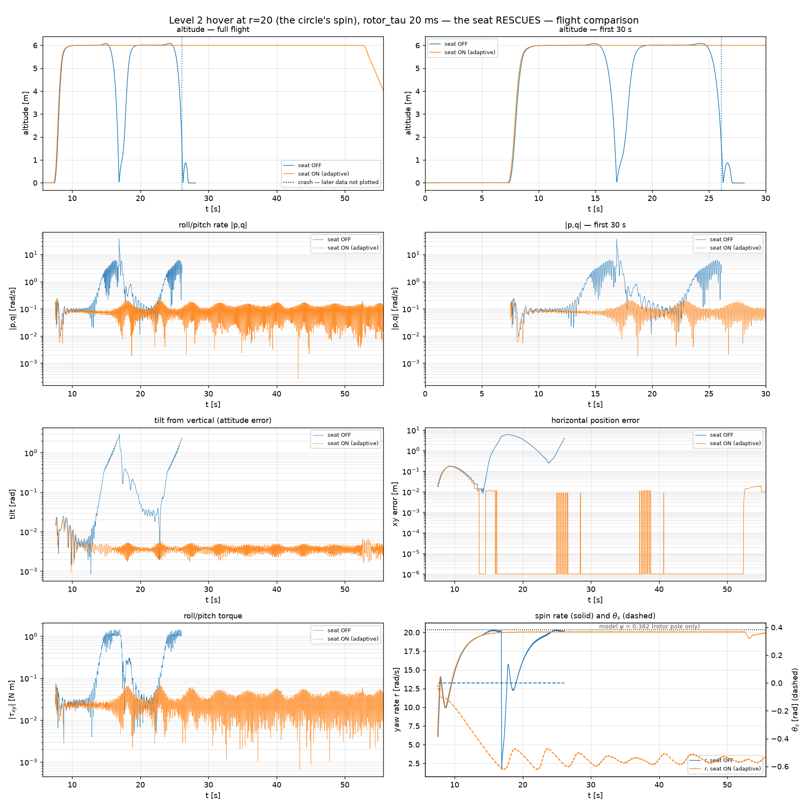

| hover, `rotor_tau = 0.02`, **r = 20.0** | seat OFF | seat ON |
|---|---|---|
| outcome | crash 26.1 s | **flew the full 47.5 s** |
| altitude sd | — | **1.5 mm** |
| mean tilt | — | 0.21° |
| mean \|p,q\| | — | 0.086 |
| converged θ_s | 0 | **−0.547 ± 0.040 rad** |

**The seat rescues hover at r = 20.** So the r ≈ 29.5 failure is a spin-rate limit, not
hover starving the observable — which was the first explanation that suggested itself and
would have been wrong.

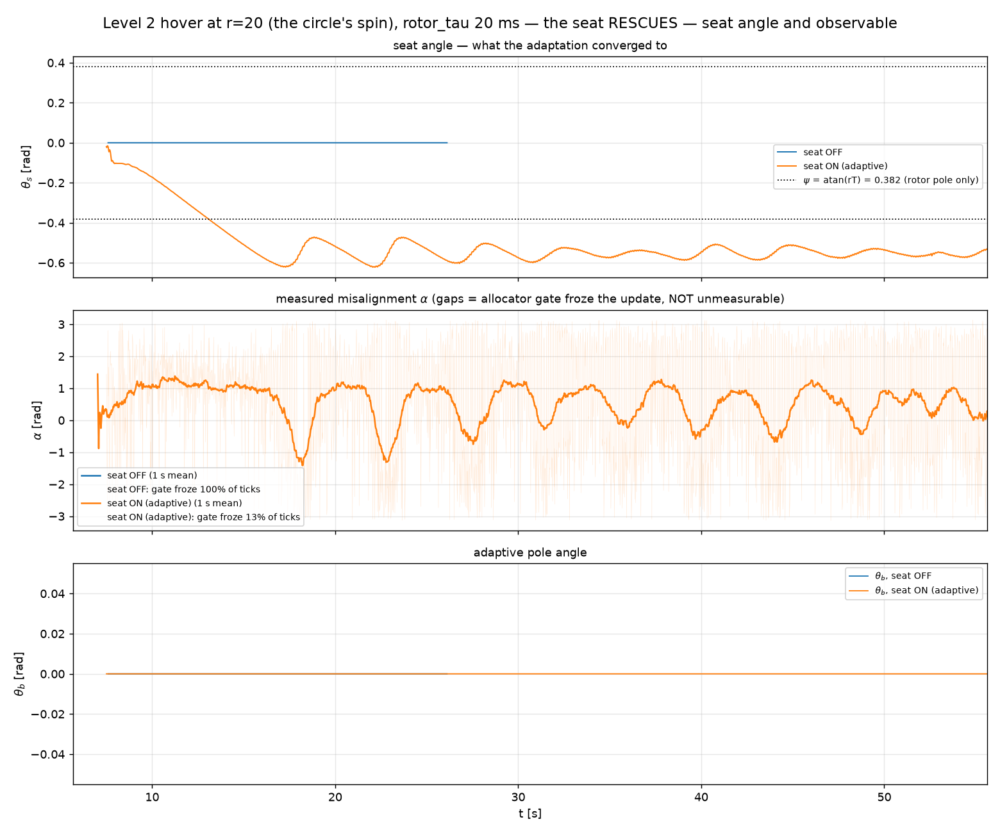

θ_s settles at −0.547 ± 0.040 within about 8 s of reaching spin and simply stays there for
the rest of the hold — no scatter growth, none of §1's rail.

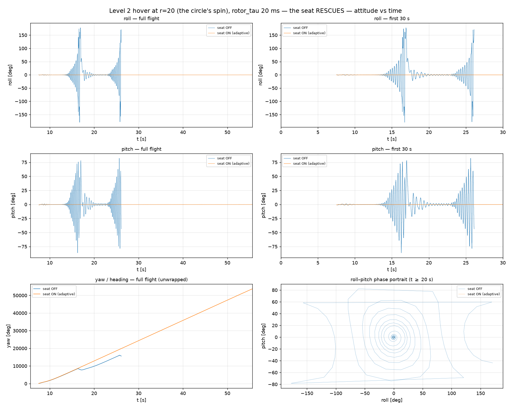
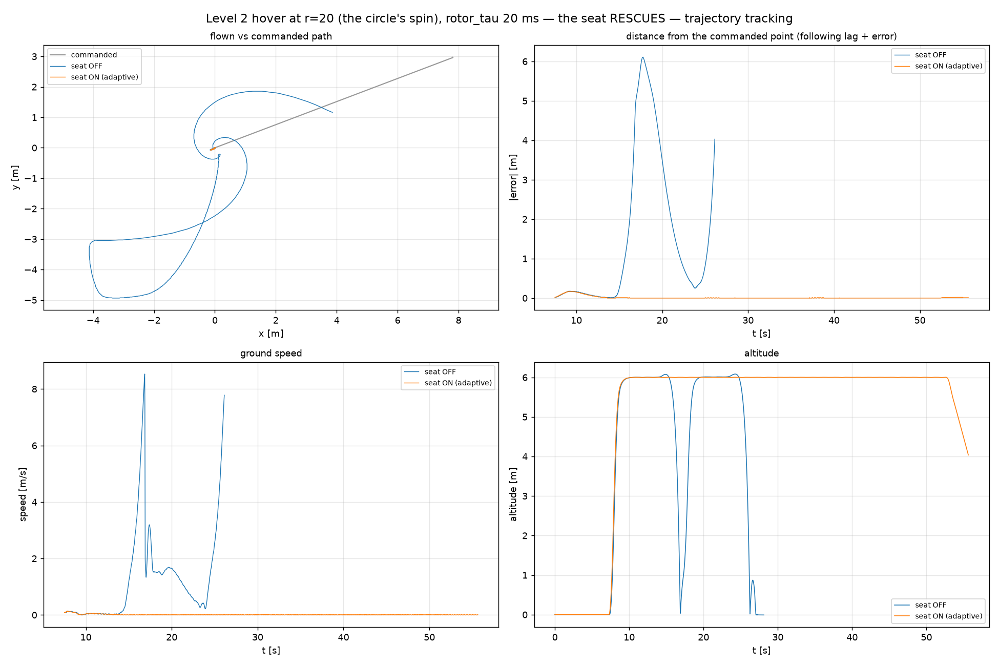

The seat-off arm's attitude diverges into the usual growing oscillation; the seat-on arm's
roll–pitch portrait is a small blob at the origin, because a hover commands no tilt. (This
is the one profile where the annulus seen at every other condition collapses to a point —
there is no centripetal demand to hold.)

Putting the three level-2 runs at `rotor_tau = 0.02` side by side:

| profile | spin | θ_s | outcome |
|---|---|---|---|
| hover | 20.0 | **−0.547 ± 0.040** | flies 47.5 s |
| circle | 20.7 | **−0.530 ± 0.028** | flies 48.7 s |
| hover | 29.5 | wanders, then rails | crash 22.1 s |

**At matched spin, hover and a 5 m/s circle give the same θ_s to 0.017 rad** — inside the
scatter of either. The seat is measuring the actuator, not the manoeuvre, which is what it
was designed to do and the first direct evidence of it across two very different profiles.

## 3. Control: `rotor_tau = 0`

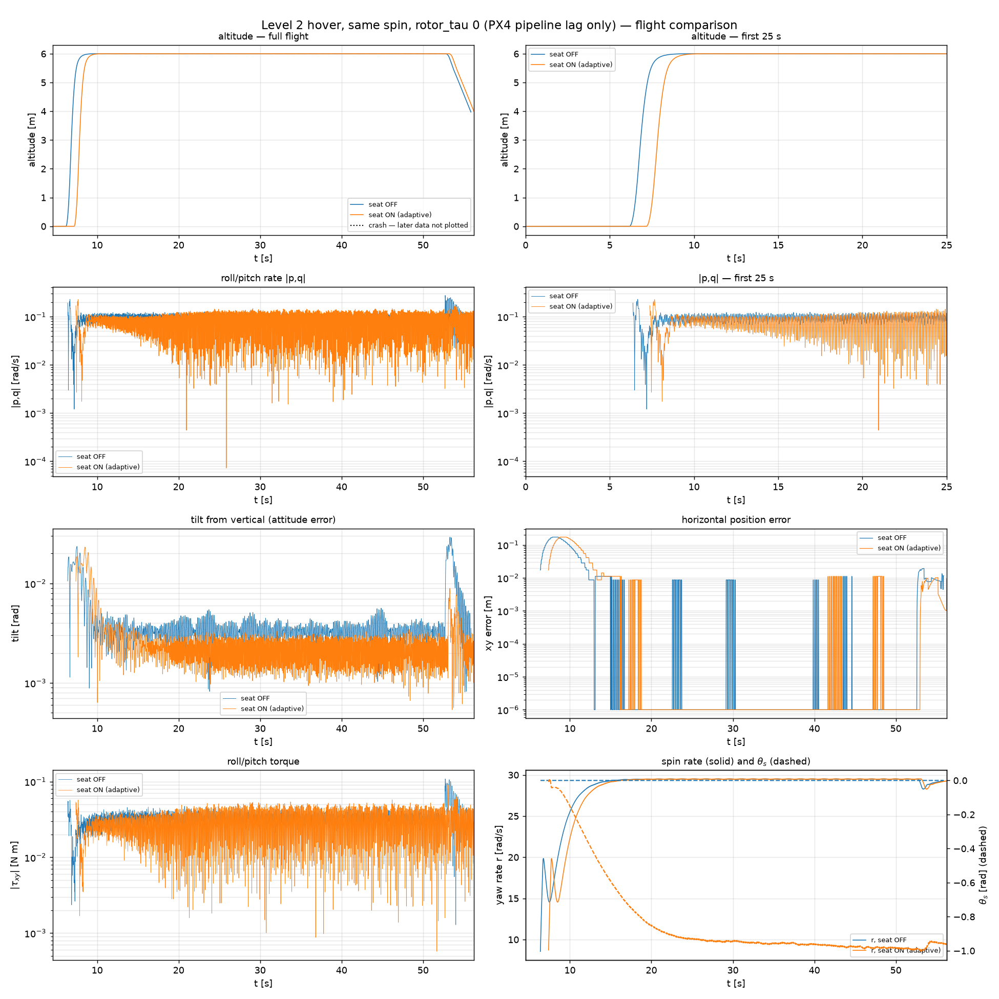
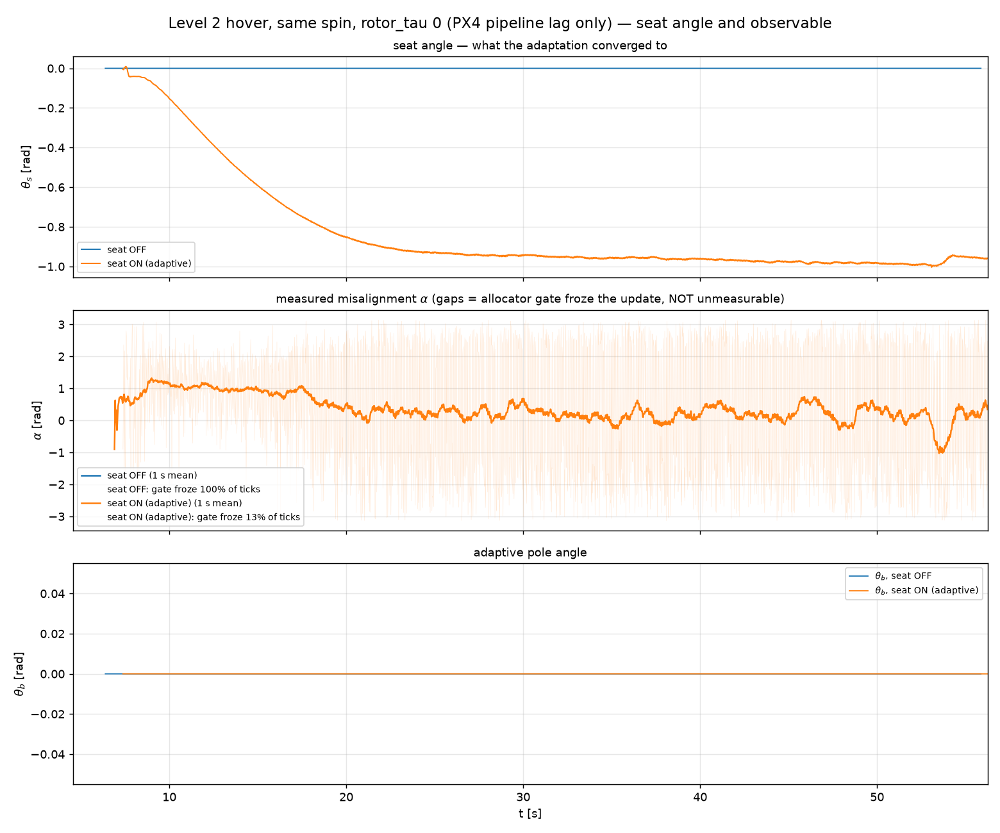
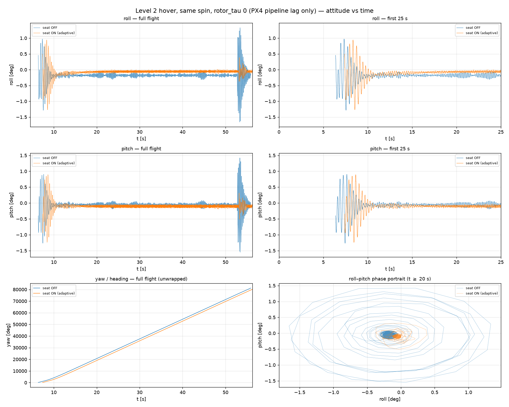
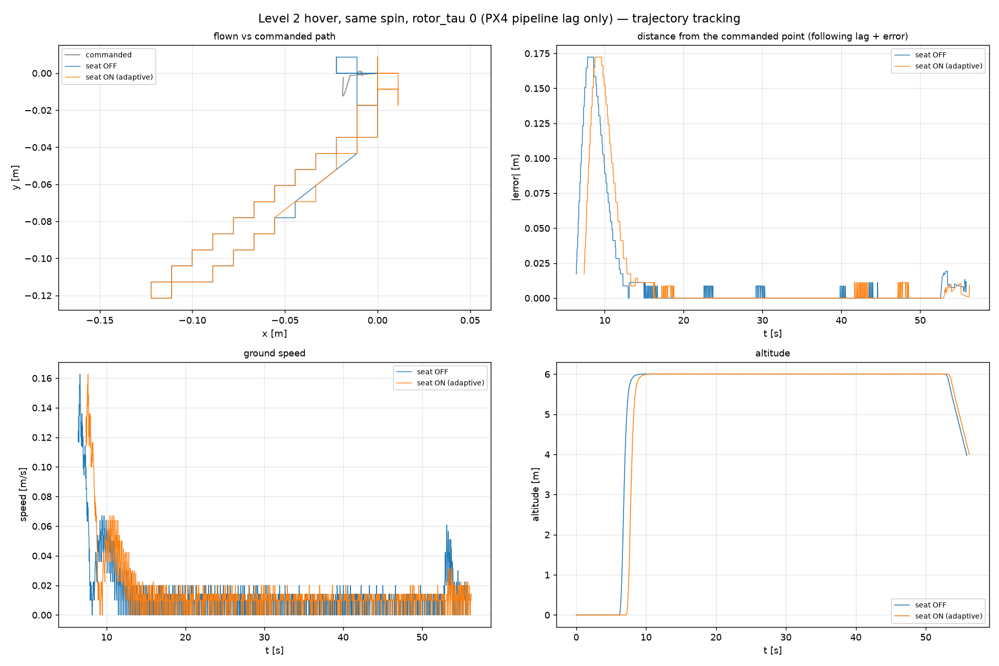

| r ≈ 29.4, no rotor lag | seat OFF | seat ON |
|---|---|---|
| outcome | flies | flies |
| altitude sd | **1.6 mm** | **1.5 mm** |
| xy drift | 1.4 mm | 1.6 mm |
| mean tilt | 0.19° | 0.12° |
| mean \|p,q\| | 0.097 | 0.081 |
| converged θ_s | 0 | **−0.906 ± 0.120 rad** |

**Hover at r ≈ 29.4 is easy without rotor lag** — note this is the *same spin* that departs
in §1 once 20 ms of lag is added. Lag is the variable, exactly as the project's earlier note
concluded ("the variable that makes the seat matter is LAG, not speed or lateral demand").

Two things worth recording:

- **This reproduces the archived level-2 hover baseline exactly.** The project note for this
  condition reads "baseline flies beautifully — alt sd 1.6 mm … adaptive seat statistically
  identical (1.6 mm)". Measured here: **1.6 mm and 1.5 mm.**
- **θ_s = −0.906 matches the modelled PX4 pipeline lag to 2%.** With ~17 ms transport and
  ~14 ms first-order at r = 29.4, `r·τ + atan(r·T)` = 0.500 + 0.390 = **0.890 rad**. The
  seat finds PX4's own lag unaided, with no rotor lag present at all.

## 4. The adaptive arm on its own axes

A shared-axis attitude figure is useless for the arm that survives — the diverging arm
reaches ±180° and squashes the survivor to a flat line. These are the adaptive arm alone,
rescaled, the same view as level 1's archived `km6e7_attitude_adaptive.png`.

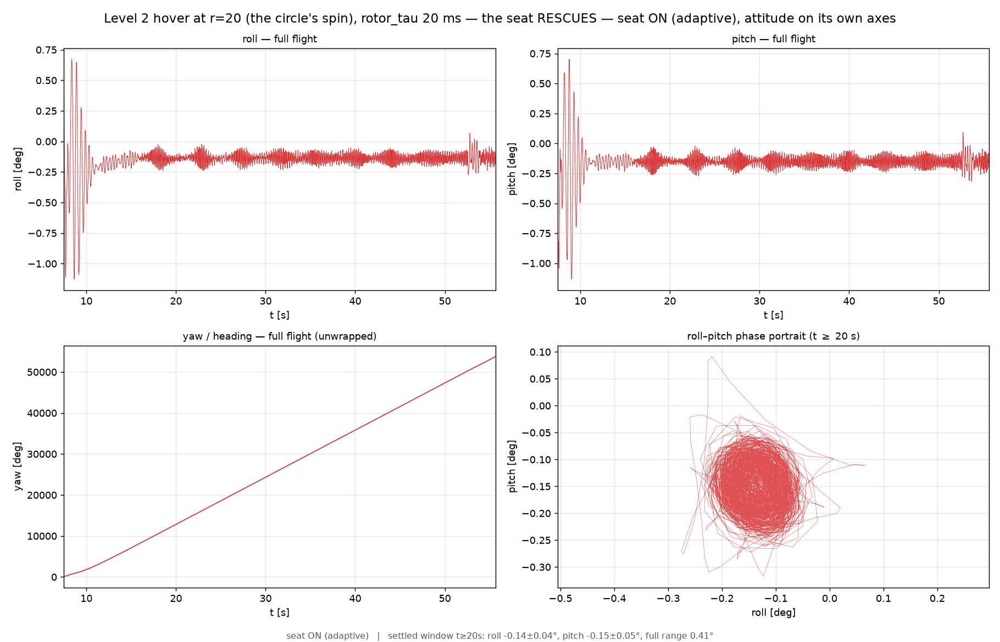

r = 20 with 20 ms of lag — **roll and pitch hold to ±0.04°** and the phase portrait is a
tight blob at the origin. Hover is the one profile where the annulus seen at every other
condition collapses to a point, because there is no centripetal tilt to hold.

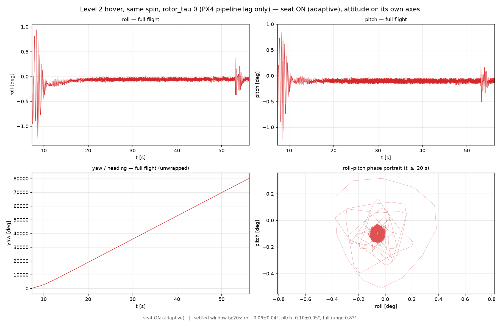

r = 29.4 with no rotor lag — indistinguishable from the above (±0.04–0.05°), confirming
that at zero lag the higher spin costs nothing.

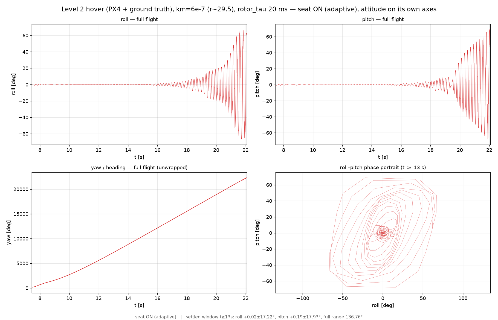

r = 29.5 **with** lag — the same axes now span ±60°. This is the departure, not a hold.

### The numbers across every hover condition flown

| case | spin | `rotor_tau` | roll [deg] | pitch [deg] | full range |
|---|---|---|---|---|---|
| L1 hover (re-flight) | 29.5 | 0.020 | −0.030 ± 0.214 | +0.023 ± 0.214 | 0.80° |
| L2 hover | 29.4 | 0 | −0.058 ± 0.043 | −0.102 ± 0.049 | 0.83° |
| L2 hover | **20.0** | 0.020 | −0.137 ± **0.041** | −0.151 ± **0.046** | **0.41°** |
| L2 hover | 29.5 | 0.020 | +0.076 ± **21.45** | +0.336 ± **22.33** | 137° |
| L3 hover | 29.4 | 0 | −0.062 ± 0.047 | −0.105 ± 0.052 | 0.44° |
| L3 hover | **20.1** | 0.020 | −0.143 ± **0.059** | −0.153 ± **0.061** | 0.85° |
| L3 hover | 29.4 | 0.020 | −0.110 ± **0.626** | −0.095 ± **0.582** | 11.2° |

Settled window t ≥ 20 s (t ≥ 60 s for level 1), adaptive arm only.

**The standard deviation is the ceiling indicator, and it moves in decades:**

| where the condition sits | roll sd | what it looks like |
|---|---|---|
| comfortably below the ceiling (r = 20, either rung; or no rotor lag) | **0.04–0.06°** | a tight blob at the origin |
| at the ceiling (L3, r = 29.4, 20 ms lag) | **0.63°** | flies, but 13× the scatter — working hard |
| past it (L2, r = 29.5, 20 ms lag) | **21.5°** | departed; this is the tumble, not a hold |

There is no intermediate regime in between the last two. The seat either holds attitude to a
fraction of a degree or it does not hold it at all.

---

## Conclusions

1. **The seat has a spin-rate ceiling at this rung, near r ≈ 29.** Below it (r = 20) it
   rescues hover completely; above it the adaptation destabilises and rails.
2. **The ceiling is a property of spin, not of the profile** (§2). Hover and a 5 m/s circle
   at matched spin agree on θ_s to 0.017 rad.
3. **θ_s tracks the spin ramp with sd ≈ 0.02 rad right up to the boundary** and then fails
   abruptly — there is no gradual degradation to warn you.
4. **With no rotor lag, hover at the same spin is easy and the seat is inert**, while still
   converging on PX4's own pipeline lag to within 2% of the model (§3).
5. **Level 3 rescues this same r ≈ 29.5 hover where level 2 does not** — see
   [`../hover_level3_px4_estimator/LEVEL3_HOVER.md`](../hover_level3_px4_estimator/LEVEL3_HOVER.md)
   §3. The ceiling is rung-dependent, and the hardware-relevant rung has the higher one.

---

## Traps

- **"Hover starves the observable" was the wrong first explanation** and the data looked
  consistent with it until the matched-spin run was flown. One extra pair of runs separated
  two hypotheses that a whole set of figures could not.
- **A spin ramp makes failure times misleading.** The vehicle departs at a *spin rate*, not
  a clock time; quoting "crashed at 22 s" hides that. Plot θ_s and \|p,q\| against spin.
- **θ_s scatter is the early warning, not θ_s itself.** Its mean was still sensible
  (−0.56 rad) two seconds before departure; its standard deviation had already gone up 10×.
