# Hover under spin — level 3 (PX4 + estimator)

> **Re-flight, 2026-09-18.** The `l3_hover_nolag_*` figures were regenerated from re-flown
> runs so that α is measured on the seat-OFF arm. θ_s on the seat-ON arm moved 9 %
> (−0.870 → −0.782); alt sd, tilt and |p,q| are unchanged. **Numbers quoted below for that
> pair are the originals.** See [`RUN_LOG.md`](RUN_LOG.md#re-flight-2026-09-18--the-nolag-pair-only).

The hover row at the rung that resembles hardware. Climb to 6 m and hold, no trajectory,
r ≈ 29.4 rad/s, `MC_CTRL_GT=0` so the controller closes the loop on PX4's own estimator.

Flown 2026-09-17 alongside an **identical** level-2 batch
([`../hover_level2_px4_groundtruth/LEVEL2_HOVER.md`](../hover_level2_px4_groundtruth/LEVEL2_HOVER.md)),
back to back, so the only difference between them is `MC_CTRL_GT`. No post-ground-truth-fix
hover runs existed at either rung before this.

---

## 1. The result: the seat rescues hover at 20 ms of lag

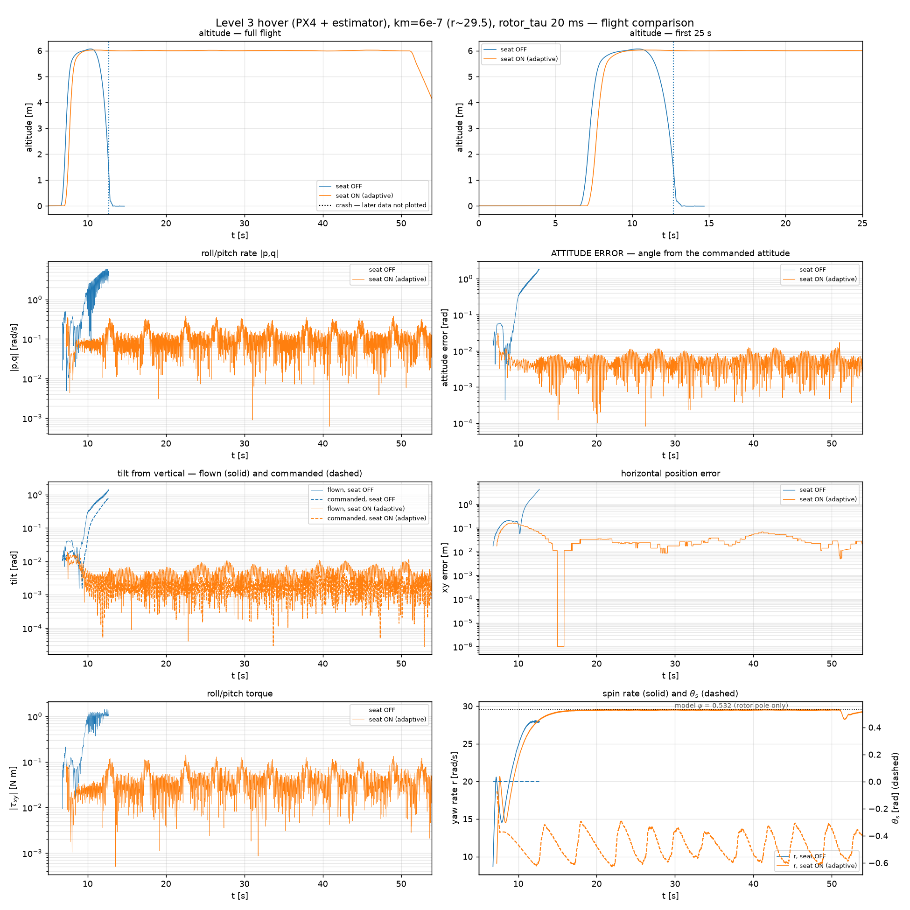

| | seat OFF | seat ON (adaptive) |
|---|---|---|
| outcome | **crash at 12.8 s** | **flew the full 46.7 s, no crash** |
| altitude sd | — | 6.8 mm |
| xy drift from the takeoff point | — | 19.7 mm |
| mean tilt | — | 0.21° |
| mean \|p,q\| | — | 0.107 rad/s |
| converged θ_s | 0 by construction | **−0.474 ± 0.101 rad** |

Seat-off climbs to 6 m, holds for about four seconds, and departs: `|p,q|` grows from the
0.1 rad/s floor through 4.6 rad/s by t = 12 s. Seat-on holds 6 m to the end of the hold and
lands normally.

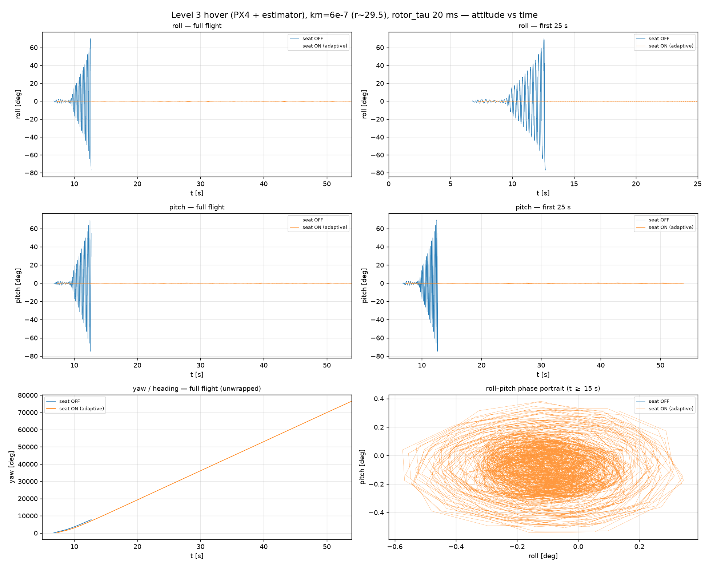
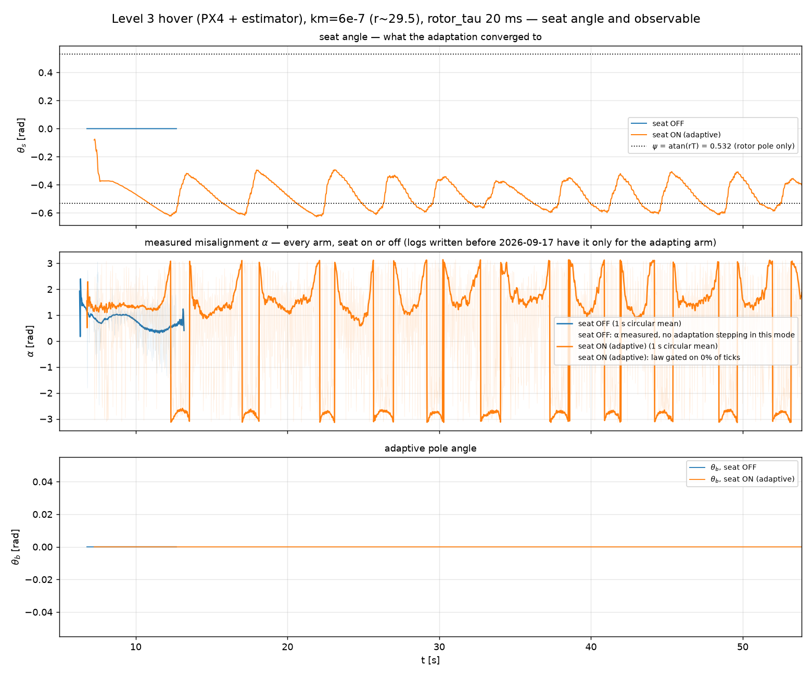
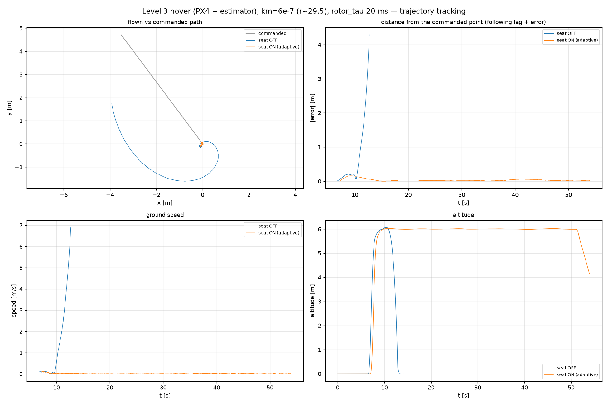

The "trajectory" figure is station-keeping here: the flown path is a 20 mm blob around the
takeoff point rather than a path.

## 2. Control: the same hover with `rotor_tau = 0`

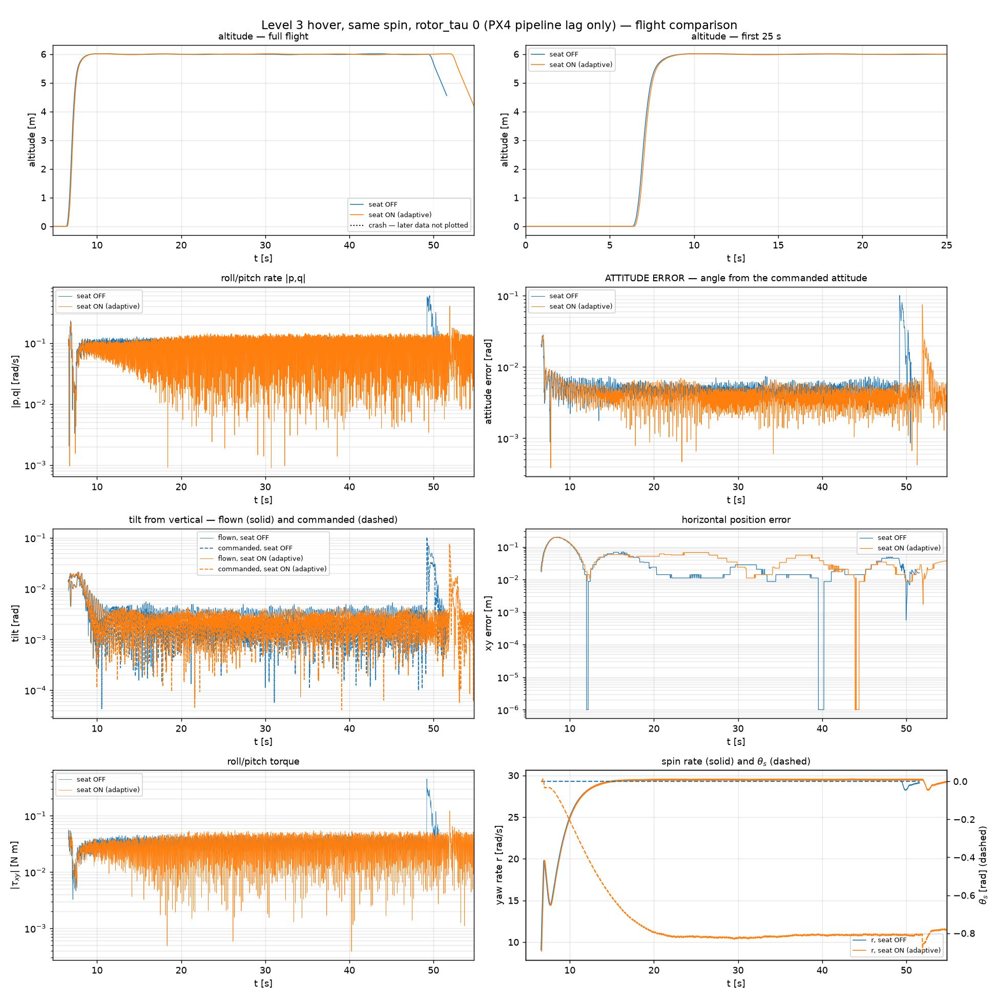
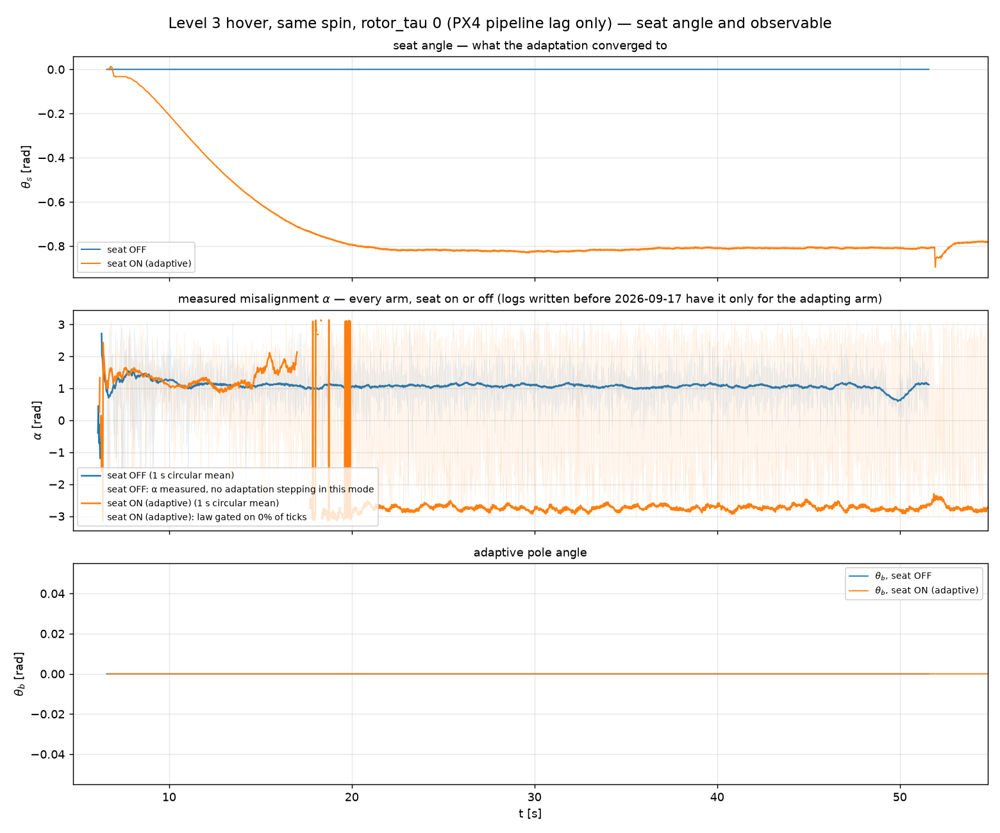
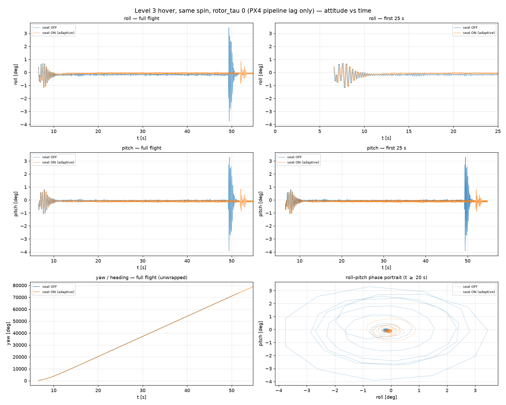
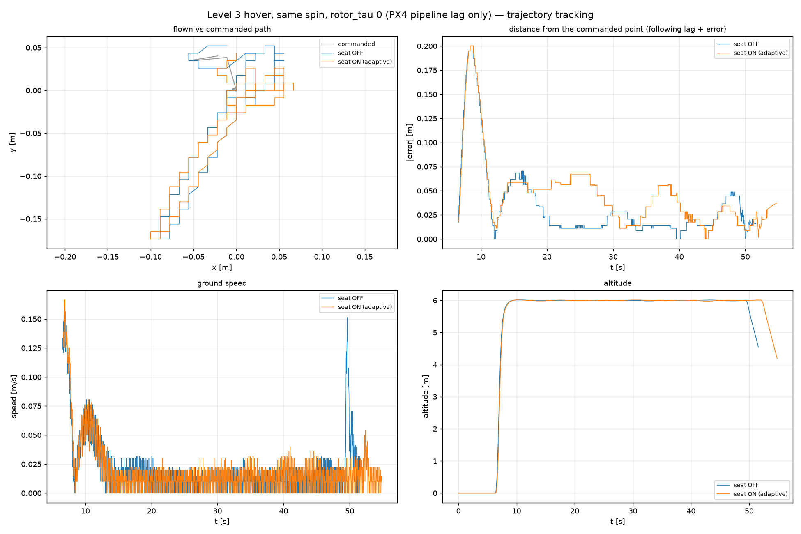

| | seat OFF | seat ON |
|---|---|---|
| outcome | flies, no crash | flies, no crash |
| altitude sd | 7.6 mm | 7.4 mm |
| xy drift | 24.8 mm | 28.9 mm |
| mean tilt | 0.19° | 0.13° |
| mean \|p,q\| | 0.098 | 0.081 |
| converged θ_s | 0 | **−0.870 ± 0.099 rad** |

**With no rotor lag, hover is easy and the seat is inert** — the two arms are
indistinguishable on every tracking number. It still converges to a definite, tightly held
angle, because PX4's own pipeline lag is always there.

**Level 3 is ~5× noisier than level 2 on the identical profile** (altitude sd 7.6 mm vs
1.6 mm, xy drift 25 mm vs 1.4 mm). That is the estimator in the loop, and it is the
expected direction — it is also the honest number, because hardware never has ground truth.

## 3. The level-2 / level-3 divergence, now with the seat on and with real lag

This is the reason the two batches were flown together. Same profile, same spin, same lag,
same everything except which position and attitude the controller believes:

| hover, r ≈ 29.5, `rotor_tau = 0.02` | seat OFF | seat ON |
|---|---|---|
| **level 2** (ground truth) | crash 12.1 s | **crash 22.1 s — not rescued** |
| **level 3** (estimator) | crash 12.8 s | **flew 46.7 s — rescued** |

The seat-off arms agree (12.1 vs 12.8 s). **The seat-on arms do not: the estimator rung
survives and the ground-truth rung does not.**

[`../trajectory_level3_px4_estimator_fast_circle/LEVEL3_TRACKING.md`](../trajectory_level3_px4_estimator_fast_circle/LEVEL3_TRACKING.md)
§3 found the same divergence on the circle with the seat *off*, and traced it to a small
(+3° to +8°) spin-synchronous phase offset between ground truth and the estimator's attitude
— "an inadvertent partial seat" that puts level 3 on the stable side of a thin margin.
**This result has exactly the sign that explanation predicts**, and extends it from a
seat-off boundary case to a lagged, seat-on one.

**It is still a correlation with the right sign, not a proven mechanism.** The confirming
experiment named in §3 — inject a matching phase shift into ground truth and see whether the
level-2 outcome flips — has not been run, and this result does not run it either. But it
raises the value of doing so: the divergence is no longer a curiosity at one boundary, it
decides whether the seat works at all on this profile.

**The practical reading is unchanged and now better supported: hardware always runs
level-3-like.** The level-2 failure is an artifact of an idealised scaffold that will never
exist on a real vehicle.

## 4. At r = 20 both arms survive — and the seat's job changes entirely

The same hover re-flown at km = 4.0816e-7 (r ≈ 20, the fast circle's spin), still with
20 ms of rotor lag:

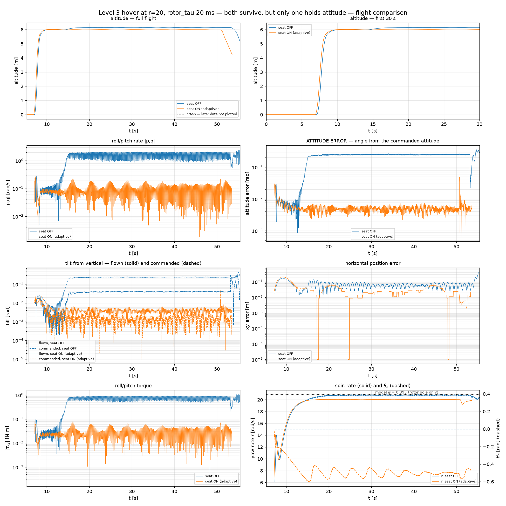

| level 3 hover, r ≈ 20, `rotor_tau = 0.02` | seat OFF | seat ON |
|---|---|---|
| outcome | **survives 47.4 s** | survives 47.7 s |
| **mean tilt** | **13.72°** | **0.22°** |
| mean \|p,q\| | **1.602 rad/s** | **0.088 rad/s** |
| xy drift | 61.5 mm | 25.2 mm |
| altitude sd | 6.5 mm | 9.3 mm |
| converged θ_s | 0 | **−0.505 ± 0.061 rad** |

**Seat-off does not crash here — it settles into a 13.7° coning limit cycle** and holds
station inside it, altitude to 6.5 mm and position to 6 cm, while the airframe cones around
the vertical at 1.6 rad/s. A duration check or a position-error plot would both call this a
successful flight.

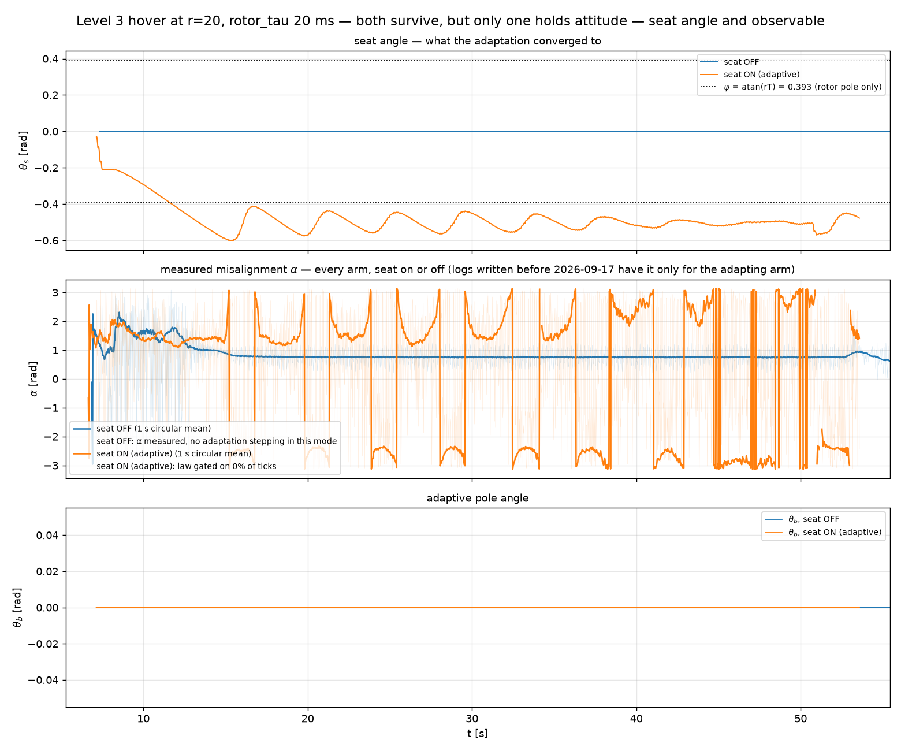
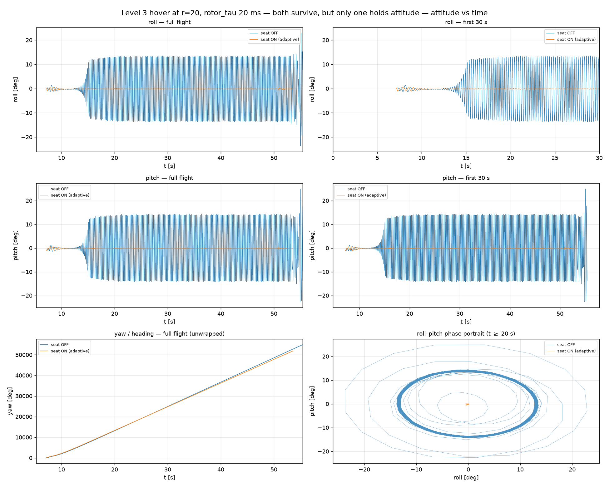
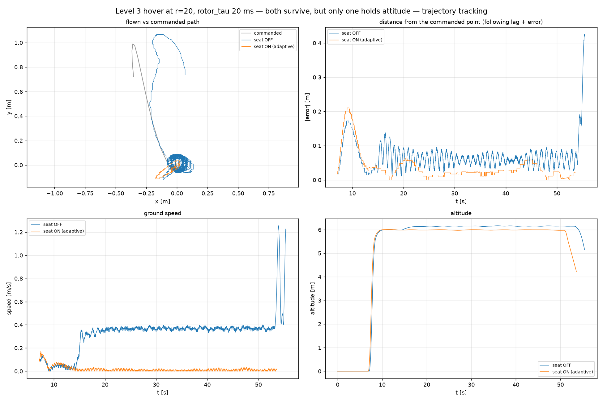

**So below the ceiling the seat is not a rescue, it is a 62× attitude improvement**
(13.72° → 0.22°, \|p,q\| 1.602 → 0.088). That is a different claim from "it keeps the
vehicle alive", and worth separating: across everything measured, the seat does three
qualitatively different things depending on where the condition sits relative to its ceiling.

| where | example | seat off | seat on | the seat's role |
|---|---|---|---|---|
| below the ceiling | L3 hover, r = 20 | survives, 13.7° cone | 0.22° hold | removes a 62× attitude error |
| at the ceiling | L3 hover, r = 29.4 | crash 12.8 s | flew 46.7 s | rescue |
| above it | L3 circle, r = 25 | crash 15.3 s | crash 20.7 s | cannot help |

## 5. θ_s is the same everywhere at matched spin — across profile *and* rung

| condition | spin | θ_s |
|---|---|---|
| L2 hover | 20.0 | −0.547 ± 0.040 |
| L2 circle | 20.7 | −0.530 ± 0.028 |
| **L3 hover** | **20.1** | **−0.505 ± 0.061** |

Three runs, two rungs, two profiles as different as a stationary hover and a 5 m/s circle,
and θ_s agrees within ±0.02 rad — inside the scatter of any one of them. **The seat measures
the actuator path, not the manoeuvre and not the state source.** This is the cleanest
evidence in the project that the observable does what it was designed to do.

## 6. The open question: the ceiling is not a single spin rate

Level 3 rescues hover at **r = 29.4** but fails the circle at **r = 25**. If the ceiling
were purely a spin rate that ordering would be the other way round, so the circle's
sustained ~19° centripetal tilt demand appears to lower it.

That is the natural reading but it is **not established**, and there is a confound: the
level-3 circle runs are from 2026-09-14 at km = 5.102e-7, while these hover runs are from
2026-09-17 at km = 6e-7 / 4.0816e-7. The discriminating experiment is one run —
**level 3, the fast circle, at r = 20** — which would sit at the same spin as §4 and §5.
It has not been flown.

Until it is, quote the ceiling as rung- *and* profile-dependent, not as a number.

## 7. An anomaly: θ_s gets *smaller* with more lag

−0.870 rad at `rotor_tau = 0`, **−0.474 rad at `rotor_tau = 0.02`**. More actuator lag
should mean more phase to cancel. On the level-2 circle it behaves that way
(−0.411 → −0.530); here it goes the other way, and by a lot.

Not explained, and deliberately not explained away. The CROSS law's fixed point is where
the time-average of `|xd||xa| sin α` vanishes, not where α vanishes (`Seat.adapt`'s
docstring), so adding lag changes the magnitude weighting as well as the phase and the
fixed point can move non-monotonically. The lagged arm may also simply not have settled in
46 s. **Do not build an argument on the sign of dθ_s/dτ from two points.**

## 8. The adaptive arm on its own axes

The same rescaled single-arm view as level 1's `km6e7_attitude_adaptive.png`, for each of
the three level-3 hover conditions.

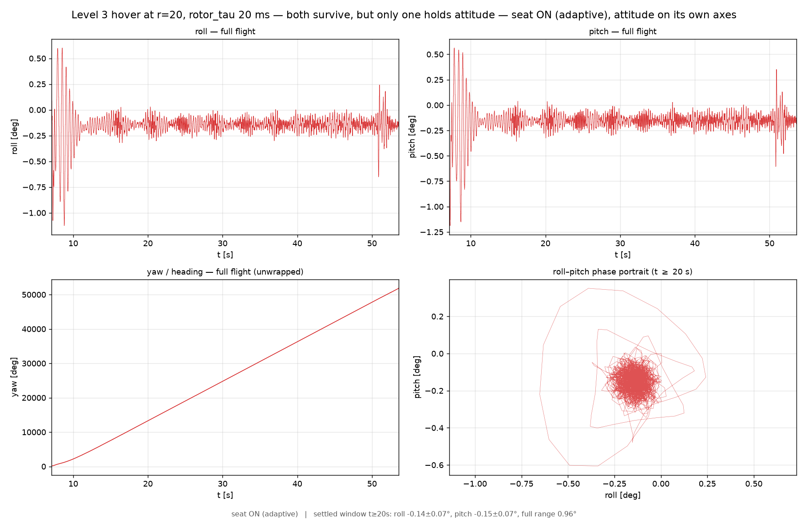

r = 20, 20 ms lag — ±0.06°, a tight blob. Compare the seat-**off** arm at this identical
condition, which survives in a 13.7° cone (§4).

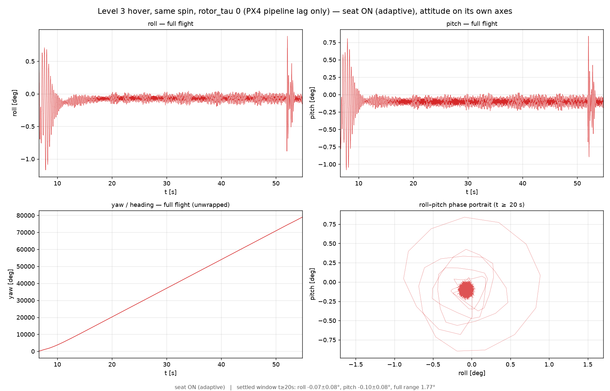

r = 29.4, no rotor lag — ±0.05°, the best of the three.

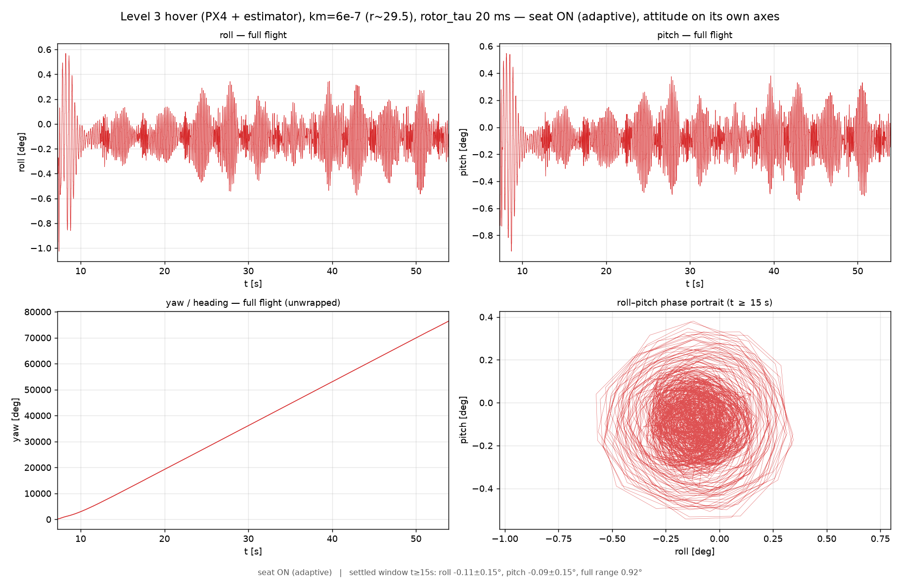

r = 29.4 **with** lag — this is the rescue of §1, and it is visibly working for it:
**±0.63°, thirteen times the scatter** of the other two, with the portrait smeared into a
ragged ring rather than a blob. It flies, but it is at the edge.

### The numbers across every hover condition flown

| case | spin | `rotor_tau` | roll [deg] | pitch [deg] | full range |
|---|---|---|---|---|---|
| L1 hover (re-flight) | 29.5 | 0.020 | −0.030 ± 0.214 | +0.023 ± 0.214 | 0.80° |
| L2 hover | 29.4 | 0 | −0.058 ± 0.043 | −0.102 ± 0.049 | 0.83° |
| L2 hover | **20.0** | 0.020 | −0.137 ± **0.041** | −0.151 ± **0.046** | **0.41°** |
| L2 hover | 29.5 | 0.020 | +0.076 ± **21.45** | +0.336 ± **22.33** | 137° |
| L3 hover | 29.4 | 0 | −0.062 ± 0.047 | −0.105 ± 0.052 | 0.44° |
| L3 hover | **20.1** | 0.020 | −0.143 ± **0.059** | −0.153 ± **0.061** | 0.85° |
| L3 hover | 29.4 | 0.020 | −0.110 ± **0.626** | −0.095 ± **0.582** | 11.2° |

Settled window t ≥ 20 s (t ≥ 60 s for level 1), adaptive arm only.

**The standard deviation is the ceiling indicator, and it moves in decades:**

| where the condition sits | roll sd | what it looks like |
|---|---|---|
| comfortably below the ceiling (r = 20, either rung; or no rotor lag) | **0.04–0.06°** | a tight blob at the origin |
| at the ceiling (L3, r = 29.4, 20 ms lag) | **0.63°** | flies, but 13× the scatter — working hard |
| past it (L2, r = 29.5, 20 ms lag) | **21.5°** | departed; this is the tumble, not a hold |

There is no intermediate regime in between the last two. The seat either holds attitude to a
fraction of a degree or it does not hold it at all.

---

## Conclusions

1. **The seat rescues level-3 hover at 20 ms of rotor lag and r ≈ 29.4** — 12.8 s → the
   full 46.7 s, with 6.8 mm altitude sd and 0.21° mean tilt. This is the hardware-relevant
   rung, and it is a clean rescue.
2. **At zero rotor lag the seat is inert**, as it should be: both arms fly and every
   tracking number matches. It still finds PX4's own pipeline lag (−0.870 rad).
3. **Level 2 and level 3 disagree at identical conditions, and level 3 is the one that
   survives** (§3). Hover matches spin exactly across the rungs, which the circle
   experiments could not — they ran level 2 at r = 20.7 and level 3 at r = 25.
4. **Below the ceiling the seat is an attitude-quality improvement, not a rescue** (§4):
   at r = 20 seat-off survives in a 13.7° coning limit cycle and the seat takes it to 0.22°.
   **A flight-duration or position-error check would score that failure as a success.**
5. **θ_s agrees to ±0.02 rad across both rungs and both profiles at matched spin** (§5) —
   the observable measures the actuator, not the manoeuvre or the state source.
6. **The ceiling is not a single spin rate** (§6): level 3 rescues hover at r = 29.4 but
   fails the circle at r = 25. One run — level 3, fast circle, r = 20 — would settle it.
7. **Level 3 costs ~5× in hold precision** relative to ground truth, and that is the number
   hardware will see.
8. **θ_s's dependence on lag is not monotonic here** (§7) and is unexplained.
