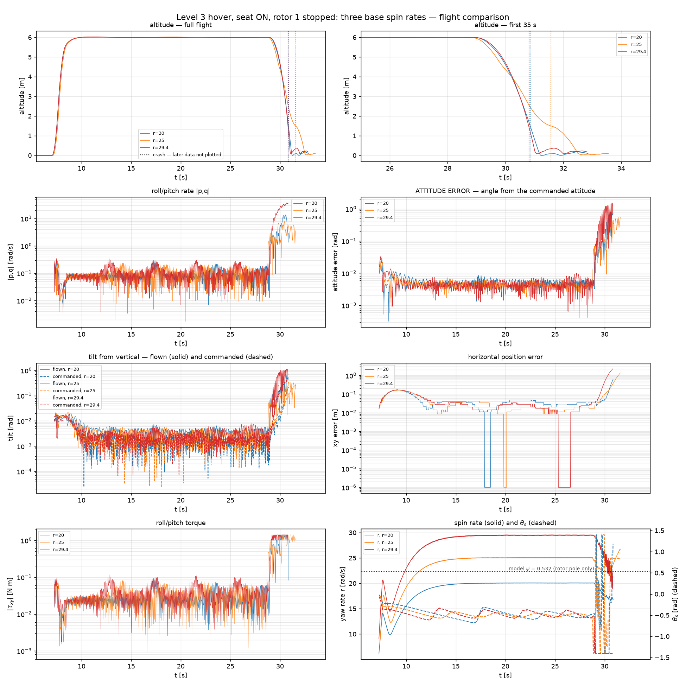
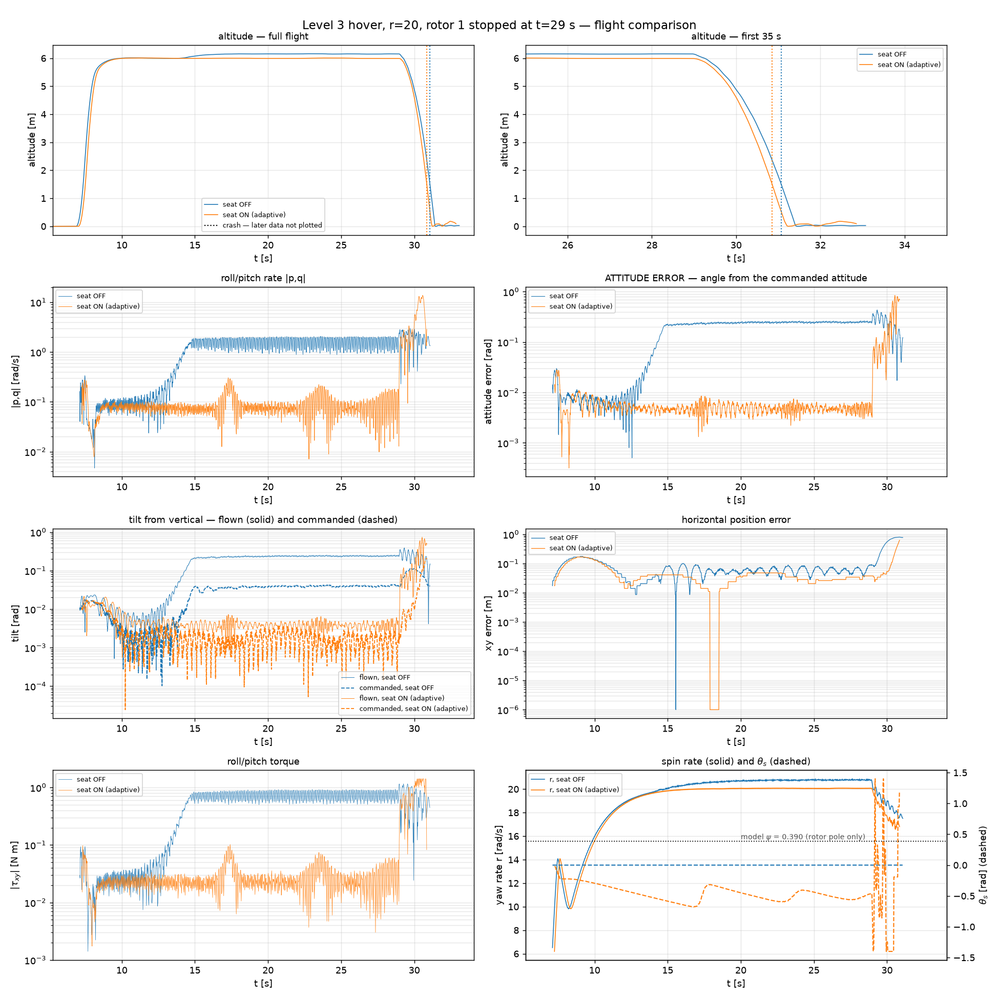

# One rotor stopped in hover — level 3

> **The question:** what base spin rate does level-3 hover need to survive a single rotor
> loss — is it at or above 25 rad/s?
>
> **The answer: there isn't one in this range.** 20, 25 and 29.5 rad/s all depart within
> 1.9–2.8 s of the rotor stopping, with no trend in spin rate. 25 is not a threshold, and
> raising the spin does not buy fault tolerance. What fails is not the spin — it is that
> the allocator goes on commanding a motor that is no longer there.

Flown 2026-09-19. Nine runs. Method, parameters and the two PX4 hooks involved are in
[`RUN_LOG.md`](RUN_LOG.md); this is what they say.

---

## 1. Every spin rate fails, and fails the same way

Seat ON (adaptive), `rotor_tau = 0.02`, rotor 1 stopped ~29 s into each flight:

| r [rad/s] | tilt before | \|p,q\| before | survives the loss by | tilt after |
|---|---|---|---|---|
| 20.1 | 0.22° | 0.087 | **1.9 s** | 11.70° |
| 25.1 | 0.17° | 0.091 | **2.8 s** | 7.07° |
| 29.5 | 0.18° | 0.103 | **1.9 s** | 25.47° |

A repeat of the r = 20 cell gives 1.8 s. The three altitude traces in the figure lie on top
of each other through the departure: **the descent is indifferent to the spin rate.**

All three were in the known-good hover when the motor died — 0.17–0.22° of tilt, θ_s
settled at −0.48 to −0.50 rad, altitude held to 5–7 mm. These reproduce
[`../hover_level3_px4_estimator/`](../hover_level3_px4_estimator/LEVEL3_HOVER.md) at
matched spin (0.22°, \|p,q\| 0.088, θ_s −0.505 there against −0.499 here), so the vehicle
was healthy and the seat had converged before anything was broken.

**There is no ceiling to find here, because nothing survives.** The premise of the question
— that fault tolerance switches on above some base spin — does not hold for this stack.

## 2. What actually kills it: the allocator keeps commanding a dead motor

Normalised motor commands across the failure at r = 20 (seat ON):

| window | motor 1 (stopped) | motor 2 | motor 3 | motor 4 |
|---|---|---|---|---|
| 2 s before | 0.601 | 0.637 | 0.600 | 0.638 |
| 0 – 0.5 s after | NaN | 0.439 (**max 1.000**) | 0.540 (**max 1.000**) | 0.725 (**max 1.000**) |
| 0.5 – 1.5 s after | NaN | 0.473 (max 1.000) | 0.493 (max 1.000) | 0.647 (max 1.000) |

Descent rate over the same interval: **+1.22 m/s** in the first second, **+3.63 m/s** in
the second.

The three survivors saturate within half a second and stay there, while their *mean*
command stays near the pre-failure value. That is the signature of a mixer thrashing on
roll/pitch, not of a vehicle short of thrust: on this airframe at this km,
`desaturation.py` measures the three surviving rotors as able to produce **31.0 N against a
15.9 N weight — 1.95×**.

(An earlier draft computed that margin as "21 %" from the normalised command sum, 2.476 of
4.0. That is wrong — thrust goes as ω² and the normalised command sets ω, so command share
is not thrust share. The measured 1.95× is the number.)

**The lift to hover on three rotors exists.** It is not delivered, because
`ControlAllocator`'s effectiveness matrix still contains the dead rotor: every roll/pitch
solution it computes assigns part of the job to a motor producing nothing, and the
correction it then demands from the other three saturates them.

This is the honest configuration — it is level 1's convention, where the controller "is not
told, and only sees the consequences through the state" (`motor_failure.py`). It is also
exactly the configuration in which no amount of spin can help, because the defect is in the
allocation, not in the attitude dynamics that spin stiffens.

## 3. Telling the allocator does not work in this rig — and can make it worse

`CA_FAILURE_MODE=1` stops the motor but only *re-allocates* around a failure the detector
has found, which needs `FD_ACT_EN=1`. Three more runs with it on:

| r | what the detector did | outcome |
|---|---|---|
| 20.1 | flagged **all four** motors at t = 10.0 s | crash 2.5 s after the failure |
| 25 | flagged **one** motor at t = 8.7 s | **fell at 9.9 s — 18 s before the injection** |
| 29.5 | flagged all four at t = 15.0 s | crash 1.9 s after the failure |

`FailureDetector::updateMotorStatus()` scores commanded thrust against `esc_status` current
through `FD_ACT_MOT_C2T` (35 A per unit of thrust). The simulated ESC current does not obey
that model, so **the detector fires on healthy motors within 10–15 s of every takeoff.**

The two ways that plays out are both useless and one is dangerous:

- **all four flagged** → `REMOVE_FIRST_FAILING_MOTOR` requires `num_motors_failed == 1` and
  declines, so the run degenerates to §1's arm. The matching crash times (1.9 s at r = 29.5
  either way) confirm nothing else changed.
- **exactly one flagged** → the allocator removes a **healthy** motor from the effectiveness
  matrix, and the vehicle drops from 5.97 m to the ground in about a second, with no
  injected failure anywhere near it.

So re-allocation is not reachable through the detector here. Reaching it needs the injector
to set `motor_failure_mask` as well as `motor_stop_mask` — a PX4 change, not a parameter —
or an `FD_ACT_MOT_C2T` calibrated to the simulated ESC. **Until then, "PX4 re-allocates
around a lost rotor" is untested on this vehicle, and `FD_ACT_EN=1` should stay off.**

## 4. The seat-off arms cannot answer the question above r = 20

| r | seat off, before the failure | reached the failure? |
|---|---|---|
| 20.8 | survives in the **13.66°** coning limit cycle, \|p,q\| 1.598 | yes — then crashes 2.2 s after it |
| 25 | — | **no: crashed at 15.8 s, 13.6 s early** |
| 29.4 | — | **no: crashed at 12.7 s, 15.7 s early** |

Those two are not failures of the experiment: 12.7 s reproduces the archived seat-off
level-3 hover (12.8 s at r = 29.4) almost exactly. They simply mean the seat-off arm has no
flight left to lose at those spins, so **at r ≥ 25 the seat-ON row is the only one that can
be read as a fault-tolerance result at all.**

At r = 20, where both arms do reach the failure, they die 2.2 s and 1.9 s after it. The seat
is worth 62× in attitude before the loss and **nothing after it** — which is the expected
result, not a disappointment: θ_s cancels an actuator *phase*, and a missing rotor is not a
phase error.

## 4b. Level 1 survives the identical failure — and level 2 does not

Added 2026-09-19 after the first draft, because the claim "a level-1 run survived a rotor
loss at 30 rad/s" is correct and needed reconciling.

| rung | who allocates | r | outcome after the rotor stops |
|---|---|---|---|
| **1** | Pegasus `Multirotor.force_and_torques_to_velocities` + the Python eigen law | **29.5** | **survives 45 s** — holds 5.41 m, xy drift 0.00 m, cones steadily at \|p,q\| 1.196 |
| 2 | PX4 `ControlAllocator`, **ground truth** | 20.1 | crash **2.0 s** after |
| 3 | PX4 `ControlAllocator`, estimator | 20.1 | crash **1.9 s** after |

Level 1 was flown with `motor_failure.py --settle-hold 10`, so the rotor stops at a settled
6 m hover with the spin fully converged (`ROTOR 0 STOPPED at t = 14.368 s, alt = 5.995 m,
|v| = 0.017 m/s`) rather than mid-spin-up.

**Level 2 and level 3 agree to 0.1 s, so the estimator is not the difference.** What changes
between rung 1 and rung 2 is who allocates.

### Why level 1 gets away with it

Per-rotor thrust across the failure at level 1 (rotor 0 is the dead one; its share is
computed, then discarded):

| window | rotor 0 | rotor 1 | rotor 2 | rotor 3 | commanded collective |
|---|---|---|---|---|---|
| before | 3.79 | 4.15 | 3.80 | 4.14 | 15.88 N |
| 1–3 s after | *8.80* | 3.45 | 2.79 | 9.90 | **24.94 N** |
| 10–20 s after | *8.78* | 3.34 | 2.81 | 9.76 | **24.68 N** |

The altitude loop simply **winds the collective up from 15.9 N to 24.7 N** until the three
survivors deliver the 15.9 N the vehicle weighs, and settles there. The peak rotor sits at
**9.90 N against a 10.34 N ceiling — it never saturates.**

So level 1 allocates to the dead rotor too. The difference is that it can afford to: it
solves in physical N·m and newtons, and has the headroom to pay for the waste.

PX4 cannot, because its per-motor setpoint is normalised 0–1 and is already near the top:
§2's three survivors hit exactly **1.000** within half a second and stay pinned there while
their *means* stay near the pre-failure value. That is a mixer oscillating against its
clip, not a loop that has found a new equilibrium.

### The desaturation policy is not the discriminator today

`desaturation.py` exists because of a stopped-rotor case where `uniform` cut a rotor asking
4.52 N down to 2.04 N and the vehicle fell in 0.77 s. **That case does not reproduce at this
operating point.** Flown back to back at r = 29.5, 6 m, converged spin:

| policy | steady state after the failure |
|---|---|
| `collective` | 5.41 m, \|p,q\| 1.196, r −29.47 |
| `uniform` | 5.41 m, \|p,q\| 1.196, r −29.47 |

Identical, because **neither policy engages** — the demand stays inside the ceiling
(9.90 of 10.34 N), so there is nothing to desaturate. The collective model is not what is
carrying this survival; the thrust headroom is. It would still be carrying it at a demand
that exceeded the ceiling, which is the case the module was written for.

**And `--desaturation` is a no-op at levels 2 and 3 in any case.** It is read by
`Multirotor.force_and_torques_to_velocities`, which runs only when a backend supplies force
and torque. On the PX4 rungs `px4_mavlink_backend.update_input_reference()` writes
`_input_reference` straight from `HIL_ACTUATOR_CONTROLS`, so that function is never called
and the policy has nothing to act on. **The fix that protects level 1's collective does not
exist on the PX4 rungs** — PX4 uses `ControlAllocationSequentialDesaturation`
(`CA_METHOD=1`) instead, which is a different rule with a different priority order.

### What level 1's survival actually looks like

Not a hover. It holds altitude (5.41 m, 0.58 m below the setpoint) and position (xy drift
0.00 m) while coning at **1.196 rad/s** indefinitely — `desaturation.py`'s own note calls
this out: "a fault-blind allocator cannot hold roll and pitch on three rotors, so the
vehicle climbs while tumbling." Score it as survival, not as control.

### The saturation is measured, and the desaturation priority is not the fix

`control_allocator_status` says it directly. Level 3, r = 20, across the failure:

| window | `vehicle_thrust_setpoint.xyz[2]` | `unallocated_thrust[2]` |
|---|---|---|
| before | −0.619 | −0.0015 |
| 0–0.5 s after | −0.846 | −0.217 |
| 0.5–1 s after | **−1.000** (full throttle) | **−0.498** |
| 1–2 s after | −1.000 | −0.505 |

The loop makes exactly the same move level 1 makes — it winds the collective up. PX4 reaches
full throttle inside a second and **the allocator reports half of it as undeliverable.**

`MC_AIRMODE=0` (the default here) routes to `mixAirmodeDisabled()`, whose first desaturation
step is literally commented *"only reduce thrust"* — the `uniform` pathology, hard-coded in
the mixer. That makes `MC_AIRMODE=1` the obvious one-parameter test, and **it does not
rescue the vehicle**: unallocated thrust improves 0.50 → 0.44 and time-to-departure goes
1.9 s → 2.3 s (`px4_runs/L3_eigen_20260919_093823`). Still a crash.

So saturation is the proximate mechanism but the desaturation *priority* is not the defect.
The arithmetic says the collective alone is affordable — hover sits at 0.62 per motor and
three rotors need about 0.72 to carry the same thrust — and `unallocated_torque[0]` reaching
−0.33 says what is consuming the rest: **a fault-blind mixer demanding roll and pitch that
three rotors cannot produce.** Thrust is what gets sacrificed to chase it.

### Is the equilibrium unallocatable, or does PX4 just not steer to it?

Level 1's post-failure fixed point, expressed in PX4's own units. Per-rotor thrust
[8.78, 3.34, 2.81, 9.76] N against a 10.34 N ceiling, and thrust goes as the square of the
command, so the normalised commands are:

    [0.921, 0.568, 0.521, 0.972]      hottest rotor 0.972 — INSIDE the 0..1 box

and `sim_px4.py` sets `input_scaling = 1100 = max_rotor_velocity` with zero offset, so **PX4
command 1.0 is exactly the physical ceiling level 1 has.** The point level 1 sits at for
45 s is reachable by PX4's actuators.

**But only just.** The hottest rotor is at 94 % of the limit in rel-thrust terms
(9.76/10.34), so the steady three-rotor solution leaves about 6 % of headroom for every
transient — and level 3 carries a 20 ms rotor pole plus PX4's own pipeline lag on top.

What moves first, in 0.2 s bins from the failure:

| t − t_fail | attitude error | \|τ_cmd\| | unallocated thrust | unallocated torque |
|---|---|---|---|---|
| −0.2 s | 0.30° | 0.036 | −0.002 | 0.000 |
| +0.0 s | 2.49° | **0.397** | −0.001 | 0.000 |
| +0.2 s | 4.53° | 0.601 | **−0.346** | 0.000 |
| +0.6 s | 3.85° | 0.626 | −0.497 | 0.206 |
| +1.0 s | 7.18° | 1.033 | −0.506 | 0.851 |
| +1.4 s | **31.49°** | 1.308 | −0.488 | 0.385 |

**The torque demand is not a symptom of the vehicle coning out of control.** It jumps 11×
in the first bin while the attitude error is 2.5–4.5° — the same order as level 1's *stable*
3.7° equilibrium. Thrust starts being sacrificed at +0.2 s while torque is still fully
delivered, which is `mixAirmodeDisabled()`'s rule, not a contest. The 31° runaway arrives
at +1.4 s, after half the commanded collective has been undeliverable for a second. It is
the consequence.

Two candidate causes tested, neither of them it:

| change | rationale | result |
|---|---|---|
| `MC_AIRMODE=1` | stop cutting thrust first | unallocated 0.50 → 0.44, **1.9 s → 2.3 s, still crashes** |
| `THR_MDL_FAC=1.0` | PX4 assumes thrust ∝ command; the plant is thrust ∝ command². 1.0 inverts the quadratic | **crash 2.0 s after** (and it perturbs the trim — hover moves to 6.39 m, θ_s to −0.09 — so it is not a clean single variable) |

So the defensible statement is narrower than either "the torque demand runs away" or "the
equilibrium is unallocatable": **the equilibrium is inside the actuator box with ~6 % to
spare, and PX4's fault-blind allocator does not steer to it.** It still carries the dead
rotor in its effectiveness matrix, so it charges that rotor's ~0.92 share against the same
0–1 budget and computes the survivors from a four-rotor solution. Level 1 allocates to the
dead rotor too, and escapes only because it can raise the total demand in newtons until the
*survivors'* share alone equals the weight.

**Not yet shown:** that PX4 *cannot* reach that point. The decisive test is to command the
level-1 equilibrium wrench and check whether the allocator reproduces the level-1 rotor set.

### The oracle test: give it more thrust and see what is left

Asked 2026-09-19: if saturation is the mechanism, does simply handing the vehicle more
thrust authority save it? `fly.py --thrust-scale K` multiplies every rotor's thrust constant
by K, with `CA_ROTOR*_CT = 10.344K` and `MC_EIG_TRQ_MAX = 3.843K` passed so PX4's model of
the vehicle still matches the vehicle. **K > 1 is an oracle, not an airframe.**

**Spin has to be held or K changes two things.** `r_ss = (km/kf)·mg/γ`, so scaling the
thrust constant `kf` by K divides the steady spin by K — a first attempt flew K = 2 at
r = 10.0 instead of 20.1, which is uninterpretable. `km` is scaled with it; the ratio
`km/kf` is what `CA_ROTOR*_KM` encodes, so that parameter is unchanged.

| K | r before | outcome | thrust sp | unallocated thrust | unallocated torque |
|---|---|---|---|---|---|
| 1.0 | 20.06 | crash **1.9 s** after | −1.000 | **−0.503** | 0.664 |
| 1.25 | 20.06 | crash **2.7 s** after | −0.987 | −0.381 | 0.148 |
| 2.0 | 20.06 | crash **15.4 s** after | **−0.493** | **−0.0007** | 0.368 |

**At K = 2 the thrust starvation is gone completely** — half throttle, nothing unallocated —
and the vehicle **holds 5.98 m of altitude for 15 s**. It still dies, at 37.4° of tilt and
47 m off station.

Two things follow, and they need keeping apart:

1. **The immediate fall at K = 1 is thrust starvation.** Remove the starvation and the fall
   disappears. That part of §2 is confirmed by intervention, not just correlation.
2. **Thrust is not sufficient.** `unallocated_torque` is still 0.368 with thrust entirely
   satisfied: a fault-blind four-rotor effectiveness matrix cannot produce the roll and
   pitch it is asking for from three rotors, and no amount of thrust changes that. The
   vehicle stops falling and starts flying away instead.

This is exactly what `desaturation.py` predicts for level 1 — *"that buys altitude, not
attitude"* — reproduced on the PX4 rungs by a different route.

**It also sharpens the open question.** Level 1 holds attitude to a standing **3.7°** and
stays on station for 45 s. Level 3 with thrust starvation fully removed tumbles to **37°**
and translates 47 m. So beyond the thrust path there is a second, unexplained difference in
the *torque* path between the rungs. Candidates, none tested: PX4's rank-3 allocation with
all four `CA_ROTOR*_KM` of one sign, the 20 ms rotor pole, the estimator (level 2 at K = 2
has not been flown and would separate the last one).

## 5. What would have to change

Fault tolerance in the sense the literature means it — Mueller's relaxed hover, where a
quadrotor with three rotors gives up attitude about two axes and controls only the direction
of a primary axis — **is not implemented anywhere in this stack.** The eigen controller
commands full roll and pitch, and the allocator solves for them with a stale effectiveness
matrix. Nothing in the nine runs tests a fault-tolerant control law, because there isn't one
to test; they test what the existing spinning controller does when a rotor stops, and the
answer is that it falls in about two seconds at every spin rate tried.

Three things, in the order they would have to happen:

1. **Make re-allocation reachable.** Either have the injector set `motor_failure_mask`
   directly, or calibrate `FD_ACT_MOT_C2T` to the simulated ESC. Without this, §3's arm
   cannot be flown at all and the "PX4 handles it" claim stays untested.
2. **Re-fly §1's grid with the allocator actually told.** Only then is the spin-rate
   question meaningful: a three-rotor allocation on a rank-3 mixer is exactly determined,
   and whether it holds may well depend on the gyroscopic stiffening that spin provides.
   That is the experiment that could produce a required spin rate.
3. **If it still fails, the relaxed-hover law is the missing piece, not a gain.** That is a
   different controller, not a tuning of this one.

---

## Conclusions

1. **No base spin rate between 20 and 29.5 rad/s makes level-3 hover survive a single rotor
   loss.** Time to departure is 1.9 / 2.8 / 1.9 s at 20 / 25 / 29.5, with no trend, and
   1.8 s on a repeat. **25 rad/s is not a threshold and spin is not the variable.**
2. **The mechanism is allocation, not dynamics, and not the estimator.** Level 2 dies 2.0 s
   after the same failure and level 3 dies 1.9 s after it, so the state source is exonerated
   (§4b). **Level 1 survives the identical failure at r = 29.5 for 45 s**, by winding the
   commanded collective from 15.9 N to 24.7 N without ever saturating a rotor — headroom
   PX4's normalised 0–1 setpoint does not have.
3. **The desaturation policy is not the discriminator at this operating point** (§4b):
   `collective` and `uniform` give bit-identical steady states at level 1, because the
   demand never reaches the ceiling. And `--desaturation` is a **no-op at levels 2 and 3** —
   it lives in the Pegasus allocator the PX4 rungs bypass.
4. **The seat is irrelevant to this failure**, as it should be: it converged to −0.48…−0.50
   rad beforehand and bought 62× in attitude, and a missing rotor is not a phase error.
5. **`FD_ACT_EN=1` is unusable in SITL** and can crash a healthy vehicle by removing a good
   motor from the mix. Re-allocation is untested on this airframe.
6. **The seat-off arm cannot be read at r ≥ 25**: it crashes 13–16 s before the injection,
   reproducing the archived seat-off hover.
