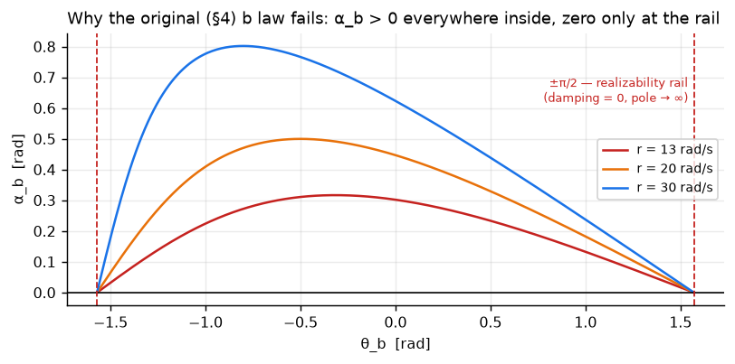
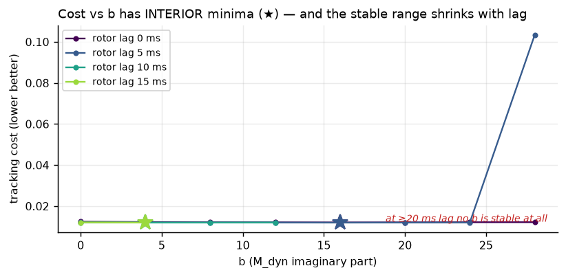

# Background for the θ_b (pole angle) question — theory and the archived sweep

**Not a flight experiment.** Two figures that the flight folders depend on but neither
produced: one analytic, one from an archived parameter sweep. They are here so the
"predicted band" and "why the original law was replaced" claims elsewhere have a source.

Referenced by
[`../trajectory_level1_waypoint_ellipse_2x2_arms/`](../trajectory_level1_waypoint_ellipse_2x2_arms/)
and
[`../trajectory_level1_seat_b_geometry_sweep/`](../trajectory_level1_seat_b_geometry_sweep/).

---

## 1. Why the original θ_b law cannot work — an analytic result, not a measurement



The first adaptive-b law (brief v3 §4) drove θ_b to null `α_b`, the angle from `M_dyn·x` to
the measured acceleration. The plot evaluates that α_b over the whole reachable range of
θ_b, at r = 13, 20 and 30 rad/s.

With `A_r = i·λ·r` and `M_dyn = −ρ·e^{i θ_b}`:

```
α_b = (θ_s − ψ) + atan2( c·cos θ_b , 1 + c·sin θ_b ),    c = λ·r / ρ
```

**α_b is strictly positive for every |θ_b| < π/2.** It is zero only *at* ±π/2 — the
realizability rail, where the damping term `cos θ_b` vanishes and the pole magnitude grows
as `1/cos θ_b`. Worse, the rail is *attracting*: slope +0.92 at r = 20, +2.55 at r = 30.

**So the law converges robustly, and to a useless place.** This is a structural defect in
the observable, not a gain problem — which is why widening the gains only slowed the damage
(k ratio 10 → 1000 reduced the attitude-error cost 0.831 → 0.188, limiting to the
θ_s-only 0.141) and never fixed it. It is also why the level-2 port of this law crashed a
90-s-stable configuration in 3–9 s.

**What replaced it** (the extremum-seeking law used in every flight folder here):

1. An **exogenous** reference — commanded horizontal acceleration, which does not rotate
   when θ_b rotates and therefore cannot cancel itself out of the cost.
2. A **dither-measured gradient sign** rather than an algebraic angle.
3. Averaging both vectors over **~4 spin periods** first: achieved lateral acceleration is
   ~70× dominated by spin-synchronous content (level 2: commanded 0.064 vs. achieved
   4.40 m/s²), a residual tilt sweeping at the spin rate.

**The general lesson, and the reason this figure is kept:** an adaptive law that converges
is not thereby correct. Check that its observable has an interior zero *where you want one*
before tuning it. Plotting the observable over its whole domain took minutes and would have
saved the entire first implementation.

## 2. The archived static-b sweep — where the "predicted band" comes from



56 flights: 8 values of `b_mdyn` × 7 values of `rotor_tau`, km = 6e-7 (~29.5 rad/s), 30 s
each. Tracking cost against b, one curve per lag.

Two findings, and the second is the important one:

- **Cost vs. b has interior minima** (★) — a real optimum exists, which is what licenses
  adapting b at all. But the bowl is shallow: among stable runs the score spans **3.2 %**
  across the whole b range, with a weak minimum near b = 16. **Too shallow to call a tuned
  value.**
- **What moves hard is the stability ceiling.** The largest b that stays airborne falls
  **28 → 12 → 4 → nothing** as tau goes 5 → 10 → 15 → 20 ms. Past ~15 ms no b in [0, 28]
  holds the spin at all.

**So b and lag do not trade off.** The lag *closes the window* b lives in rather than
moving the optimum inside it. A lagged plant needs something other than a different b —
which is the argument for the seat, made before the seat was built. And a b picked at
tau = 0 is outside the stable set by tau = 10 ms, so gains tuned on an instant-response
plant are **unflyable** on a lagged one, not merely detuned.

### The predicted band

Converted to the polar parameterisation (`M_dyn = a·R(θ_b)` rather than two Cartesian
entries — commit `92c12a2`), the optimum maps to **θ_b ∈ [+0.106, +0.403] rad**. That is
the green band drawn on every θ_b figure in the flight folders, and it is an *independent*
prediction: it comes from static sweeps, not from any adaptive run.

Adaptive θ_b landing inside it is therefore a real cross-check. It does, with the seat on —
straight line, ellipse, 5× ellipse and smooth circle all converge into it (level-1 mean
+0.287, 84 % positive). Without the seat it does not (mean −0.190).

## Provenance

| | |
|---|---|
| sweep script | `examples/sweeps/b_vs_tau_sweep.py` |
| raw data | `examples/results/b_vs_tau/mm_6.0e-07/b_vs_tau.csv` — **intact** |
| sibling figures | `examples/results/b_vs_tau/mm_6.0e-07/{score_heatmap,ideal_b_vs_tau}.png` |
| commits | `6df6d8b` *"Measure b against rotor lag: the lag closes the window, b does not reopen it"*; `ae294bd`/`92c12a2` for the polar reparameterisation |
| write-up | `notes/FINDINGS.md` |
| theory figure | generated analytically from the α_b expression above — no flight data, reproducible from the formula alone |

**Plotting note, worth copying:** the sweep figure shades only the *stable* cells, and
**hatches** the failures rather than colouring them as very bad scores. Colouring diverged
runs on the same scale flattens a 3 % bowl into invisibility next to cells two orders of
magnitude worse — and a crash is a different outcome, not a worse number.
