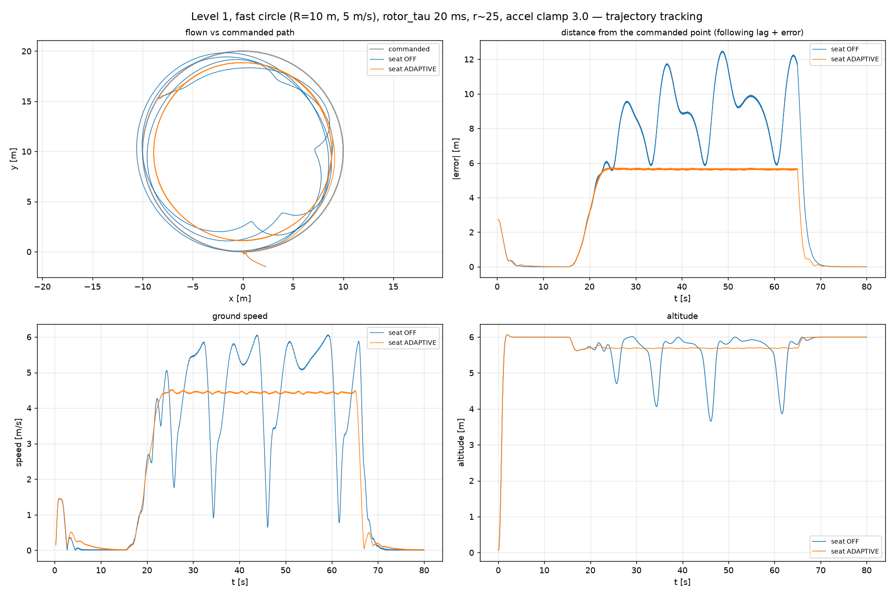
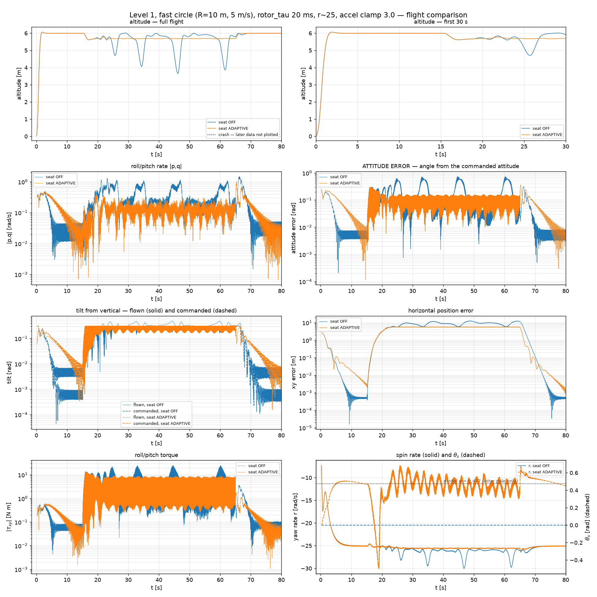
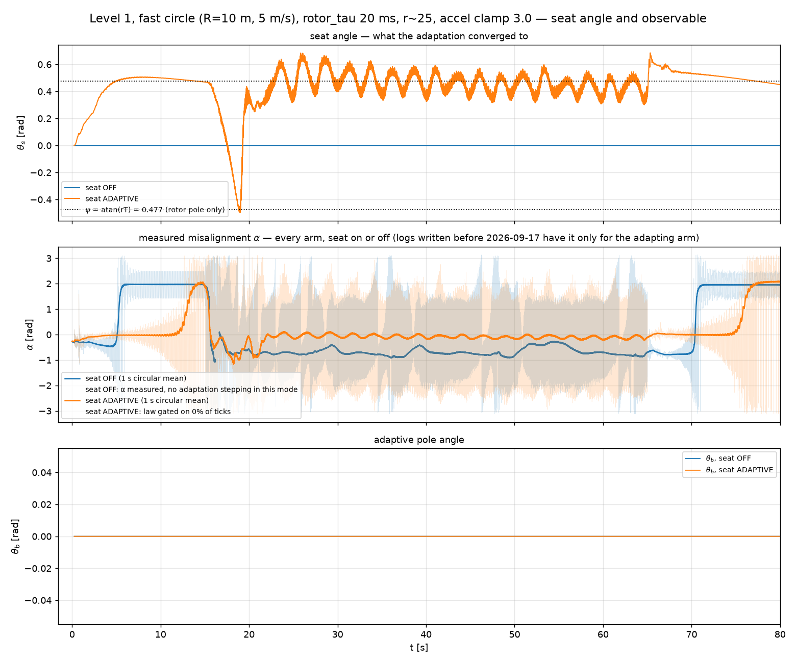

# Level 1 on a circle — the seat improves tracking at both speeds

**Date flown:** 2026-09-18. Eigen controller, r ≈ 25 rad/s, `rotor_tau = 0.02`,
**`--max-lateral-accel 3.0`**, seat adaptive (CROSS law, `Seat()` defaults).

Two circles, the same two arms on each:

| | radius | speed | centripetal | altitude |
|---|---|---|---|---|
| **smooth** (`smooth_circle.csv`) | 2.95 m | 1.03 m/s | 0.36 m/s² | 1.5 m |
| **fast** (`fast_circle_l1.csv`) | 10 m | 5 m/s | 2.5 m/s² | 6 m |

The fast circle is the **same path levels 2 and 3 fly**, so this folder is what lets the
level-1 column exist on the circle comparison sheet. It is `fast_circle_l2.csv` with its
first point held for 15 s — see the RUN_LOG for why that lead-in is needed.

---

## 1. The result

Both arms fly both circles. The seat is not rescuing anything here; it is **tracking
better**, on every measure, at both speeds:

| | smooth circle | | fast circle | |
|---|---|---|---|---|
| | seat OFF | seat ON | seat OFF | seat ON |
| following distance | 2.39 ± 0.56 m | **1.38 ± 0.04 m** | 7.54 ± 3.69 m | **4.62 ± 2.11 m** |
| altitude hold | ±358 mm | **±8 mm** | ±473 mm | **±118 mm** |
| tilt | — | — | 16.61° | **11.79°** |
| θ_s | 0 | +0.208 | 0 | +0.468 |





Altitude is the sharpest of these. On the smooth circle the seat-off arm wanders by a
third of a metre while the seat-on arm holds to **8 mm** — a factor of 45. The vehicle is
spinning at 25 rad/s the whole time in both cases.

θ_s grows with speed, +0.208 → +0.468, which is the direction the law is supposed to move
in: a faster orbit demands more lateral wrench, so more of the delay shows up as a
command-frame rotation.

## 2. This reproduces the archived result, and that is the point

[`../../seat_plots/TRAJECTORY_TRACKING.md`](../../../seat_plots/TRAJECTORY_TRACKING.md) §5
reports the smooth circle with a following distance **"rock-steady at ~1.4 m"** and a flown
path sitting inside the commanded one at a constant radial offset. This re-flight measures
**1.38 ± 0.04 m** with the path 2.69 m inside a 3.01 m command. The archived result stands.

That matters more than the new numbers: it is the control that says this harness is
measuring the same thing the original work measured.

## 3. THE TRAP — `--max-lateral-accel` defaults to OFF

**`--max-lateral-accel` is not set by default.** `fly.py` passes it only when given, and
`EigenController`'s own default is `0.0`, which the code reads as *no clamp*:

```python
self.max_lateral_accel = max(float(max_lateral_accel), 0.0)
...
if self.max_lateral_accel > 0.0:          # 0.0 means the clamp never runs
```

Every level-1 trajectory flight in this tree uses the clamp — the header of
`TRAJECTORY_TRACKING.md` says so explicitly — but nothing enforces it and nothing warns
when it is missing.

Flying the fast circle without it, on 2026-09-18, produced this:

| | no clamp | clamp 3.0 |
|---|---|---|
| seat OFF | **crash 13.1 s into the circle** | **flies the full 65 s** |
| seat ON | crash 8.1 s into the circle | flies the full 65 s, and tracks better |

and an apparent, entirely spurious, finding that *the seat is harmful at level 1 on
circles*, complete with a monotonic gain sweep (crash at 13.1 / 7.5 / 5.2 / 3.9 s for
k = 0 / 0.02 / 0.2 / 2.0) that looked convincing and meant nothing. The unclamped runs also
showed θ_s railing to ±1.4 on up to 95 % of ticks; **the clamped runs rail on 0.0 %**, so
even the "k must be retuned for this amplitude" reading that came out of them is not
supported by a clean flight.

**If a level-1 trajectory result says the seat hurts, check the clamp before believing it.**

## 4. What this does not say

- **Not a rescue.** Both arms survive both circles. This is a tracking-quality result, and
  the level-1 rescue evidence is in
  [`../hover_level1_km6e7_seat_off_fixed_adaptive/`](../hover_level1_km6e7_seat_off_fixed_adaptive/).
- **n = 1 per cell.** No repeats. The level-2 circle at 20 ms turned out to be 1-in-4
  bimodal, so single runs in this project are worth treating as provisional — though these
  differences (45× on altitude hold) are far larger than the scatter seen anywhere else.
- **Adaptive b is not tested here.** The b arm flown on 2026-09-18 was an unclamped run and
  is void with the rest of them.
- **Spin is 25 rad/s**, matching level 3's circle, not level 2's 20.7.
