# Trajectory tracking under spin — seat and adaptive b

Level 1, eigen controller, 25 rad/s spin, 20 ms rotor lag throughout. Seat adaptive
(CROSS law); adaptive b where noted uses the extremum-seeking law
(`--adapt-b --pole-gains law=extremum k_es=0.3 dither_amp=0.05 dither_hz=0.4 a_min=0.3
theta_b_max=0.6`). All flights use the outer-loop acceleration clamp
(`--max-lateral-accel`) added during this work — see "Traps" at the end.

Question behind all of it: **when the vehicle translates while spinning, is there a
standing directional bias between commanded and actual motion — and does adaptive b do
anything about it?**

---

## 1. Straight line, 40 m, 21 waypoints 2 m apart

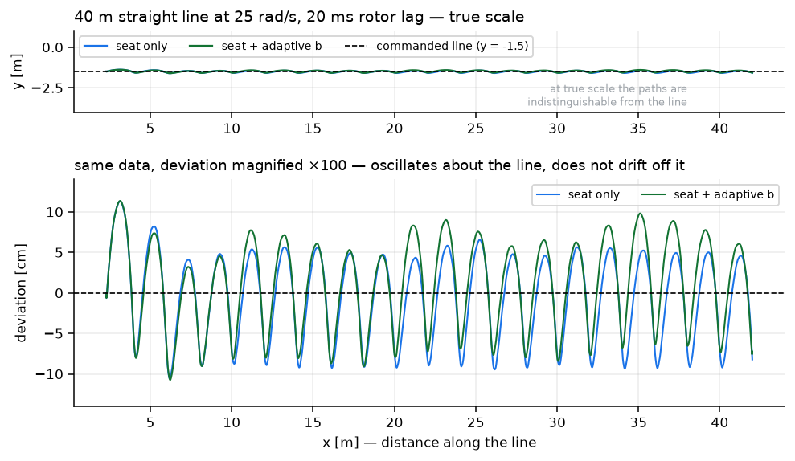

Flies straight at true scale. Magnified ×100, the deviation oscillates ±7 cm with a
spatial period of **exactly 2.00 m — the waypoint spacing**. That is the vehicle
re-aiming at each new point, not a phase error: no monotonic drift to either side.

**Reading at the time:** no standing bias, seat alone is sufficient.
**Later found incomplete** — this test never isolated a single continuous transit long
enough to show a bias if one existed (see §2).

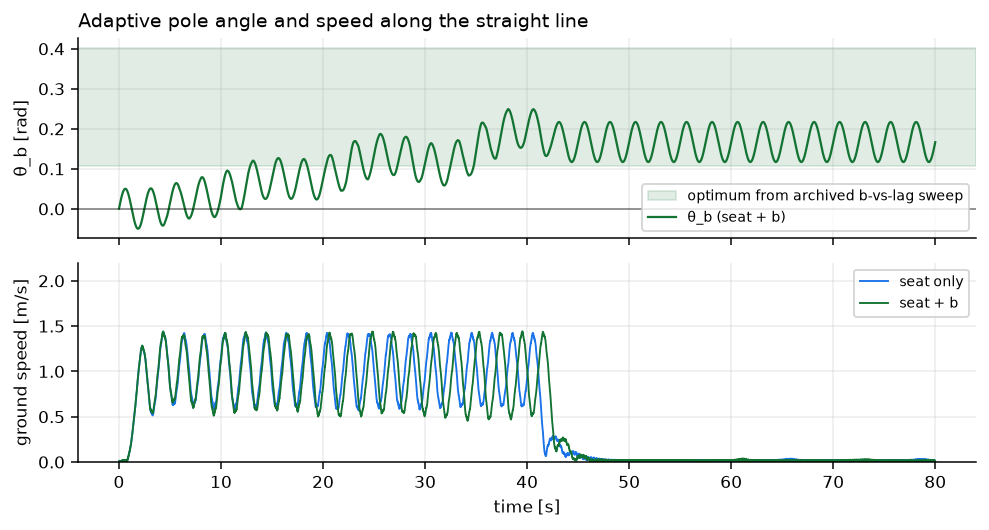

θ_b on the same flight, with ground speed underneath. θ_b climbs from 0 into the archived
sweep's predicted band over ~40 s and stays there, the fine ripple being the waypoint weave
feeding through into the cost. Ground speed cycles 0.5–1.45 m/s once per 2 m leg — the same
weave, seen in the other variable. Both arms' speed traces lie on top of each other, which
is the first hint of §4 and §5's conclusion that b does not change tracking.

---

## 2. Single distant goal — misalignment scales with speed

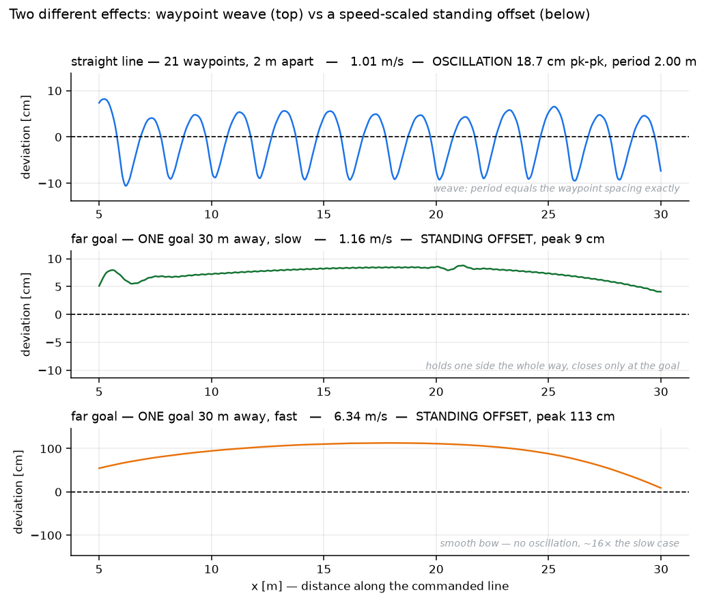

Two effects, kept separate on purpose:

- **Waypoint weave** (top): only when chasing multiple waypoints. ±9 cm, period =
  exactly the waypoint spacing. Pure geometry.
- **A genuine standing offset** (middle/bottom): a *single* far goal, no weave possible.
  **+7.6 cm at 1.16 m/s, +93 cm at 6.40 m/s** — the vehicle holds one side of the
  line the whole transit and only closes at the goal. Real, one-sided, and it scales
  roughly linearly with speed.

This corrected the §1 reading: there *is* a standing bias, it just doesn't show up at
waypoint-chasing speeds (~1 m/s) — it needs either higher speed or a long enough
uninterrupted transit to see.

---

## 3. Ellipse (waypoint chasing) — why it looks like a star

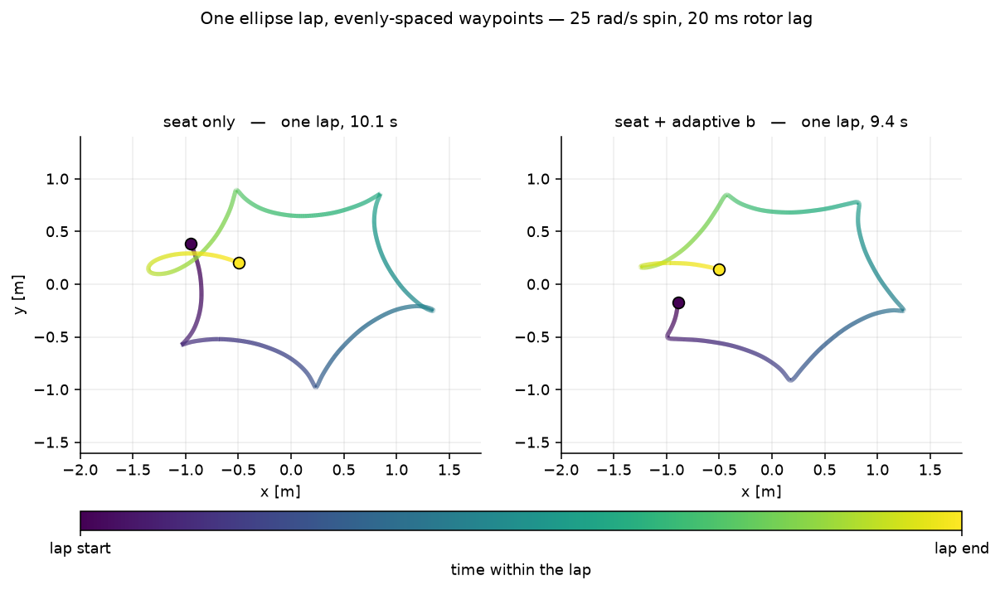

One lap, evenly-arc-spaced waypoints (16/lap, ~1.3 m apart), colored by time. Both arms
cut every corner — the vehicle advances to the next point as soon as it enters the
0.35 m acceptance radius, so it never reaches the vertices. Seat-only and seat+b produce
the same 16-pointed star: this geometry is not sensitive to b.

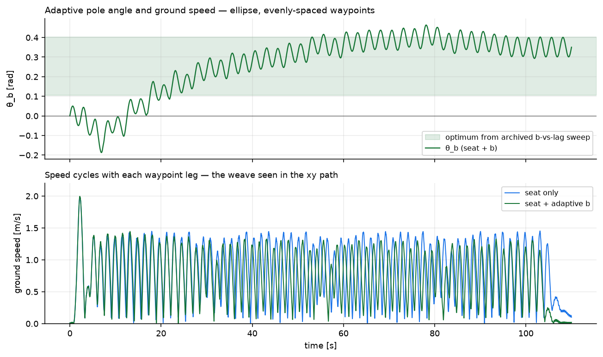

θ_b rises into the archived sweep's predicted band despite the constant weaving; ground
speed cycles 0.5–1.4 m/s once per waypoint leg — the oscillation visible in the xy path
above.

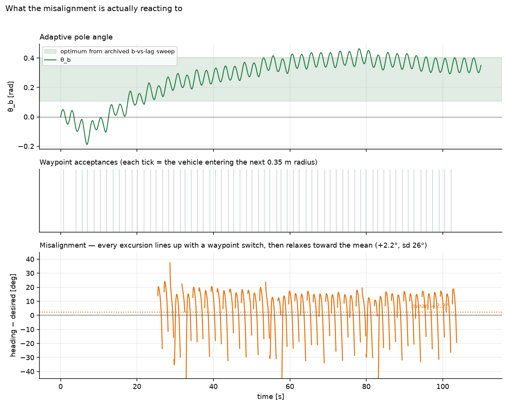

Three panels on one time axis, and the one that settles what the misalignment *is*: θ_b on
top, **a tick for every waypoint acceptance** in the middle, misalignment at the bottom.
Every excursion in the bottom panel lines up with a tick above it and decays before the
next one arrives — mean **+2.2°**, sd 26°, 30% negative. **A sd seven times the mean, with
no consistent sign, is not a bias; it is the transient response to a step, sampled at
random phase.** The middle panel is what makes that legible — without the acceptance ticks
the bottom panel looks like unexplained 30° noise.

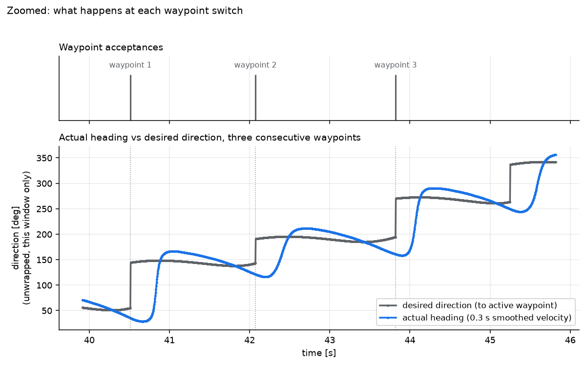

Zoomed with heading and desired direction plotted together (unwrapped): desired direction
steps instantly at each switch, actual heading responds with a lag, overshoots, and is
curving back toward it when the *next* step interrupts. At this spacing (~1.6 s/leg) the
vehicle is **always mid-transient** — it never gets the chance to settle.

---

## 4. Ellipse at 5× scale — does it settle given time?

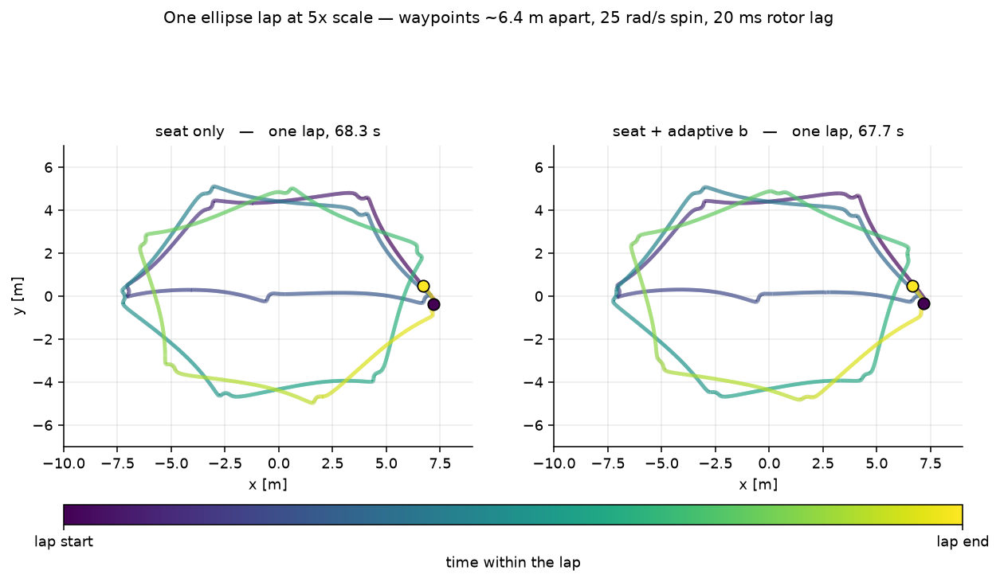

Same 16 waypoints, spaced ~6.4 m apart (legs ~4–5 s instead of ~1.6 s).

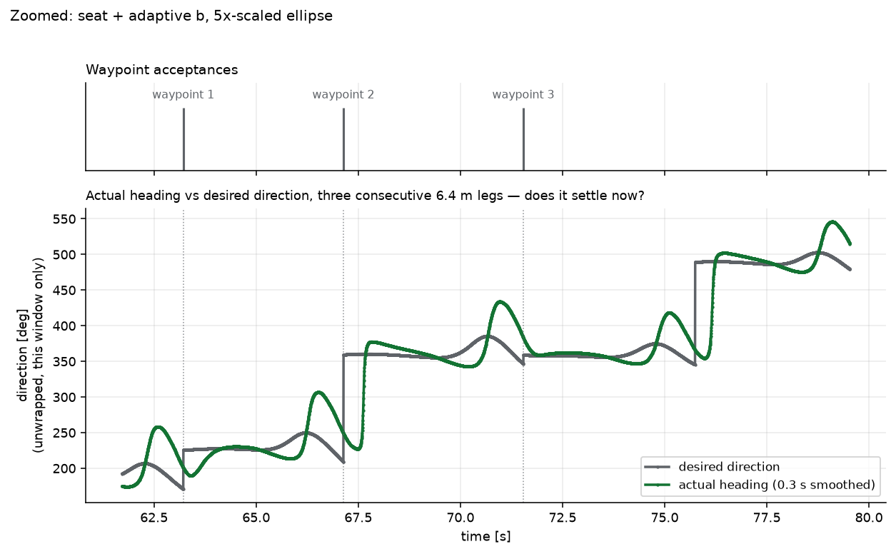

**Yes.** Clear flat plateaus (e.g. t≈68–70, 72–74.5) where heading sits right on top of
desired before the next step arrives — confirms §3's diagnosis: the small ellipse was too
tight to show settling, not evidence of a persistent lag.

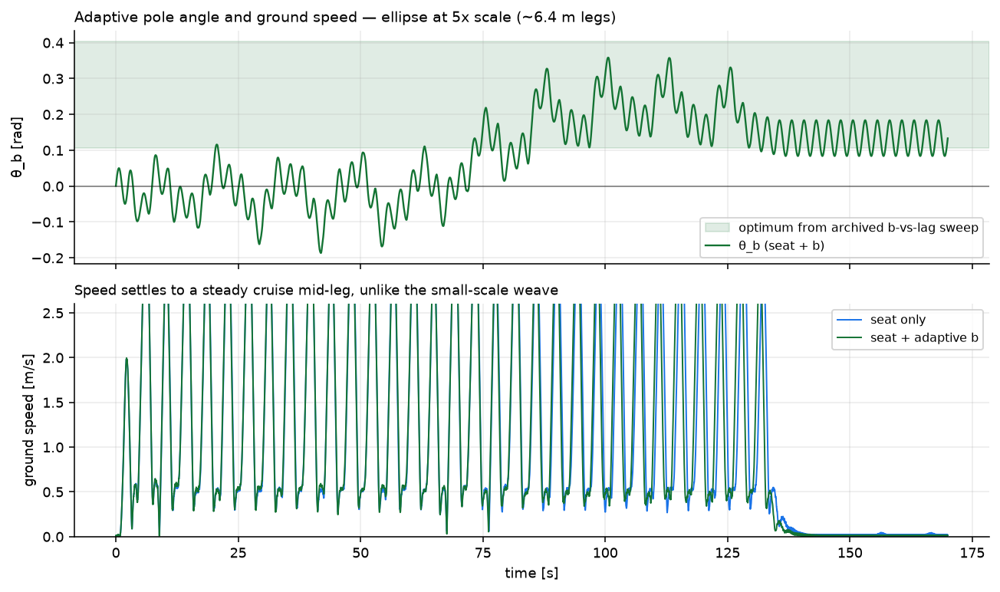

θ_b converges the same way as at small scale; ground speed now settles to a steady
mid-leg cruise instead of the constant weave, since legs are long enough to actually reach
a cruise phase between waypoints.

Isolating the **settled, mid-leg** portion (excludes the post-switch transient *and* the
near-arrival zone, where distance-to-target < 2 m and direction becomes ill-conditioned —
the same "angle of a near-zero vector is noise" problem seen earlier in this project, now
in position space) gives a clean result:

| | mean | sd |
|---|---|---|
| seat only | +0.7° | 3° |
| seat + adaptive b | +0.6° | 3° |

Under 1°, b indistinguishable from off.

---

## 5. Smooth continuous circular trajectory — the cleanest test

No waypoints, no discrete switches. A circle (R = 3 m, speed 1.2 m/s, centripetal accel
0.48 m/s², well inside the 3.0 m/s² clamp) parameterized continuously by time, joined to
the takeoff point with **zero position discontinuity** — the reference just starts moving
under the vehicle rather than jumping to a new target.

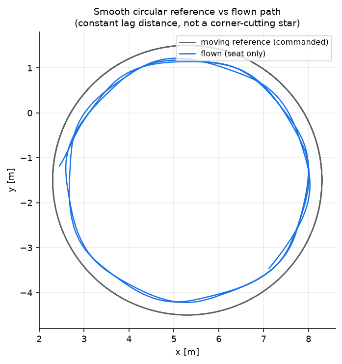

The flown path is a genuinely smooth circle, running consistently *inside* the commanded
one at a constant radial offset — no kinks, no star.

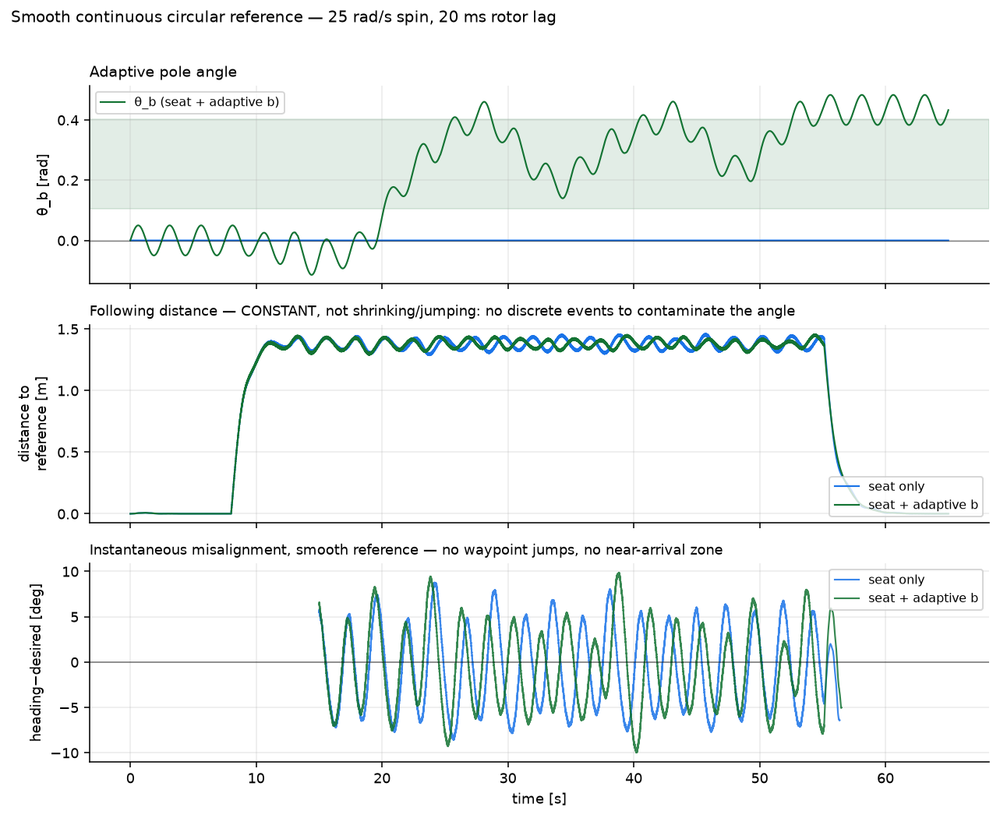

- **Following distance holds rock-steady at ~1.4 m** (middle panel) for both arms — no
  jumps, confirming this is a pure P-D following lag (no integral term to zero a ramp
  error), not divergence.
- **Misalignment (bottom) is a clean bounded oscillation**, ±5–10°. No spikes, no
  artifacts.
- **θ_b (top)** converges into the archived sweep's predicted band (+0.11 to +0.40 rad)
  exactly as in every other test.

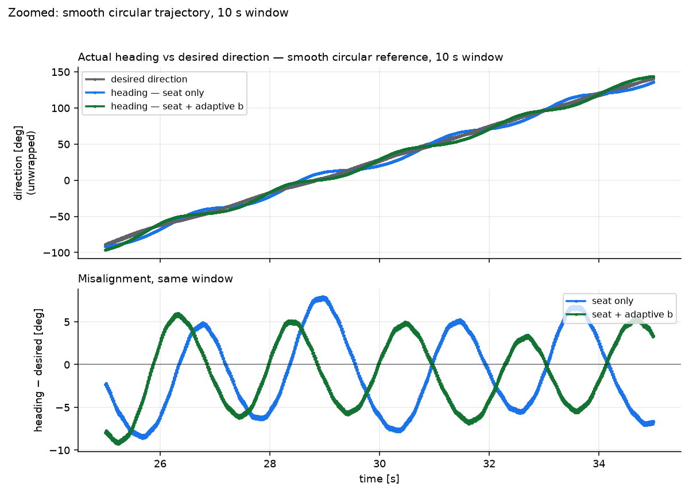

Zoomed to a 10 s window, heading and desired direction plotted together (unwrapped)
alongside the misalignment — individual cycles are now countable directly. **Correction
to the read above:** the oscillation period, measured directly, is **~1.1 s and
irregular** (sd almost as large as the mean) — not once per orbit as first guessed from
the compressed full-flight plot. It doesn't match the orbit period (15.7 s), the position
loop's own natural period (~3.5 s, from `kp_pos=3.1469`), or the spin period (0.25 s)
cleanly either. Source not yet identified; flagged rather than asserted.

| | mean | sd |
|---|---|---|
| seat only | −0.65° | 4.52° |
| seat + adaptive b | −0.56° | 4.45° |

Statistically indistinguishable, on the test with zero measurement artifacts of any kind.

---

## Conclusions

1. **No large standing directional bias exists at normal cruise speeds (~1 m/s).**
   Straight line, evenly-spaced ellipse, and smooth circle all agree: misalignment stays
   under a few degrees once transients and near-zero-vector artifacts are excluded.
2. **A real, speed-scaled bias does exist** (§2) — negligible at 1 m/s, ~1 m over 30 m at
   6.4 m/s. It was never large enough to measure cleanly in any waypoint-based test.
3. **b converges correctly everywhere it was tested** — positive, inside the band the
   archived static-b sweep independently predicted — but **never moved the tracking
   number outside noise**, because the seat alone already leaves very little
   misalignment to correct at these speeds.
4. **The right next test, not yet run:** the smooth-trajectory method (§5) at the higher
   speed where §2 found a real effect (~6 m/s), since that combines the cleanest
   measurement with the one regime where there is something for b to fix.

---

## Traps hit while building these tests (kept so they aren't repeated)

- **Time-based trajectory references run away under spin** if the vehicle falls behind —
  error compounds since the reference doesn't wait. Fixed by `--waypoint-radius`
  (arrival-based advance) for discrete points, or by keeping a timed reference's demanded
  speed within what `--max-lateral-accel` allows (§5).
- **Clamping position error breaks the D term** — it flattens `d(error)/dt` to zero and
  removes damping (measured: 8.6 m/s on a leg meant to be flown at 1.2 m/s). Clamp the
  *acceleration output* instead, scaled as a vector so direction is preserved.
- **A shrinking position-error vector is ill-conditioned**, same as a shrinking
  acceleration vector was earlier in this project. Near waypoint arrival, `desired
  direction` becomes noise; gate on distance-to-target, not just speed.
- **Repo trajectory CSVs are stored in reverse time order** and are not evenly spaced in
  arc length — resample by cumulative arc length before use, or waypoints cluster.
