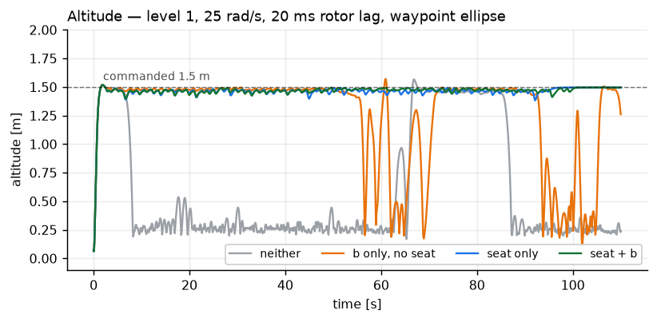
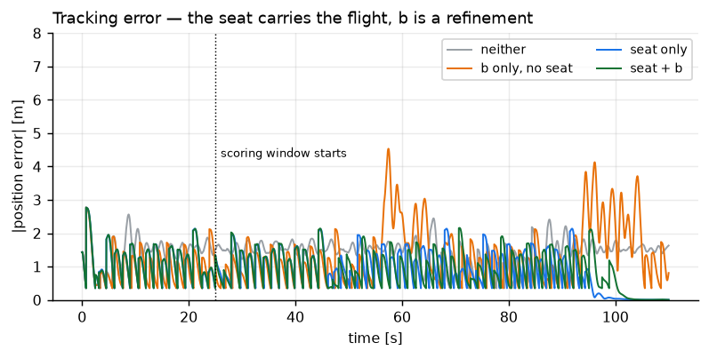
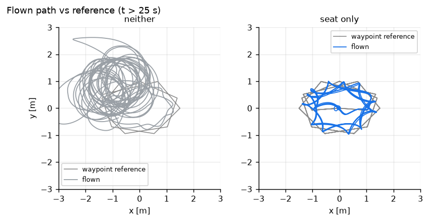
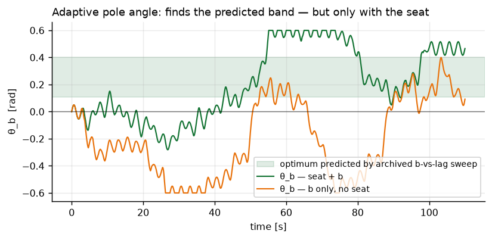

# The 2×2: which of the two adaptations is actually carrying the flight?

Level 1, eigen controller, **25 rad/s spin, 20 ms rotor lag**, waypoint ellipse, 110 s.
Four arms — the full factorial over {seat, adaptive b}:

| | no b | + adaptive b |
|---|---|---|
| **no seat** | `neither` | `b only, no seat` |
| **+ seat** | `seat only` | `seat + b` |

Both adaptations had been shown to do *something* individually. Neither had been run
against the other, so "the seat works" and "b works" were not separable claims. This is
the experiment that separates them.

**Result: the seat is load-bearing and b is a refinement on top of a flight the seat has
already stabilised. b cannot substitute for the seat — b alone still crashes.**

---

## The numbers

Scoring window `t > 25 s` (excludes the climb and the first lap's transient):

| arm | spin [rad/s] | altitude mean (min) [m] | \|ep\| mean [m] | vs. baseline | outcome |
|---|---|---|---|---|---|
| neither | −21.09 | 0.57 (0.17) | 1.4168 | — | **CRASHED** |
| b only, no seat | −22.98 | 1.21 (0.11) | 1.3472 | −4.9 % | **CRASHED** |
| seat only | −25.76 | 1.47 (1.38) | 0.9005 | **−36.4 %** | FLEW |
| seat + b | −25.61 | 1.47 (1.41) | 0.8916 | **−37.1 %** | FLEW |

Read the **outcome column before the error column.** Two of these four arms are on the
ground for much of the scoring window, and a mean tracking error computed over a crashed
vehicle is not a tracking measurement.

**b's −4.9 % is the gap between two failures, not a win.** The −36.4 % → −37.1 % step is
the honest measure of what b adds: **0.7 points, on top of a flight that only exists
because the seat is there.**

Note also that the *spin rate itself* separates the arms: −21.1 on the crashed baseline
versus −25.8 when flying. The vehicle that loses attitude control does not hold its
commanded spin either, so spin rate is a usable secondary health indicator here.

---

## 1. Altitude — the outcome, before any tracking statistic

The plot that determines how every other number may be read.

- **neither** (grey): climbs, then falls out at **t ≈ 8 s** and spends the rest of the run
  on the ground at 0.2–0.5 m, with one brief bounce near t = 60 s.
- **b only** (orange): holds 1.5 m to **t ≈ 55 s**, then collapses, partially recovers, and
  fails again around t ≈ 92 s — a bounce sequence, not a flight.
- **seat only** (blue) and **seat + b** (green): flat on the commanded 1.5 m for the full
  110 s, minimum 1.38 / 1.41 m.

b-only surviving 55 s where neither survives 8 s is real and worth noting — b is not
*nothing*. But it ends in the same place.

## 2. Tracking error — the headline

`|position error|` against time, all four arms, with the `t = 25 s` scoring-window start
marked. The two surviving arms sit in a band around 0.5–2 m (the sawtooth is waypoint
chasing — error grows along each leg and collapses at each acceptance). The two failing
arms are indistinguishable from them *until they fail*, which is exactly why the outcome
column has to be read first.

The orange (b-only) excursions to 4.5 m at t ≈ 57 and t ≈ 95 are the crash and the bounce.

## 3. Flown path — what the two outcomes look like in space

Flown path against the waypoint reference, `t > 25 s`, for **neither** and **seat only**.

- **neither**: an unstructured tangle across a ±3 m box with no relationship to the
  reference. This is not bad tracking; it is a vehicle on the ground being dragged around.
- **seat only**: the flown path follows the 16-point ellipse, cutting each corner (the
  vehicle advances as soon as it enters the 0.35 m acceptance radius, so it never reaches a
  vertex). The corner-cutting star is geometry, not a control error — see
  [`../trajectory_level1_seat_b_geometry_sweep/TRAJECTORY_TRACKING.md`](../trajectory_level1_seat_b_geometry_sweep/TRAJECTORY_TRACKING.md) §3.

The two b arms are not drawn — they add nothing this pair does not already show.

## 4. θ_b — and the reason b's own diagnostics need the seat too

θ_b for the two b arms, against the band the archived static-b sweep independently
predicted as optimal (`[+0.106, +0.403]` rad — see
[`../supporting_b_pole_theory_and_archive/`](../supporting_b_pole_theory_and_archive/)).

| | mean | median | % positive | % inside predicted band |
|---|---|---|---|---|
| seat + b | **+0.287** | — | 84 % | 29 % |
| b only, no seat | **−0.190** | −0.247 | 43 % | — |

**With the seat, θ_b finds the right neighbourhood unaided. Without it, θ_b goes the wrong
way entirely** — negative mean, negative median, and long excursions to the −0.6 rail.

This is a sharper point than it looks. The extremum-seeking law measures a *lateral
tracking cost*. On a departing vehicle that cost is dominated by the departure, so the
gradient the law estimates is the gradient of the crash, not of the pole placement. **An
adaptation whose cost function is contaminated by a failure elsewhere in the loop will
converge confidently to the wrong answer** — it does not fail loudly.

The ±0.6 rail visible on both traces is `theta_b_max=0.6`, set deliberately: `k_es=2.0`
with `dither_amp=0.12` railed and crashed, and `k_es=0.3 / dither 0.05 / th_max 0.6` flew.
The usable gain window for this law is narrow.

---

## Conclusions

1. **The seat is what makes the flight possible at 25 rad/s and 20 ms lag.** −36.4 %
   tracking error, and it is the difference between flying and not flying.
2. **b is a 0.7-point refinement on top of that, and cannot replace it.** b-only crashes.
3. **b's −4.9 % "improvement" is an artifact of comparing two crashes.** Any metric
   averaged over a window in which the vehicle is on the ground is measuring the ground.
4. **θ_b only converges correctly when the vehicle is actually flying.** Its cost function
   is not robust to a failure elsewhere in the loop, and it fails silently, not loudly.
5. **Spin rate is a free health check** — it drops from −25.8 to −21.1 when attitude
   control is lost, with no extra instrumentation.

---

## Traps

- **Always read outcome before any averaged metric.** Three of the five numbers in the
  headline table would be actively misleading on their own.
- **`neither` and `b only` look healthy in the position-error trace right up until they
  fail.** A tracking-error plot alone would not have caught either failure.
- **An adaptation's own diagnostic can be contaminated by an unrelated failure.** θ_b's
  sign flips when the seat is removed, not because the pole optimum moved, but because the
  cost it is descending stopped measuring the pole.
