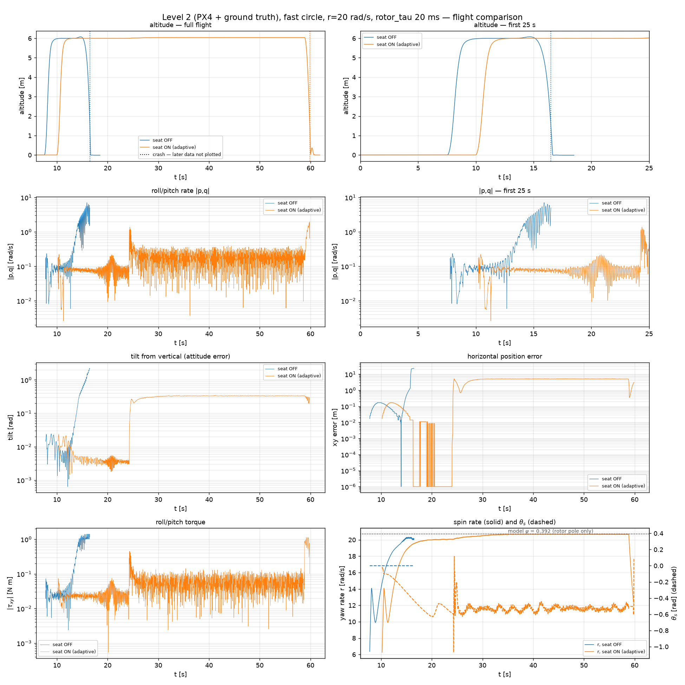
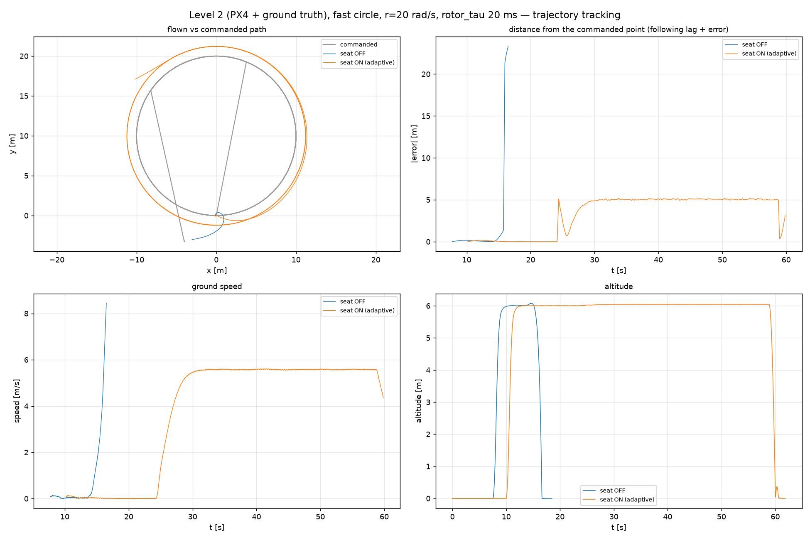
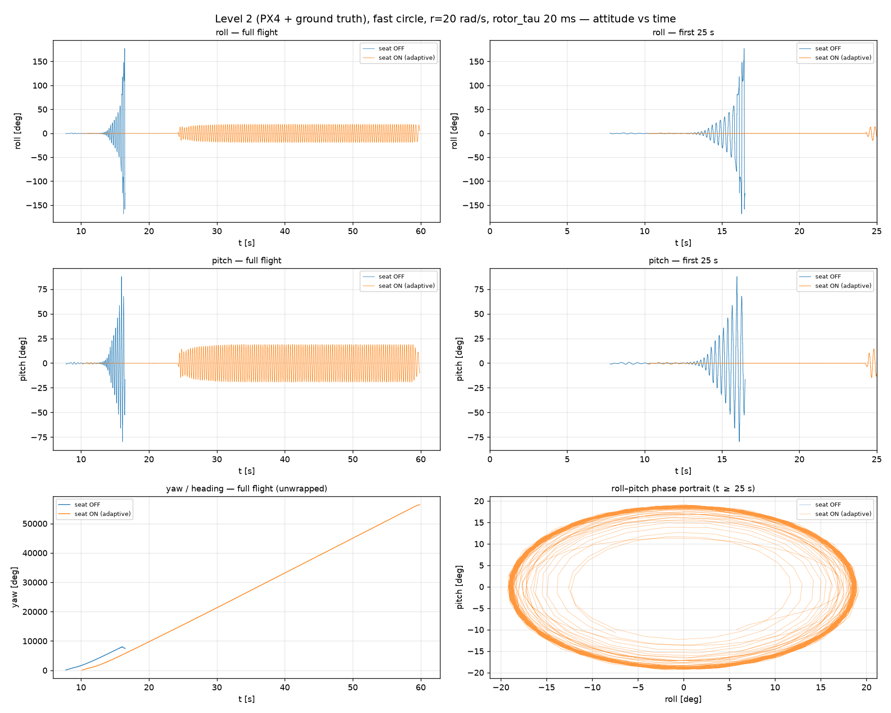
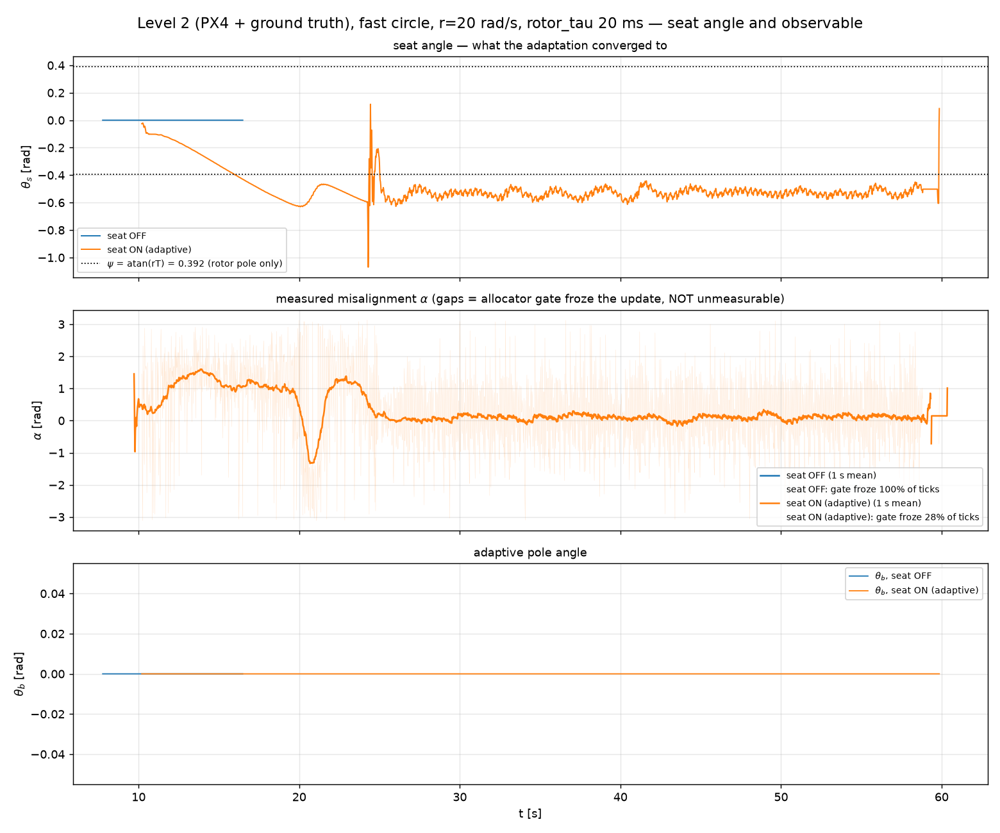
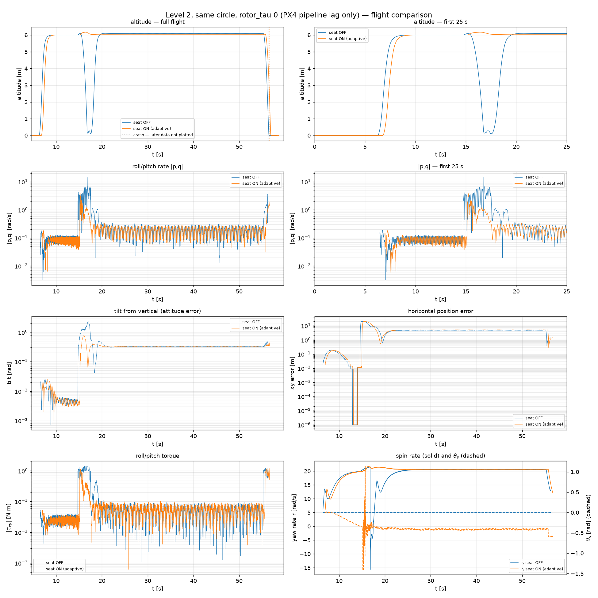
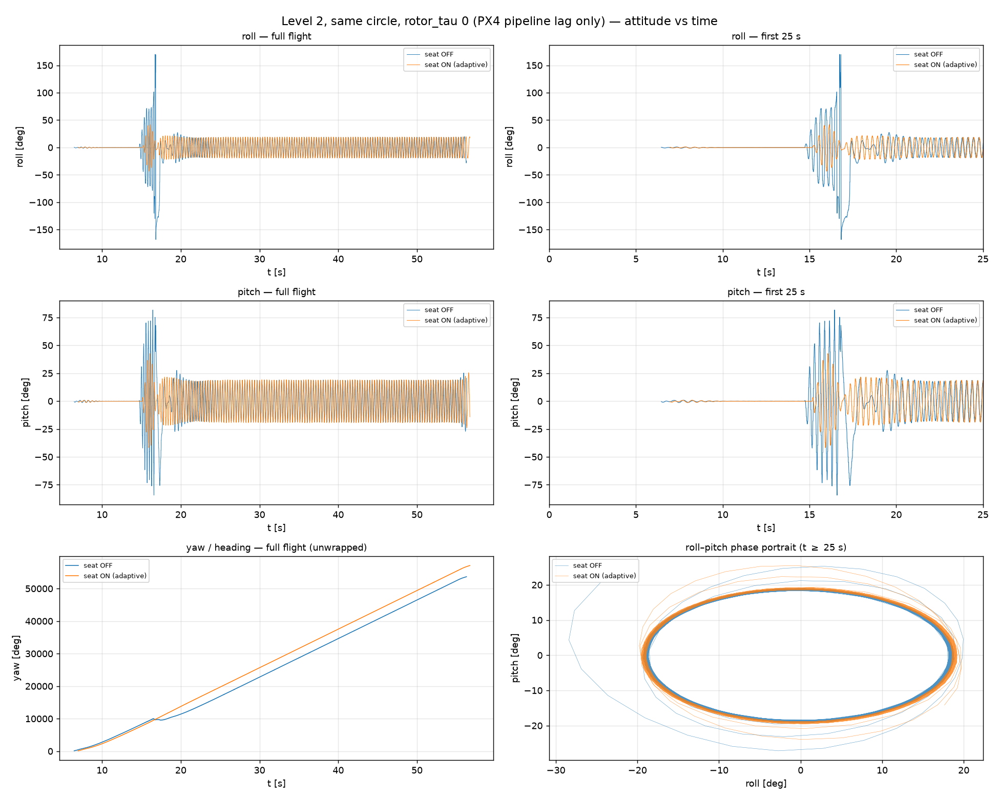
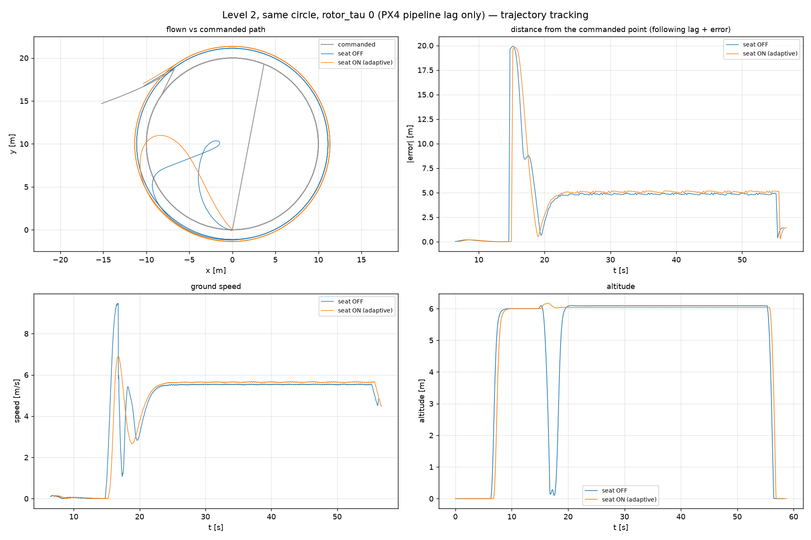
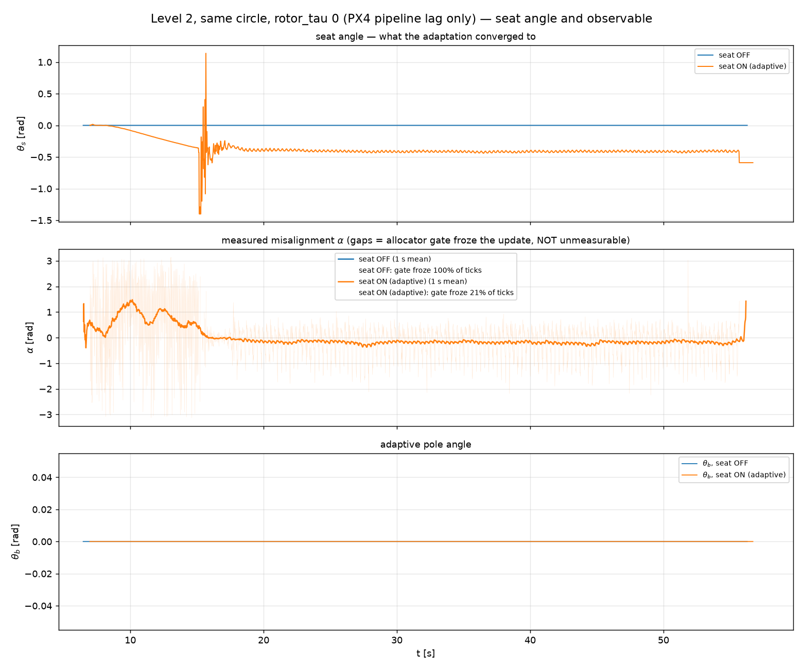
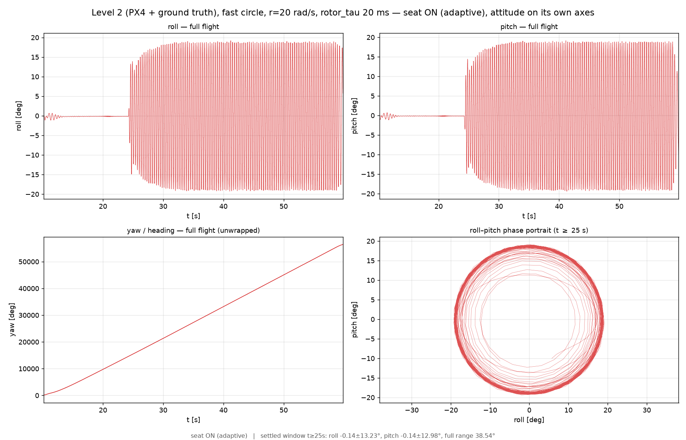
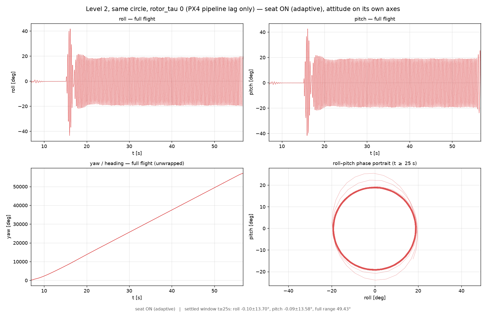

# Trajectory tracking under spin — level 2 (PX4 + ground truth)

The middle rung, and the one that was missing a write-up. Level 2 is PX4 flying the real
control stack but closing the loop on **simulator ground truth** (`MC_CTRL_GT=1`) rather
than its own estimator — so it isolates "does the PX4 port of the law work" from "does the
estimator survive the spin", which is [level 3](../trajectory_level3_px4_estimator_fast_circle/LEVEL3_TRACKING.md)'s
question.

Trajectory throughout: `examples/results/fast_circle_l2.csv` — R = 10 m at 5 m/s, altitude
6 m, with a cosine ramp on the **orbital rate** so the reference starts moving under the
vehicle instead of stepping. Eigen controller, km = 4.0816e-7 (r ≈ 20.7 rad/s),
`IMU_DGYRO_CUTOFF=60`.

**Everything here post-dates the 2026-09-13 ground-truth fix.** Level 2 flies *on* the
ground-truth position, so the 57.2958× radians/degrees bug was inside the control loop, not
just the logs. Every level-2 result recorded before that date is void.

---

## 1. The headline: at 20 ms of rotor lag, the seat is the difference between flying and crashing



| | seat OFF | seat ON (adaptive) |
|---|---|---|
| airborne above 4 m | **7.8 s** | **48.7 s** |
| reached cruise speed? | **never** — lost it before the circle began | yes, 5.58 m/s |
| orbit radius (commanded 10 m) | — | 11.170 ± 0.525 m |
| altitude sd in cruise | — | **1.0 mm** |
| mean tilt | — | 18.9° |
| mean \|p,q\| | 0.757 rad/s (departing) | 0.192 rad/s |
| converged θ_s | n/a (0 by construction) | **−0.530 ± 0.028 rad** |

Seat-off climbs to 6 m, holds for about six seconds, and is on the ground by t ≈ 17 s —
**before the trajectory has even started**. The `|p,q|` panel shows why: a smooth
exponential envelope from the 0.05 rad/s hover floor up through 1 rad/s. That is a linear
instability, the same signature as [level 1's hover
failure](../hover_level1_km6e7_seat_off_fixed_adaptive/KM6E7_LEVEL1.md), one rung up.



The clearest single panel in this folder. **Seat ON flies 3+ clean orbits**; seat OFF is a
dot near the origin where it fell, and its "position error" is the 24 m sawtooth of a
reference circling around a stationary wreck. That sawtooth is a useful warning: *a
tracking-error trace can look periodic and bounded while the vehicle is not flying at all.*

The following distance for the flying arm holds at **5.05 ± 0.05 m** — dead steady. That is
a standing lag, not a divergence: the timed reference marches on its own clock while the
vehicle cruises slightly fast (5.58 vs 5.0 m/s commanded), and a P-D loop with no integral
term has no mechanism to close a ramp error. Same effect, same explanation as level 3 §1.



Roll and pitch for both arms. Seat-off diverges into a growing oscillation and tumbles past
±180°; seat-on holds a clean ±19° band. The phase portrait is an **annulus at ~19° radius**
— the vehicle holds a near-constant tilt in the *world* frame (the centripetal demand,
v²/R ≈ 3.1 m/s² → 17.7°) while the body spins underneath it at 20.7 rad/s. That annulus is
the same structure as level 1's hover portrait, just at 19° instead of 0.3°: **the radius
of the annulus is the commanded tilt.**

## 2. The seat angle itself



θ_s on its own axes, with the measured misalignment α underneath.

- θ_s runs 0 → −0.6 by t ≈ 20 s, rings once, and settles at **−0.530 ± 0.028 rad**.
- The model line for the *rotor pole alone* is atan(r·T) = **0.392 rad**. θ_s converges past
  it, which is correct: level 2 also carries PX4's own ~17 ms transport + ~14 ms pipeline
  lag, which level 1 does not have. **This is why θ_s must not be compared across levels
  without accounting for the pipeline.**
- **The allocator gate froze 0 % of ticks here**, against 98 % on the seat-off arm. The gate
  freezing is not a defect — on the off arm there is no rotation to measure — but it is
  worth checking on any run where θ_s looks stuck.

## 3. Control: the same circle with `rotor_tau = 0`






With the rotor lag removed, **both arms fly** — so the seat is not carrying the flight here,
and the comparison isolates what it does when there is little to correct.

| | seat OFF | seat ON |
|---|---|---|
| airborne | 48.8 s (4 altitude crossings) | 48.8 s (2 crossings) |
| orbit radius | 11.008 ± 0.618 m | 11.298 ± 0.439 m |
| altitude sd, clean cruise (t = 25–55 s) | 1.22 mm | 1.00 mm |
| mean tilt | 18.91° | 19.12° |
| converged θ_s | 0 | **−0.411 ± 0.014 rad** |

**θ_s is not zero at zero rotor lag, and that is the correct answer** — it is finding PX4's
own pipeline lag, which is always present. It converges tightly (sd 0.014, a third of the
lagged case's scatter).

**A flagged result here was checked and withdrawn.** An earlier pass reported 101 mm
altitude sd for seat-off against 1.2 mm for seat-on — an 80× difference that would have been
a significant finding. It was an artifact of the scoring window. The seat-off arm **dips to
0.11 m at t ≈ 16 s during the trajectory start and then recovers to 6.09 m and flies
cleanly for another 40 s**; the window used (speed > 5 m/s, starting at t = 19 s) clipped the
tail of that recovery, and the dip alone produced the 101 mm.

Over a clean cruise window (t = 25–55 s) the two arms read **1.22 mm and 1.00 mm** —
indistinguishable, which is the expected "little to correct" result and agrees with the
earlier project note that the seat is correctly inert at zero rotor lag. Tracking radius and
tilt were indistinguishable all along.

**The transient dip is real and unexplained**, and it is the source of the 4 altitude
crossings. It happens once, on the seat-off arm, at trajectory start. Worth a look if the
trajectory-start transient ever matters; it is not a seat effect.

## 3b. The adaptive arm on its own axes




The seat-on arm alone, rescaled — the view that the shared-axis attitude figure cannot give
once the other arm has tumbled past ±180°. Both show the **annulus at ~19° radius**: a
near-constant world-frame tilt (the centripetal demand) with the body spinning underneath.
Contrast [the hover figures](../hover_level2_px4_groundtruth/LEVEL2_HOVER.md#4-the-adaptive-arm-on-its-own-axes),
where the same plot collapses to a blob at the origin because a hover commands no tilt.
**The annulus radius is the commanded tilt** — that is the whole content of the shape.

## 4. What the lag increment says about ψ_model — a cross-level pattern

The two conditions differ only in `rotor_tau`, so the difference in converged θ_s is the
seat's own estimate of what 20 ms of rotor lag adds:

```
θ_s(20 ms) − θ_s(0 ms)  =  −0.530 − (−0.411)  =  −0.119 rad
model increment          =  atan(r·T) = atan(20.66 × 0.020)  =  0.392 rad
ratio                    =  0.30
```

**An earlier version of this section claimed level 1 matched this at 0.295. It does
not — that has been tested and withdrawn.** The 0.295 came from a figure read off a
rendered PNG from a *superseded build* of the level-1 controller. Level 1 was re-flown on
2026-09-17 and measured properly:

| measurement | θ_s | atan(r·T) | ratio |
|---|---|---|---|
| L1 archived 2026-09-10 (pixel-read, old build) | 0.157 | 0.533 | 0.295 |
| **L1 re-flown 2026-09-17 (measured, current build)** | **0.0672** | 0.533 | **0.126** |
| **L2 lag increment (measured, this folder)** | **0.118** | 0.392 | **0.301** |

So there is no cross-level constant. What survives is the weaker but still useful statement:
**θ_s converges to substantially less than atan(r·T) at every level and on every build
measured — between an eighth and a third of it** — and holding the model value outright is
worse than no seat at all (level 1 §2). The size of the shortfall is not universal, and
anything that depended on it matching across levels should be discarded.

See [level 1's re-flight section](../hover_level1_km6e7_seat_off_fixed_adaptive/KM6E7_LEVEL1.md#re-flight-2026-09-17--read-this-before-quoting-any-number-above).

---

## Conclusions

1. **The seat rescues level 2 at 20 ms of rotor lag** — 7.8 s → 48.7 s airborne, and the
   difference between never starting the trajectory and flying three clean orbits. The
   level-1 hover result reproduces one rung up, on a translating profile.
2. **θ_s converges to the *whole* actuator path's phase, not the rotor's.** −0.411 rad with
   no rotor lag at all (PX4's own pipeline), −0.530 rad with 20 ms added.
3. **The seat is not idle at zero rotor lag** — it finds the pipeline lag unaided and holds
   it tightly (sd 0.014 rad).
4. **The measured lag increment is 30 % of atan(r·T)** (§4). The seat consistently
   converges to well under the textbook phase — but the *fraction* is not a constant across
   levels, and an earlier claim that it was has been withdrawn.
5. **There is no altitude-hold benefit at zero rotor lag.** A flagged 80× difference turned
   out to be a scoring-window artifact around a recovered transient dip (§3); the clean
   numbers are 1.22 mm vs 1.00 mm.

---

## Traps

- **A bounded, periodic position-error trace does not mean the vehicle is flying.** The
  seat-off arm's 24 m sawtooth is the reference orbiting a crash site. Check altitude and
  count threshold crossings first.
- **Orbit radius must be measured about the fitted circle centre, not the origin.** This
  reference is centred near (0, 10); measuring about (0, 0) gives 14.3 ± 6.4 m instead of
  11.2 ± 0.5 m and hides the result entirely.
- **`vehicle_local_position_setpoint` is (0,0,0) before the trajectory streams**, so a naive
  position error over the whole log is really "distance from the origin" during the climb.
  The plotting tool blanks it while the commanded altitude is below 1 m.
- **A recovered dip is not a crash.** The seat-off arm at `rotor_tau=0` drops to 0.11 m at
  t ≈ 16 s and flies for another 40 s afterwards. Any "crash detector" or scoring window
  must require a *terminal* loss of altitude, or it deletes the flight and inflates every
  statistic computed near the dip — which is exactly what happened here (§3).
- **Do not compare θ_s across levels without the pipeline lag.** Level 1 has no transport
  delay at all; levels 2 and 3 add ~17 ms transport + ~14 ms first-order on top.
