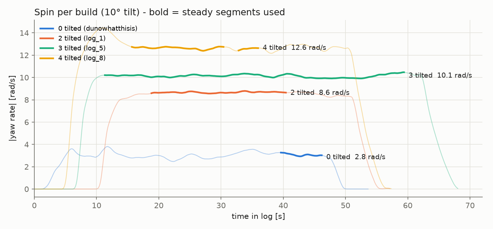
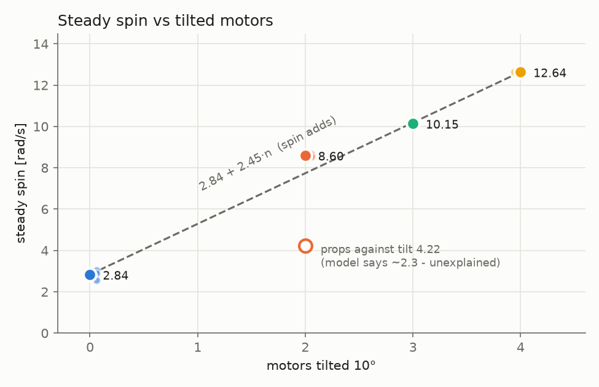
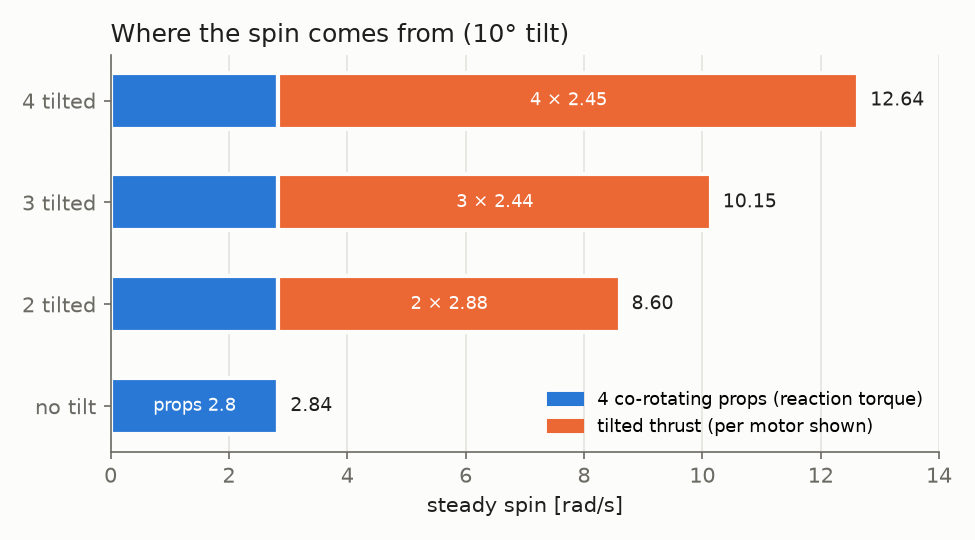
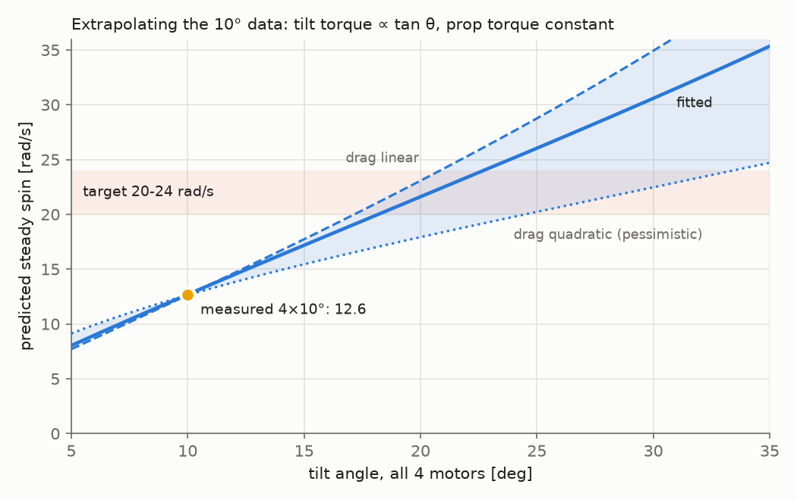

# Hardware analysis — spin from props vs 10° motor tilt (0/2/3/4 tilted motors)

**All tilted builds in this note use a 10° tilt.** Each tilted motor is canted 10° so that part
of its thrust pushes along the direction of rotation. All four props spin the same way.

Reproduce every number and figure with:

```bash
python3 examples/tools/px4_tuning/tilt_spin_analysis.py      # figures -> notes/figures/tilt10/
python3 examples/tools/px4_tuning/ev_delay_long_baseline.py <log> [--inject 0.02]
```

## 1. Data and selection

Only **steady** segments are used. Spin-up, climbing and near-ground flight are excluded,
because there the thrust or the ground effect changes and inflates the spin. "Steady" means:

- hover thrust (mean motor command > 0.3),
- spin settled (|ṙ| < 0.3 rad/s² over 1 s),
- height held (|dz/dt| < 0.05 m/s, from the mocap z),
- z > 0.3 m where the mocap height is valid,
- runs ≥ 4 s long, with 1 s trimmed from each end.

| Build | Log | Steady | Spin | Height |
|---|---|---|---|---|
| no tilt | `eigen/dunowhatthisis.ulg` | 6.6 s | 3.04 | 2.7 m |
| no tilt | `spin_24/log_1_2026-9-24-12-10-04.ulg` | 5.3 s | 2.90 | (mocap frame offset) |
| no tilt | `Downloads/log_3_UnknownDate.ulg` | 5.7 s | 2.57 | 0.5 m |
| 2 tilted | `30th_2tilt/log_1_2026-9-30-21-50-08.ulg` | 21.6 s | 8.66 | 0.42 m |
| 2 tilted | `2_10_2026_2_tilt/log_2_UnknownDate.ulg` | 27.7 s | 8.54 | 0.42 m |
| 2 tilted, props reversed | `30th_2tilted_props_against_tilt/log_12_UnknownDate.ulg` | 5.3 s | 4.22 | 0.48 m |
| 3 tilted | `3_tilt spin/log_5_UnknownDate.ulg` | 48.1 s | 10.15 | 0.61 m |
| 4 tilted | `4_tilt/log_8_UnknownDate.ulg` | 17.9 s | 12.64 | 0.36 m |

- **Thrust is the same in every build.** Hover RPM is ~18,000 wherever BDShot is logged, and
  the hover command is 0.34–0.39.
- **The untilted flights are an older build.** They date from 24 Sep or earlier, before the
  tilt mounts, with the props spinning the other way (`KM −`). Only the magnitude of the spin
  is used.
- **Excluded: `spin_24/log_2`** (no segment passes the steady test) and **`eigen/log_6`**
  (flown at z ≈ 0.15 m, in ground effect).
- **Ground effect matters.** The 4-tilt flight briefly reached 14.5 rad/s at z ≈ 0.13 m.
  That segment is excluded.



## 2. Result — spin per source



**The spin contributions add.** Yaw drag was modelled as `r + k·r²` and fitted across the
0/2/3/4 builds. The fit gives k = 0.009, so drag is nearly linear between 3 and 13 rad/s, and
contributions in rad/s add up. Model predictions vs measured:

| Build | Model | Measured |
|---|---|---|
| no tilt | 3.06 | 2.84 |
| 2 tilted | 8.06 | 8.60 |
| 3 tilted | 10.42 | 10.15 |
| 4 tilted | 12.69 | 12.64 |

| Source | Contribution |
|---|---|
| **4 co-rotating props** (reaction torque), measured directly on the untilted build | **≈ 2.8–3.1 rad/s** (≈ 0.75 per prop) |
| **Each 10° tilted motor**, (12.64 − 2.84) / 4 | **≈ 2.45 rad/s** |
| Each tilted motor, fitted | 2.77 rad/s |

Measured steps:

| Change | Spin added | Per tilted motor |
|---|---|---|
| 0 → 2 tilted | +5.77 | 2.9 |
| 2 → 3 tilted | +1.54 | 1.54 |
| 3 → 4 tilted | +2.49 | 2.49 |

On the 4-tilt build, **≈ 22% of the spin comes from the props and ≈ 78% from the tilt.** One
tilted motor is worth about 3× one prop's reaction torque.



**Open: the props-reversed flight does not fit.** The model predicts ~2.3 rad/s for log_12; it
measured 4.22. Reversing the props changed more than the sign of the prop torque. Candidates
are different props, or the prop swirl interacting with the tilted mount. This flight is not
used for anything below.

## 3. Going to a larger tilt (target 20–24 rad/s)

**Tilt torque grows with tan θ.** Each motor must still carry its share of the weight
vertically, so T = mg / (4 cos θ). Its sideways component is T·sin θ = (mg/4)·tan θ, so:

- torque per motor = (mg/4)·tan θ·d, with d = 0.46 m the arm length,
- total over 4 motors = **mg·tan θ·d**.

**Prop torque stays constant.** The prop torque Q scales with T ∝ 1/cos θ, but only Q·cos θ
acts about the yaw axis, so the two cancel.

**Doubling the tilt torque needs θ ≈ 19.4°** (tan θ = 2·tan 10°). 20° gives 2.06× and costs
+6.4% thrust per motor (1/cos 20°), against +1.5% at 10°.



| Target spin | Drag linear | Fitted | Drag quadratic (pessimistic) |
|---|---|---|---|
| 16 rad/s | 13.3° | 13.7° | 16.1° |
| 20 rad/s | 17.2° | 18.2° | 24.5° |
| 22 rad/s | 19.0° | 20.5° | 29.0° |
| 24 rad/s | 20.8° | 22.7° | 33.4° |

**At 20°, expect ~18–23 rad/s, most likely ~21.5.**

**The drag curve is the main uncertainty above 13 rad/s.** It was only measured between 3 and
13 rad/s, so the band in the plot widens quickly. Flying 20° first, then adjusting, pins it down.

## 4. Izz

- **The 3- and 4-tilt logs can't measure it.** Their gyro is logged at 50 Hz
  (`SDLOG_PROFILE 0`), and no log contains an absolute torque (see §6).
- **The 2-tilt pair at 332 Hz gives Izz ≈ 0.016–0.021.** I fitted the roll/pitch gyroscopic
  coupling with `coupling_fit.py` on log_1 and log_12. Their props spin in opposite
  directions, which cancels the rotor angular momentum. At the measured 25–35 ms lag this
  gives Izz / mean(Ixx, Iyy) ≈ 1.01–1.05.
  - The implied rotor momentum is ≈ 0.022 N·m·s (≈ 3×10⁻⁶ kg·m² per rotor), which is
    plausible.
- **Caveats:**
  - log_12 is the props-reversed flight that §2 could not explain.
  - The coupling estimate is still lag-sensitive.
  - Treat this as indicative, not as a measurement.
- **To settle it,** fly the 4-tilt build once at `SDLOG_PROFILE 17`.

## 5. EV delay

Measured with `ev_delay_long_baseline.py`. EV is logged at 5 Hz; the gyro at 50 Hz is enough
for the long baselines.

| Log | EV delay | 95% CI | +20 ms injected → recovered |
|---|---|---|---|
| 3-tilt log_5 | **15.9 ms** | ~10.5–22.5 | +19.9 ms |
| 4-tilt log_8 | **15.3 ms** | ~10.5–18.5 | +20.0 ms |

This agrees with the earlier 2-tilt log_1 (15.8 ms). log_4 is too short to give a usable fit.
**`EKF2_EV_DELAY 15` is correct.**

**Delay matters more at higher spin.** Heading error ≈ r × delay error, so a 3 ms error is
~4° at 24 rad/s.

## 6. Battery current sensor

**The current channel reads battery voltage, not current, in every log since `ev_delay.ulg`
(19 Sep).**

- `current_a / voltage_v` is 2.88–3.03, the same disarmed and at hover.
- Motor command explains nothing once voltage is in the fit.
- It reads ~35 A while disarmed.

The current input on the KakuteH7 is probably not connected, or is wired to the wrong signal.
Fix it before relying on power or efficiency numbers.

## 7. Withdrawn

- *"4 props alone give 5.4 rad/s"* and *"props are 39 / 28 / 18% of the drive"*. These came
  from treating the props-reversed flight as a pure flip of the prop torque, with drag ∝ r².
  The untilted logs contradict both assumptions.
