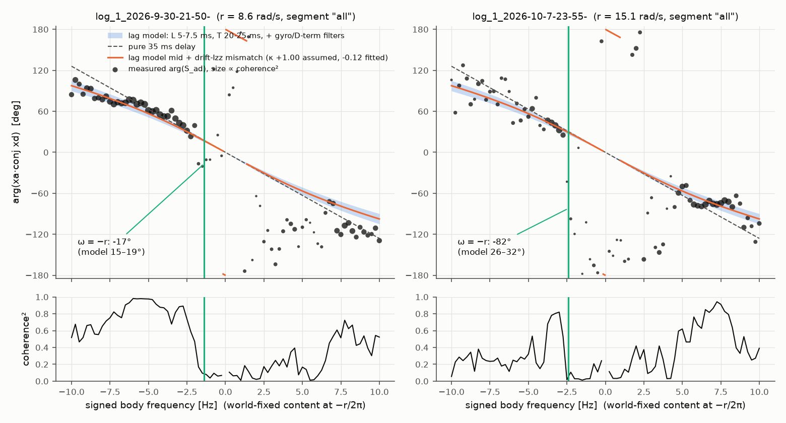
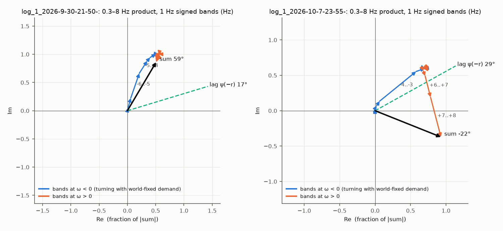
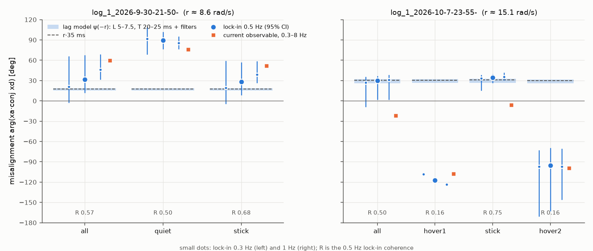

# Seat observable on hardware: why it misses the lag rotation, and the lock-in test (13 Oct 2026)

This is the offline analysis specified in [`SPIN_RAMP_STEPS.md`](SPIN_RAMP_STEPS.md) §6a, run on two seat-off,
lead-off eigen logs. No flights and no firmware changes. Every number comes from
`examples/tools/px4_tuning/seat_observable.py` (commands in §8).

## 0. Verdict first

- **Go/no-go on a seat flight (`MC_SEAT_MODE 2`) before Oct 30: no-go.** The firmware observable as
  flashed is the raw per-tick `arg(xa·conj xd)`, with no band-pass. On the 15 rad/s log its cross-law
  fixed point is **+83°**, against a lag of −26 to −32°: the wrong sign. The seat would run to
  `MC_SEAT_THMAX` (80°). That is the sim runaway. Adding the 0.3–8 Hz band-pass alone still settles at
  **+22°**, also the wrong sign.
- **(a) Does the lock-in read the lag rotation?** At 15 rad/s with commanded content: **yes.**
  Stick segment of log B: **34° [27, 39]**, R 0.75, against a model of 26.5–32.6°. It holds for low-pass
  cutoffs of 0.3–1 Hz, first or second order, and both yaw inertias. **In hover: no** (−95° to −117°,
  R 0.16). **At 8.6 rad/s (log A): not established.** The reading depends on the cutoff, from −3° to 46°
  against a model of 15–19°.
- **(b) A seat flight is not worth doing before Oct 30.** It would need the firmware change in (c), a
  SITL check, and a flight built around sustained stick or circle content. At 15 rad/s the lag costs
  only cos 30° ≈ 0.87 of in-phase authority, and the vehicle already holds 1.1° rms. The thesis can
  carry the offline result: the lock-in's predicted fixed point is −34° (stick) or −30° (whole flight),
  against −26 to −32°. If time opens up after the lead flight and the tilt step: lock-in observable,
  `MC_SEAT_LAW 1`, adaptation gated on demand, flown with stick inputs.
- **(c) The firmware observable should change.** Rotate xd and xa into the world frame, low-pass both,
  and adapt only on commanded demand (§6).

## 1. Data and flown parameters

| | Log A `30th_2tilt/log_1_2026-9-30-21-50-08` | Log B `3_10_1_20/log_1_2026-10-7-23-55-48` |
|---|---|---|
| Spin r (steady) | +8.6 rad/s | +14.9 to +15.4 rad/s |
| `MC_EIG_IXX/IYY/IZZ` | 0.017 / 0.015 / **0.032** | 0.017 / 0.015 / **0.015** |
| `MC_EIG_TRQ_MAX` | 2.11 | 2.11 |
| `IMU_GYRO_CUTOFF` / `IMU_DGYRO_CUTOFF` | 90 / **60** Hz | 90 / **60** Hz |
| Seat / lead / `MC_EIG_ALPHA` | off / off / 0 | off / off / 0 (torque trim present, zero) |
| Logged gyro and torque ticks | 3–4 ms apart: mean 280 Hz, median 250 | 3–4 ms apart: mean 285 Hz, median 333 |
| Segments (log-relative s) | all 15–47; quiet 15–20 + 26–36; stick 20–26 + 36–46 | all 9–54; hover1 9–15; stick 15–34; hover2 36–54 |

- The 15–34 s stick window on log B has inputs of 0.16–0.24. The 12–16 s window already carries
  0.07–0.08 of stick, so "hover1" is not perfectly quiet.
- Log A has 0.10–0.40 stick at 20–25, 36–41 and 44–46 s.
- `EigenController.cpp`'s comment gives `IMU_DGYRO_CUTOFF` as 50 Hz. Both logs flew **60 Hz**.

## 2. Method

**Signals, matched to the firmware.** `EigenController.cpp` lines 486–491:

- `xd = TRQ_MAX·(τ_sp − τ_trim) / (Ixx, Iyy)`, the pre-seat torque. The seat and lead are off, and
  the trim is zero or absent.
- `xa = xyz_derivative − drift`, with drift `= ((Iyy−Izz)/Ixx·r·q, (Izz−Ixx)/Iyy·r·p)` at the flown
  inertias.
- The two are paired by `timestamp_sample`; 98.2% of torque samples match on A and 99.7% on B.
- **Check:** on every `mc_controller_status` sample whose control tick was logged (798 on A, 906 on B),
  the recomputed α, |xd| and |xa| match the logged `seat_alpha`, `debug[6]` and `debug[7]` to
  ≤ 1.4·10⁻⁵°, i.e. to float precision.
- The controller runs at ~1 kHz. The logger keeps every 3rd or 4th tick, without anti-aliasing.
  Sums, and content below 10 Hz, are unaffected.

**Sign convention.** Signals are written x + i·y in FRD body axes (x roll, y pitch).

- Body frequency ω is signed: content goes as e^{iωt}.
- FRD yaw is positive when x turns toward y. A world-fixed vector therefore appears in the body at
  **ω = −r**.
- A delay L multiplies content at ω by e^{−iωL}. So `arg(xa·conj xd) = −ωL − atan(ωT) + ∠H_filt(ω)`.
- At ω = −r this is **+ψ**, with ψ = rL + atan(rT) + |∠H_filt(r)| > 0 for r > 0. That is the lag
  rotation.
- Firmware `measure() = atan2(xd×xa, xd·xa)` is the same angle.
- The seat applies e^{iθ}, so its cross-law fixed point is θ* = −arg Σ(xa·conj xd).

**Lag model. Nothing was fitted to the cross-spectrum.**

- Dead time L = 5–7.5 ms and pole T = 20–25 ms, from bench RPM (`HARDWARE_15RADS_ANALYSIS.md` §4).
- The measurement chain on xa, from `VehicleAngularVelocity.cpp`:
  - the D-term differentiates the gyro *after* the 2-pole 90 Hz Butterworth;
  - then a backward difference at 1 kHz;
  - then a 1-pole `AlphaFilter` at 60 Hz.
  This totals ≈ 5.6 ms of group delay.
- Total torque → acceleration ≈ 31–38 ms.
- ψ(−r) = **15.1–18.7°** at 8.6 rad/s and **26.1–32.1°** at 15.1 rad/s.

**Observables compared.**

| Observable | What it is |
|---|---|
| Raw | per-tick `xa·conj xd`, summed. **What the firmware integrates today.** |
| Band-passed | 0.3–8 Hz brick-wall on each of xd and xa, then the product. On a uniform time grid (see §3.1). |
| Cross-spectrum | Welch, 4 s Hann, 50% overlap, complex inputs, signed frequency. Coherence γ². |
| Lock-in | `xd_w = e^{iψ_yaw}·xd`, `xa_w = e^{iψ_yaw}·xa`. First-order low-pass of each at fc 0.3, 0.5 or 1 Hz (per-tick dt; 2nd-order also tried), then `arg Σ xa_w·conj xd_w`. |

- Heading comes from `vehicle_attitude` yaw. A gyro-integrated ∫r dt gives the same angle to ≤ 0.2°.
- CIs are block bootstraps over 2 s blocks. hover1, at 6 s, is too short for one.

## 3. Results

### 3.1 Reproduction (step 1), and a correction to the 12°

| | coupling_fit.py method | Time-correct 0.3–8 Hz |
|---|---|---|
| Log A | **59.3°, R 0.73** ✔ | 60.0°, R 0.69 |
| Log B | **12.0°, R 0.42** ✔ | **−24.9°, R 0.42** |

- **Both known numbers reproduce exactly.**
- **The B number is a band-edge artefact.** `coupling_fit.py` band-passes by FFT over sample *index*,
  with fs = 1/median(dt). The logged ticks are an irregular mix of 3 and 4 ms. So:
  - On A, fs is taken as 250 Hz against a true 280 Hz, and the "0.3–8 Hz" band is really 0.34–9.0 Hz.
  - On B, fs is taken as 333 Hz against a true 285 Hz, and the band is really **0.26–6.85 Hz**.
- On B that edge drops most of the +7 to +8 Hz content (§3.3). Recomputed on a uniform grid with the
  6.85 Hz edge, B reads 15.0°. So the edge explains the whole 12° vs −25° difference.
- The plant fit in `coupling_fit.py` (κ, Izz_eff) applies the same linear filter to both sides, so it
  is not biased by this. Only its band label is wrong.
- **`HARDWARE_15RADS_ANALYSIS.md` §4's "12°" should read −25° (0.3–8 Hz).** It is not corrected there yet.

### 3.2 Cross-spectrum against signed frequency (step 2)



Residual of the measured phase against the model's mid-point, on bins with γ² > 0.3, over the whole
segment:

| | ω < 0: bins, mean, rms, share within envelope ±10° | ω > 0: same |
|---|---|---|
| A | 25 bins, **+7°**, 8°, **92%** | 8 bins, −30°, 37°, 25% |
| B | 7 bins, **−0.3°**, 5°, **100%** | 17 bins, **+0.5°**, 59°, 82% |

- **Where the data are coherent, the phase follows the lag model without tuning.** That is all of A's
  negative side (γ² 0.8–0.98 from −3 to −7 Hz). On B it is −3 to −5 Hz and +5 to +8 Hz.
- **A reads 5–10° more lag than the envelope from −3 to −6 Hz** (for example 43.7° against 32–39° at
  −3 Hz). That is about 40 ms instead of 31–38 ms. It is consistent with the 35 ms best fit in
  `coupling_fit.py` for that log.
- **A's positive side does not follow the model.** Coherence there is ≤ 0.46. Not established.
- **The "power-weighted average" explanation holds.** The single angle is the coherent lag curve
  weighted by where the product's power sits (§3.3).
- **At ω = −r the cross-spectrum cannot be read.** Coherence collapses exactly there: γ² 0.09 on A and
  0.02–0.04 on B, against 0.5–0.9 half a hertz away. The phase there is −17° (A) and −43° to −82° (B),
  and means nothing. This is the hypothesis-2 signature (§3.4).
- **On A's stick segment** the bins next to −r are coherent but sit below the model: +7° at −1.88 Hz
  (γ² 0.96, model 21°) and −25° at −1.38 Hz (γ² 0.42). **Unexplained.**

### 3.3 Hypothesis 1: opposite rotation directions (step 3)

The band-passed observable splits exactly over signed frequency, by Parseval per contiguous piece.
Shares below are |S| as a fraction of |total|.

| Whole segment | ω < 0 | ω > 0 | Sum |
|---|---|---|---|
| A | 1.14 at **+61°** | 0.15 at −110° | **59°**, R 0.70 |
| B | 0.91 at **+40°** | 0.99 at **−76°** | **−22°**, R 0.44 |



- **B: held.**
  - The negative side (mostly −3 to −4 Hz, 33% of the product) reads +40°, near its own lag.
  - The positive side (+6 to +8 Hz, 45%) reads −76°, which also follows the model there (§3.2).
  - The two are about equal in size and roughly 115° apart, so they cancel to −22°.
  - Where the band edge falls decides the answer: 15° at 6.85 Hz, −22° at 8 Hz.
- **A: not cancellation.** The positive side is 15% of the total and moves the sum by only 1.4°.
  A's over-reading is weighting *within* ω < 0: 66% of the product sits at −4 to −7 Hz, where the
  lag is 42–72° by the model and 57–77° measured.
- That −4 to −7 Hz content is a coherent closed-loop mode (γ² ≈ 0.97). Its identity is not
  established.
- **One mechanism, two outcomes.** A correct, frequency-dependent lag, averaged with the hover
  spectrum's weights, gives 60° at 8.6 rad/s and −22° (or 12°) at 15 rad/s.

### 3.4 Hypothesis 2: disturbance bias in hover (step 4)

| Segment | 0.3–8 Hz | Lock-in 0.5 Hz [95% CI] | R | Model ψ(−r) |
|---|---|---|---|---|
| A quiet | 76° | 89° [77, 101] | 0.50 | 15–19° |
| A stick | 52° | 28° [9, 56] | 0.68 | 15–19° |
| B hover1 | −108° | −117° | 0.16 | 26–32° |
| B stick | −6° | **34° [27, 39]** | **0.75** | 26.5–32.6° |
| B hover2 | −99° | −95° [−162, −70] | 0.16 | 26–32° |

The same data in 2 s windows, binned by commanded world-fixed demand |xd_w| (lock-in 0.5 Hz, pooled):

| | Low tercile | Middle | High | Stick = 0 | Stick > 0.05 |
|---|---|---|---|---|---|
| A | 86°, R 0.56 | 74°, R 0.48 | **24°, R 0.73** | 93°, R 0.52 | **32°, R 0.88** |
| B | −116°, R 0.12 | −70°, R 0.09 | **33°, R 0.82** | −1°, R 0.19 | **34°, R 0.82** |

- **Held.** When commanded content dominates, the observable moves onto the lag rotation:
  - B to within a few degrees of the model;
  - A to within ~5–17° of it (24–32° against 15–19°).
- **In hover it reads far from the lag, with low R:**
  - B: −95° to −117° at R 0.16;
  - A: 89°.
  - Combined with the coherence hole at exactly −r (§3.2), this is what a disturbance-driven loop
    gives. With no external excitation, a closed-loop xa/xd estimate returns the feedback path rather
    than the plant (the standard closed-loop identification result).
  - The specific hover angles were not modelled, so this mechanism is **plausible, not established**.
- **Stick content pulls the law much harder than hover content.** The cross law's per-tick pull is
  |mean z| at 0.5 Hz:
  - B: 3.9 in stick, 0.24–0.29 in hover (13–16×);
  - A: 0.53 against 0.16 (3×).
  So a stick-rich flight would be dominated by the right answer, but a long hover would let θ wander
  toward the wrong one.

### 3.5 The lock-in observable (step 5)



| Segment | 0.3 Hz | 0.5 Hz | 1 Hz | 0.5 Hz, 2nd-order | 1 Hz, 2nd-order | Model |
|---|---|---|---|---|---|---|
| A all | 21° | 31° [13, 67] | 46° | −3° | 22° | 15–19° |
| A stick | 19° | 28° [9, 56] | 39° | 0° | 21° | 15–19° |
| B all | 27° | 30° [2, 36] | 31° | 25° | 31° | 26–32° |
| **B stick** | **33°** | **34° [27, 39]** | **35°** | **32°** | **35°** | **26.5–32.6°** |

- **Log B, stick: reads the lag rotation.**
  - 33–35° for every cutoff and filter order; R 0.70–0.84.
  - It sits 2–5° above the model's upper edge, and the CI overlaps it.
  - The stick content lands at body −2.7 to −3.4 Hz (world −0.3 to −1 Hz), where the lag is 31–42°.
    So the lock-in reads the lag curve *near* −r, not at it, and slightly high.
  - Over the whole flight it reads 30°, with a wide CI because of the hovers.
- **Log A: not robust.**
  - The first-order filter leaks the strong, coherent −4 to −7 Hz mode at 60–75°. Its reading climbs
    with the cutoff: 21°, 31°, 46°.
  - A sharper second-order filter removes that leak, and then reads the near-−r bins that already
    sit below the model (§3.2): −3° to 0°.
  - **Whether the lock-in reads the lag at 8.6 rad/s is not established on this log.**
- **Heading source makes no difference.** `vehicle_attitude` yaw and gyro-integrated ∫r dt agree to
  ≤ 0.2°. A heading error common to both signals cancels, as §6a predicted.
- **Yaw inertia in the drift (lock-in 0.5 Hz):**

  | Segment | Flown Izz | Izz_eff (fit) | 0.022 |
  |---|---|---|---|
  | B stick | 34.4° | 37.5° | 37.4° |
  | B all | 29.7° | 39.5° | 39.3° |
  | A all (flown 0.032, fitted 0.014) | 31.5° | 29.8° | 30.8° |

  - The band-passed observable moves much more with Izz on B: −22° → −1.5°.
  - The algebra explains why. With the drift built on a wrong κ (Ixx = Iyy approximation),
    `xa/xd_delayed = (1 − κ_a r/ω)/(1 − κ_t r/ω)`. That is **real** at every ω, and negative only
    between κ_a·r and κ_t·r.
  - At ω = −r it is (1 + κ_a)/(1 + κ_t) > 0: a magnitude error, not a rotation. So the lock-in is
    insensitive to Izz by construction, and the broadband band-pass is not.
  - The hover segments flip sign with Izz (R 0.16, so they carry no direction).

### 3.6 The cross law's fixed point (step 6)

θ* is where the mean of |xd||xa|·sin ε = 0 with `MC_SEAT_KSIGN +1`, i.e. θ* = −arg Σz. The target is
−ψ(−r).

| | Target | Raw (firmware today) | 0.3–8 Hz | Lock-in 0.5 Hz |
|---|---|---|---|---|
| A all | −15 to −19° | **−89°** | −59° | −31° (−21° at 0.3 Hz, −46° at 1 Hz) |
| A stick | −15 to −19° | −81° | −52° | −28° |
| B all | −26 to −32° | **+83°** | **+22°** | **−30°** |
| B stick | −26.5 to −32.6° | +24° | +6° | **−34°** |
| B hover2 | −26 to −32° | +124° | +99° | +95° |

- **Current observable: the seat would not compensate.**
  - On B it would rotate the wrong way: +83° raw, clipped by `THMAX` at 80°.
  - On A it would over-rotate about 5× (−89°).
  - The angle law (`MC_SEAT_LAW 0`) on the raw signal is no better: +81° (A), −87° (B).
- **Lock-in: the fixed point lands on the lag on B** (−30° whole flight, −34° stick). On A it is
  within the cutoff spread.
- **First order only.** This assumes the rotation does not reshape the closed-loop spectra. With θ near
  30° the loop changes, and this was not simulated.
- `MC_SEAT_SATGATE`: no airborne tick in these segments had unallocated roll or pitch torque, so the
  gate would not have frozen anything. The approximation used was |unallocated| > 10⁻³.

## 4. Which hypotheses held

| Claim | Status |
|---|---|
| The broadband reading is a power-weighted average of a correct lag curve | **Held.** Coherent phase follows the untuned model (A ω<0: rms 8°; B both sides where coherent). |
| H1: opposite directions cancel | **Held on B** (+40° and −76° halves, near-equal size). **Not the cause on A** (ω>0 is 15%; A is weighting within ω<0). |
| H2: disturbance bias in hover | **Held.** Coherence hole at −r; hover reads −95° to −117° (B) and 89° (A) at low R; the high-demand tercile and stick windows read 24–34°. The closed-loop mechanism is plausible, not established. |
| Lock-in reads the lag | **Yes on B with commanded content; no in hover; not established on A.** |
| Lock-in is insensitive to heading error and Izz | **Held** (≤ 0.2° heading; +3° for Izz on B stick, explained by §3.5 algebra). |

## 5. Not established

- Why A's positive side, and its near-−r bins, depart from the model.
- The identity of A's −4 to −7 Hz coherent mode.
- Why A's coherent negative side sits 5–10° above the envelope (≈ 40 ms against 31–38 ms).
- Whether a demand-gated lock-in converges with the seat *on*. The fixed-point prediction is open-loop.
- Whether 0.5 Hz first-order is the right filter at 8.6 rad/s: the two logs disagree on cutoff
  sensitivity.
- The demand-gate threshold. On B the high tercile starts at |xd_w| ≈ 1.7 rad/s² and hover sits at
  1.2–1.5. Both are vehicle-, rate- and filter-dependent.

## 6. What changes in the firmware observable (described, not implemented)

In `EigenController.cpp`'s seat block and in `Seat`, with the same change in the level-1 twin
`examples/utils/seat.py` (the `Seat.hpp` header requires the two to stay in step):

1. **Keep xd and xa exactly as now.** Use the pre-seat torque and the same drift: the lag-invariant
   pairing of `seat.tex` Eq. seat-xa is untouched.
2. **Rotate both into the world frame** by a heading ψ. ∫r dt, integrated in the controller and reset
   with the seat, is enough: an EKF yaw is not needed, because any error common to both cancels. Then
   `xd_w = e^{iψ}·xd` and `xa_w = e^{iψ}·xa`.
3. **Low-pass both:** two complex first-order filters, i.e. 4 real states, with the per-tick dt. Make
   the cutoff a new parameter (e.g. `MC_SEAT_LPF`), defaulting to 0.5 Hz. Reset them wherever the seat
   resets, including on the ground.
4. **Drive the law on the filtered pair.** Cross law: `step = Im(conj(xd_w)·xa_w)`. The angle
   between two vectors does not depend on the frame they are written in, so θ_s and the applied
   body-frame rotation are unchanged. `measure()` and `seat_alpha` take the filtered pair too.
5. **Gate adaptation on commanded demand:** adapt only while |xd_w| exceeds a threshold (new parameter,
   e.g. `MC_SEAT_DMIN`), on top of `RMIN` and `SATGATE`. Hover is the case where the observable is
   wrong (§3.4). The threshold value is not established (§5).
6. **Log** |xd_w|, |xa_w| and the gate state, in the `debug[]` slots or new fields.
7. **Optional:** set `MC_EIG_IZZ` 0.022, already planned. It moves the lock-in by about 3°; the
   broadband observable moved 20°.

Flying it would then also need demand: a slow circle or held stick, not station-keeping (§6a "Give it
signal").

## 7. Files

- `examples/tools/px4_tuning/seat_observable.py`: steps 1–6 and the figures. It reuses
  `coupling_fit.py`'s regression for κ.
- `figures/seat_observable/fig1_phase_signed_freq.png`, `fig2_lockin_vs_lag.png`,
  `fig3_signed_band_sum.png`.

## 8. Reproduce

```bash
cd examples/tools/px4_tuning
python3 seat_observable.py ~/Downloads/logs/30th_2tilt/log_1_2026-9-30-21-50-08.ulg \
    ~/Downloads/logs/3_10_1_20/log_1_2026-10-7-23-55-48.ulg \
    --seg-for "0:all=15-47" --seg-for "0:quiet=15-20+26-36" --seg-for "0:stick=20-26+36-46" \
    --seg-for "1:all=9-54" --seg-for "1:hover1=9-15" --seg-for "1:stick=15-34" --seg-for "1:hover2=36-54" \
    --izz 0.022 --fig-dir ../../../notes/figures/seat_observable
```

With no `--seg` arguments it uses the steady airborne span (r within 10% of its median, 3 s from
takeoff and landing). Runtime is about 3 s.

## 9. Sim vs hardware: what the seat was actually reading in sim (added 13 Oct)

Run with `seat_observable.py` on the level-3 hover pair at r ≈ 20, 20 ms pole:
`px4_runs/L3_eigen_20260917_035942` (seat off) and `px4_runs/L3_eigen_20260917_040133` (seat on).
This is a Sep-17 build: `seat_alpha` is logged only on adapting ticks, and there are no `MC_SEAT_*`
params. So the firmware check does not pass on these logs, and the seat-on xd was un-rotated by
hand with the logged `seat_theta`.

| | Sim seat off, r 20.8 | Sim seat on, r 20.1 | HW A quiet, r 8.6 | HW B hover, r 15 |
|---|---|---|---|---|
| rms \|xd\| | **88 rad/s²** | 3.6 | 2.9 | 6.3 |
| Dominant xd content | **one line at body −4.25 Hz** (world −0.94 Hz), 97% of power | +8 Hz, 95% | −5.25 Hz (world −3.9), 44%, broad | +7 Hz 47%; −3.0 Hz (world −0.6) 23%; broad |
| Raw observable | **43.6°, R 0.97** | −152° | 106° | −128° |
| Lock-in 0.5 Hz | 43.4°, R 1.00 | 106°, R 0.86 | 89°, R 0.50 | −100°, R 0.16 |

- **In sim, seat-off is a lag-driven limit cycle, not a hover.** A backward-whirl closed-loop mode is
  unstable (13.7° coning, |p,q| 1.6 rad/s). It is one deterministic line, so every observable, raw
  included, reads its phase cleanly (43°).
- **That line is not at −r.** It sits about 0.9 Hz away in body frequency. The sim seat was rotating
  by the lag phase *of the mode it was destabilising*, not by ψ(−r) as `seat.tex` defines it. That is
  consistent with the long-standing "θ_s converges well below the model angle".
- **Once the seat damps the mode, the signal is gone:** |xd| falls 24×, and the observable reads
  noise (106°). θ_s then holds by integrating very little; it does not re-measure anything.
- **Hardware at 8.6–15 rad/s is stable seat-off, so no line exists.** xd is broadband closed-loop
  modes plus the hover hold at −r, the raw observable averages them (§3.3–3.4), and its fixed point is
  wrong.
- **There is a trend, only suggestive** (different inertias and gains; spectral widths are limited by
  0.25 Hz resolution). The hardware backward mode moves toward world ~0 as spin rises: world −3.9 Hz
  at 8.6 rad/s, −0.6 Hz at 15 rad/s. Sim went unstable at world −0.94 Hz at 20.8 rad/s. At 15 rad/s
  the hardware mode is still broad and holds 23% of the power, not 97%.
- **What a higher-spin seat-off log answers:** whether that backward mode sharpens (damping falls,
  power share rises) as r goes past 15.7. If it does, hardware is entering the regime where the sim
  seat worked, and the seat is needed. If it stays broad, the seat at those rates is a small
  correction that needs the lock-in and stick excitation (§6).
